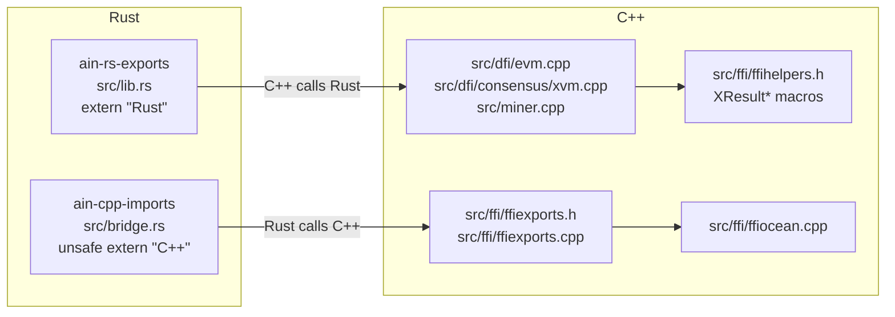

# C++ ↔ Rust bridge

The node contains a C++20 core and a Rust EVM. Both live in the same process
and call each other through a narrow, explicitly declared FFI surface built
with [`cxx`](https://cxx.rs/).

This page describes that surface, the conventions it follows and how to extend
it safely.

Part of the [Architecture section](index.md) of the
[Developer & Architecture Manual](../index.md).

## Why `cxx`

`cxx` generates the glue code between Rust and C++ from a single
declaration. It gives both sides:

* type-safe marshalling of shared structs, enums, strings, vectors and
  `UniquePtr`,
* a single build step: the Rust crate compiles the generated C++ shim with
  `cxx-build`, the C++ build compiles the generated Rust shim with `cxx-gen`,
* no manual ABI handling, no `extern "C"` symbol juggling.

## The two directions



### Rust → C++ (`lib/ain-cpp-imports`)

`lib/ain-cpp-imports/src/bridge.rs` contains a single `#[cxx::bridge]` module
with an `unsafe extern "C++"` block:

```rust
#[cxx::bridge]
pub mod ffi {
    // ...
    unsafe extern "C++" {
        include!("ffi/ffiexports.h");

        fn getChainId() -> u64;
        fn publishEthTransaction(data: Vec<u8>) -> String;
        // ...
    }
}
```

* `include!("ffi/ffiexports.h")` points the generated code at
  `src/ffi/ffiexports.h`, which is the **single source of truth** for the
  C++ side of the interface. The header is included with the `src/` directory
  on the include path (see `lib/ain-cpp-imports/build.rs`).
* The C++ implementations live in `src/ffi/ffiexports.cpp`; the Ocean-specific
  hook is in `src/ffi/ffiocean.cpp`.
* `lib/ain-cpp-imports/src/lib.rs` wraps the raw bridge calls in idiomatic
  Rust helpers (`get_chain_id()`, `publish_eth_transaction()`, …). Under
  `cfg(test)` the bridge is replaced by stub implementations, so the Rust unit
  tests run without a C++ node.
* The shared types (`Attributes`, `DSTToken`, `SystemTxData`, `TokenAmount`, …)
  are declared in the same `bridge.rs` module and are used by both sides.

### C++ → Rust (`lib/ain-rs-exports`)

`lib/ain-rs-exports/src/lib.rs` declares the opposite direction with
`extern "Rust"` blocks:

```rust
#[cxx::bridge]
pub mod ffi {
    pub struct CrossBoundaryResult {
        pub ok: bool,
        pub reason: String,
    }

    extern "Rust" {
        fn ain_rs_init_core_services(result: &mut CrossBoundaryResult);
        fn evm_try_unsafe_create_template(
            result: &mut CrossBoundaryResult,
            dvm_block: u64,
            // ...
        ) -> &'static mut BlockTemplateWrapper;
    }
}
```

* `lib/ain-rs-exports/build.rs` runs `cxx_gen::generate_header_and_cc()` on
  that module and writes `ain_rs_exports.h` and `ain_rs_exports.cpp` into the
  Cargo target directory. The C++ build includes the header with
  `#include <ain_rs_exports.h>` — for example `src/dfi/evm.cpp`.
* The implementations live in `lib/ain-rs-exports/src/{core,evm,ocean,debug,util}.rs`.
* The Rust side owns the services: `ain_rs_preinit()`, `ain_rs_init_logging()`,
  `ain_rs_init_core_services()`, the JSON-RPC/gRPC/Ocean network services and
  their shutdown counterparts.

## Error handling convention

Fallible bridge functions never throw across the boundary. They take a
`CrossBoundaryResult` as their **first** argument, which the callee fills in:

* `ok == true` — the call succeeded,
* `ok == false` — `reason` carries a human-readable error message.

The C++ side never inspects the result manually; the macros in
`src/ffi/ffihelpers.h` do it:

| Macro | Behaviour on `ok == false` |
| --- | --- |
| `XResultThrowOnErr(x)` | Throws `std::runtime_error` with the reason. |
| `XResultStatus(x)` | Returns `Res::Err(...)`. |
| `XResultStatusLogged(x)` | Logs the reason and returns `Res::Err(...)`. |
| `XResultValue(x)` | Returns the value, or a default on error. |
| `XResultValueLogged(x)` | Logs the reason and returns the value, or a default on error. |

On the Rust side the same convention appears in the function names: fallible
functions start with `try_`, for example
`evm_try_unsafe_validate_raw_tx_in_template()`. The `CrossBoundaryResult`
parameter is added by the `#[ffi_fallible]` attribute macro
(`lib/ain-macros/src/lib.rs`): it rewrites the Rust function to fill the
result and to return the default value (`0`) on error. A few functions are
documented as infallible even though they carry the prefix (for example
`evm_try_get_balance()`, which returns `0` instead of an error); those are
listed under the `// In-fallible functions` comment in
`lib/ain-rs-exports/src/lib.rs`.

!!! note "Naming"
    The `evm_try_unsafe_*` family mutates the EVM block template and must
    only be used while a template is alive (see below).

## The block template lifecycle

The most important object that crosses the boundary is the EVM block template.
It is owned by Rust and handed to C++ as an opaque handle:

1. `CScopedTemplate::Create()` (`src/dfi/evm.cpp`) calls
   `evm_try_unsafe_create_template()` and wraps the returned
   `BlockTemplateWrapper` in an RAII object.
2. The template is filled and updated through the `evm_try_unsafe_*` family:
   `evm_try_unsafe_update_state_in_template()`,
   `evm_try_unsafe_validate_raw_tx_in_template()`,
   `evm_try_unsafe_push_tx_in_template()`,
   `evm_try_unsafe_construct_block_in_template()`.
3. `CScopedTemplate::~CScopedTemplate()` calls
   `evm_try_unsafe_remove_template()`, so a failed block attempt never leaves
   a stale template behind.

The same handle is used for the cross-layer transfers
(`src/dfi/consensus/xvm.cpp`): `TransferDomain` and DST20 bridging create and
sign EVM transactions (`evm_try_create_and_sign_tx()`,
   `evm_try_create_and_sign_transfer_domain_tx()`) and push them into the
   template of the block that is currently being built.

## Function inventory

### Rust → C++ (declared in `lib/ain-cpp-imports/src/bridge.rs`)

| Group | Examples | Purpose |
| --- | --- | --- |
| Chain identity | `getChainId()`, `getNetwork()`, `getClientVersion()` | Network parameters and version strings. |
| Node configuration | `getRPCPort()`, `getRPCAuth()`, `getDatadir()`, `getNumCores()`, `getEthMaxConnections()`, `getCORSAllowedOrigin()` | Configuration the Rust services need from the C++ node. |
| Transaction submission | `publishEthTransaction()`, `getPoolTransactions()`, `getNativeTxSize()`, `getMinRelayTxFee()` | Mempool access and fee relay rules. |
| Chain state | `getDifficulty()`, `getChainWork()`, `getEthSyncStatus()`, `getPoolPairs()`, `getDSTToken()`, `getDST20Tokens()`, `getAttributeValues()` | Read-only access to DVM state from the Rust side. |
| EVM system transactions | `getEVMSystemTxsFromBlock()` | Reconstructs the system transactions of a block for the Ocean indexer. |
| Activation heights | `getDF23Height()`, `getDF24Height()`, `getDF25Height()`, `getBalanceOverflowHeight()`, `getMNVersionGateHeight()` | Lets the Rust side apply the same height gates as the C++ side. |
| Token migration | `migrateTokensFromEVM()` | Moves balances from the EVM into the DVM during the token migration. |
| Logging | `CppLogPrintf()` | Routes Rust log output into the C++ logger. |

### C++ → Rust (declared in `lib/ain-rs-exports/src/lib.rs`)

| Group | Examples | Purpose |
| --- | --- | --- |
| Service lifecycle | `ain_rs_preinit()`, `ain_rs_init_logging()`, `ain_rs_init_core_services()`, `ain_rs_stop_core_services()`, `ain_rs_wipe_evm_folder()` | Start-up and shutdown of the Rust side. |
| Network services | `ain_rs_init_network_json_rpc_service()`, `ain_rs_init_network_grpc_service()`, `ain_rs_init_network_rest_ocean()`, `ain_rs_init_network_subscriptions_service()` | Starts the Ethereum JSON-RPC, the gRPC service, the Ocean REST API and the subscription service. |
| Block template | `evm_try_unsafe_create_template()`, `evm_try_unsafe_update_state_in_template()`, `evm_try_unsafe_push_tx_in_template()`, `evm_try_unsafe_construct_block_in_template()`, `evm_try_unsafe_commit_block()`, `evm_try_unsafe_remove_template()` | The per-block EVM lifecycle described above. |
| Transactions | `evm_try_create_and_sign_tx()`, `evm_try_create_and_sign_transfer_domain_tx()`, `evm_try_unsafe_validate_raw_tx_in_template()`, `evm_try_unsafe_validate_transferdomain_tx_in_template()` | Signing and validation of cross-layer transactions. |
| Balances | `evm_try_unsafe_add_balance_in_template()`, `evm_try_unsafe_sub_balance_in_template()`, `evm_try_get_balance()` | Native ↔ EVM value transfer. |
| DST20 tokens | `evm_try_unsafe_create_dst20()`, `evm_try_unsafe_bridge_dst20()`, `evm_try_unsafe_rename_dst20()`, `evm_try_unsafe_is_smart_contract_in_template()` | Token bridging and contract registry. |
| Governance | `evm_try_unsafe_handle_attribute_apply()` | Applies governance attributes (`v0/evm/block/*`) to the EVM. |
| Queries | `evm_try_get_tx_by_hash()`, `evm_try_get_tx_hash()`, `evm_try_get_block_hash_by_number()`, `evm_try_get_block_header_by_hash()`, `evm_try_get_latest_block_hash()` | Read-only EVM queries used by RPC and by the Ocean indexer. |
| Ocean | `ocean_index_block()`, `ocean_invalidate_block()`, `ocean_try_set_tx_result()`, `ocean_get_block_height()`, `ocean_try_get_hash_db_state()` | Keeps the Ocean index in sync with the chain. |
| Debug | `debug_dump_db()`, `debug_log_account_states()` | Debug helpers behind the `-debug` flags. |

## Adding a new bridge function

1. **Decide the direction.** If the Rust side needs data that only the node
   knows, add an `unsafe extern "C++"` declaration to
   `lib/ain-cpp-imports/src/bridge.rs` and implement it in
   `src/ffi/ffiexports.cpp`. If the C++ side needs EVM functionality, add an
   `extern "Rust"` declaration to `lib/ain-rs-exports/src/lib.rs` and
   implement it in the matching module of `lib/ain-rs-exports/src/`.
2. **Follow the error convention.** Fallible functions take a
   `CrossBoundaryResult` as the first parameter, set `ok`/`reason` and are
   named with a `try_` prefix on the Rust side.
3. **Keep the surface small.** Only pass data that is cheap to copy. Large
   state is accessed through the read-only helpers, not copied across the
   boundary.
4. **Do not change consensus semantics in the bridge.** The bridge transports
   data; the rules live in `src/dfi/consensus/`. A change that alters
   validation needs an activation height (see
   [Consensus](../consensus/index.md)).
5. **Rebuild and test.** The generated glue is rebuilt by the Cargo build, so
   run the Rust and C++ test suites as described in
   [Building & Testing](../building-testing/index.md).

## Build integration

* `lib/Makefile.am` drives the Cargo build. It exports `CARGO_TARGET_DIR`,
  `CARGO_BUILD_JOBS` and the toolchain flags so that `cc`/`cxx` used by
  `cxx-build` match the C++ compiler of the node.
* `lib/ain-cpp-imports/build.rs` compiles the generated C++ shim with
  `-std=c++20` and adds the platform specific defines for Windows.
* `lib/ain-rs-exports/build.rs` writes the generated `ain_rs_exports.h` and
  `ain_rs_exports.cpp` into the Cargo target directory, from where the
  autotools build picks them up.
* The C++ sources of the bridge are part of the node build:
  `src/ffi/ffiexports.cpp` and `src/ffi/ffiocean.cpp` are listed in
  `src/Makefile.am`, and `src/ffi/ffiexports.h`, `src/ffi/ffihelpers.h` and
  `src/ffi/ffiocean.h` are installed as headers.

## Related pages

* [Architecture overview](overview.md) — how the two layers work together.
* [Codebase map](../codebase-map/index.md) — the crates and directories of
  the bridge.
* [Subsystems](../subsystems/index.md) — the RPC and state storage layers
  that sit on top of the bridge.
