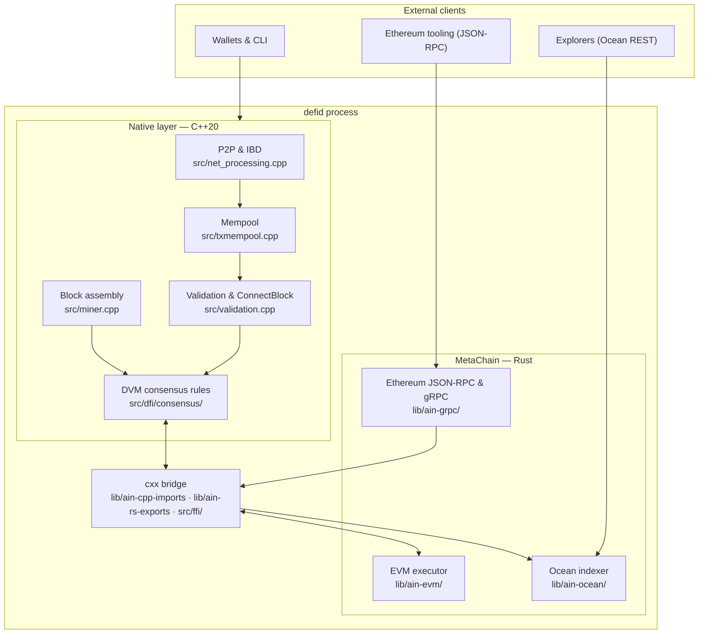
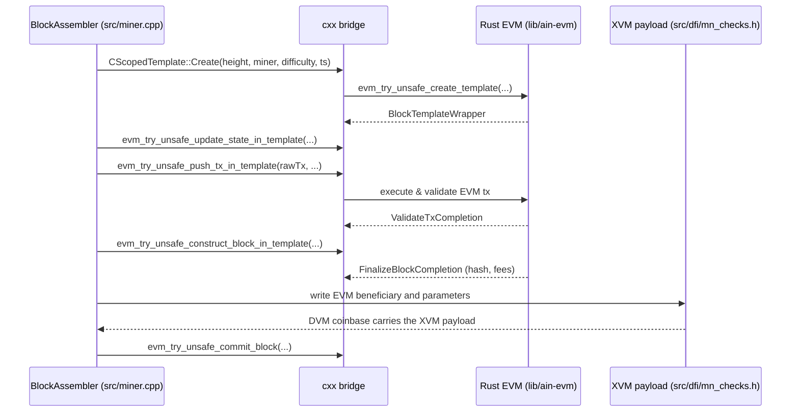

# Architecture overview

This page describes how the DeFiChain node is put together: the two execution
layers it hosts, how a block is produced and validated, where state lives and
which entry points the outside world uses.

Part of the [Architecture section](index.md) of the
[Developer & Architecture Manual](../index.md).

## Two execution layers, one node

`defid` hosts two execution engines that advance in lockstep:

| Layer | Language | Code | Role |
| --- | --- | --- | --- |
| Native layer (DVM) | C++20 | `src/`, DeFiChain-specific parts in `src/dfi/` | UTXO set and accounts, tokens, custom transactions (DfTx), masternode proof of stake, governance. |
| MetaChain EVM | Rust | `lib/ain-evm/` | Ethereum-compatible execution environment with its own accounts, gas and smart contracts. |
| Ocean indexer | Rust | `lib/ain-ocean/` | Read-only index of blocks, transactions and tokens, exposed over a REST API. |

The EVM is **not** a separate chain: it produces exactly one block per DVM
block, committed together with it, and it is anchored to the DVM chain through
an *XVM* payload in the DVM coinbase (`src/dfi/mn_checks.h`, the consensus
checks are in `src/dfi/consensus/xvm.cpp`).

## The C++ ↔ Rust boundary

Everything that crosses the language boundary goes through a generated `cxx`
interface. There are exactly two directions:

* **Rust → C++** is declared in `lib/ain-cpp-imports/src/bridge.rs` as an
  `unsafe extern "C++"` block. The C++ side of those functions is implemented
  in `src/ffi/ffiexports.cpp` (and `src/ffi/ffiocean.cpp` for the Ocean
  hooks); the header `src/ffi/ffiexports.h` is the single source of truth for
  the generated glue code.
* **C++ → Rust** is declared in `lib/ain-rs-exports/src/lib.rs` as an
  `extern "Rust"` block. `lib/ain-rs-exports/build.rs` turns that block into
  the C++ header and source file `ain_rs_exports.h` / `ain_rs_exports.cpp`,
  which the C++ code includes (for example `src/dfi/evm.cpp`).

The details, the current function inventory and the rules for adding a new
bridge function are in [C++ ↔ Rust bridge](cxx-bridge.md).

## Block production

Block assembly is implemented in `src/miner.cpp` (`BlockAssembler`). The
interesting part for the EVM is the *block template*: for every DVM block the
node asks the Rust side for a matching EVM block template and fills it with
the EVM transactions of the mempool.

1. `CScopedTemplate::Create()` (`src/dfi/evm.cpp`) calls
   `evm_try_unsafe_create_template()` and returns a RAII wrapper around the
   Rust-owned `BlockTemplateWrapper`. The template is removed again in the
   destructor, so a failed block attempt leaves no EVM state behind.
2. The template state is synchronised with the DVM state with
   `evm_try_unsafe_update_state_in_template()` (`src/miner.cpp`).
3. EVM transactions from the mempool are validated against the template and
   pushed into it (`BlockAssembler::EvmTxPreapply()` in `src/miner.cpp`,
   `src/dfi/consensus/xvm.cpp`).
4. `evm_try_unsafe_construct_block_in_template()` builds the EVM block, and
   the XVM payload — EVM block hash, beneficiary, burnt fees and priority
   fees (`struct XVM` in `src/dfi/mn_checks.h`) — is placed into the DVM
   coinbase.
5. `evm_try_unsafe_commit_block()` commits the EVM block together with the
   DVM block.

## Block validation

Validation lives in `src/validation.cpp`. After the ordinary UTXO and
consensus checks, the XVM payload of the coinbase is parsed
(`XVM::TryFrom()`, `src/dfi/mn_checks.h`, used at `src/validation.cpp`) and
the referenced EVM block is checked against the node's EVM state. The
cross-layer transaction rules are enforced by `CXVMConsensus`
(`src/dfi/consensus/xvm.cpp`). The relation between the two layers is
persisted:

* `SetVMDomainBlockEdge()` / `GetVMDomainBlockEdge()` map an EVM block hash to
  its DVM block hash (storage prefix `'N'`),
* `SetVMDomainTxEdge()` / `GetVMDomainTxEdge()` map an EVM transaction hash to
  the DVM transaction that carried it (storage prefix `'e'`),

both implemented in `src/dfi/evm.cpp` on top of `CVMDomainGraphView`.

## The native layer (DVM)

The native layer is a Bitcoin Core derived node with DeFiChain extensions.
The parts a contributor is most likely to touch:

| Area | Location | Notes |
| --- | --- | --- |
| Consensus rules for custom transactions | `src/dfi/consensus/` | One file per domain: `tokens.cpp`, `accounts.cpp`, `poolpairs.cpp`, `loans.cpp`, `vaults.cpp`, `oracles.cpp`, `masternodes.cpp`, `proposals.cpp`, `governance.cpp`, `smartcontracts.cpp`, `xvm.cpp`. |
| Custom transaction format | `src/dfi/customtx.h`, `src/dfi/customtx.cpp` | Type codes and message serialisation. |
| Account model | `src/dfi/accounts.cpp`, `src/dfi/balances.h` | Balances, submbalances, account history. |
| Tokens | `src/dfi/tokens.cpp` | Token creation, minting, destruction, DAT handling. |
| Governance variables | `src/dfi/gv.cpp`, `src/dfi/govvariables/` | On-chain parameters such as `v0/evm/block/*`. |
| DEX, loans, vaults, oracles, ICX, proposals | `src/dfi/poolpairs.cpp`, `loan.cpp`, `vault.cpp`, `oracles.cpp`, `icxorder.cpp`, `proposals.cpp` | Domain logic; the matching consensus checks live in `src/dfi/consensus/`. |
| Masternodes | `src/dfi/masternodes.cpp`, `src/dfi/mn_checks.cpp` | Registration, timelocks, PoS checks. |
| RPC endpoints | `src/dfi/rpc_*.cpp` | Registered in `src/rpc/register.h` / `src/dfi/rpc_*.cpp`. |

The Bitcoin-derived core (`src/net_processing.cpp`, `src/txmempool.cpp`,
`src/validation.cpp`, `src/chainparams.cpp`, `src/consensus/`) follows the
upstream Bitcoin Core layout and is the place to look for the usual node
machinery.

## The MetaChain (EVM)

The Rust side is a Cargo workspace in `lib/`:

| Crate | Role |
| --- | --- |
| `ain-evm` | The EVM itself: executor, gas, precompiles, block template, storage backend, genesis. |
| `ain-cpp-imports` | Rust → C++ declarations (`bridge.rs`) plus the `cxx-build` glue. |
| `ain-rs-exports` | C++ → Rust declarations (`lib.rs`) plus the `cxx-gen` header/source generator. |
| `ain-db` | Storage backend for the EVM and Ocean data (RocksDB, `bincode` encoding). |
| `ain-dftx` | Shared definition of the DfTx types, so that both sides agree on the format. |
| `ain-contracts` | Contract artifacts and precompile helpers. |
| `ain-grpc` | Ethereum-compatible JSON-RPC (`eth`, `net`, `web3`, `debug`), subscriptions and the gRPC service. |
| `ain-ocean` | The Ocean indexer and its REST API (axum). |
| `ain-macros` | Procedural macros used by the workspace. |
| `cli`, `parser` | `metachain-cli` and the transaction/RPC payload parser. |
| `proto/` | Protobuf definitions (`block.proto`, `eth.proto`, `tx.proto`) used by the gRPC service; a directory of `.proto` files, not a crate. |

## State storage

Two independent databases live side by side:

* the **DVM state** in the node's LevelDB (`src/flushablestorage.h`,
  `CFlushableStorageKV`), written by the C++ layer and accessed through the
  storage views (`CStorageView`, `CAccountsView`, `CVaultView`);
* the **EVM and Ocean state** in the Rust storage (`lib/ain-db/`, RocksDB),
  written by the EVM executor and the Ocean indexer.

Both are committed per block. The node refuses to start when the EVM chain
cannot be anchored to the DVM chain, because that means the two databases
disagree and a reindex is required (`src/init.cpp`).

## Entry points

| Interface | Implementation | Used by |
| --- | --- | --- |
| Bitcoin-style JSON-RPC | `src/rpc/`, `src/dfi/rpc_*.cpp` | `defi-cli`, wallets, automation. |
| REST | `src/rest.cpp` | Block and chain data. |
| ZMQ | `src/zmq/` | Event notifications. |
| Ethereum JSON-RPC | `lib/ain-grpc/src/rpc/` (`eth`, `net`, `web3`, `debug`) | `eth_sendRawTransaction` and other Ethereum tooling. |
| gRPC | `lib/ain-grpc/src/codegen.rs` with `lib/proto/` | Service integrations. |
| Ocean REST | `lib/ain-ocean/src/api/` | Explorers and indexers. |

An Ethereum transaction submitted through `eth_sendRawTransaction` reaches the
node as `publishEthTransaction()` (`src/ffi/ffiexports.cpp`): the raw bytes
are wrapped into a `CustomTxType::EvmTx` DfTx, put into an `OP_RETURN`
output, checked with `execTestTx()` and finally handed to the mempool like
any other transaction.

## Where to change what

| Goal | Start here |
| --- | --- |
| New DVM consensus rule | `src/dfi/consensus/` + an activation height in `src/consensus/params.h` and `src/chainparams.cpp`. |
| New custom transaction type | `src/dfi/customtx.h`, `src/dfi/customtx.cpp`, `lib/ain-dftx/`. |
| New DVM RPC | `src/dfi/rpc_*.cpp` and the registration in `src/rpc/register.h`. |
| New EVM behaviour | `lib/ain-evm/`. |
| New Ethereum RPC method | `lib/ain-grpc/src/rpc/`. |
| New Ocean endpoint | `lib/ain-ocean/src/api/`. |
| New call across the language boundary | `lib/ain-cpp-imports/src/bridge.rs` or `lib/ain-rs-exports/src/lib.rs` — see [C++ ↔ Rust bridge](cxx-bridge.md). |

## Related pages

* [C++ ↔ Rust bridge](cxx-bridge.md) — the FFI surface in detail.
* [Codebase map](../codebase-map/index.md) — the full directory and crate
  inventory.
* [Consensus](../consensus/index.md) — activation-height gating and the
  hardfork timeline.
