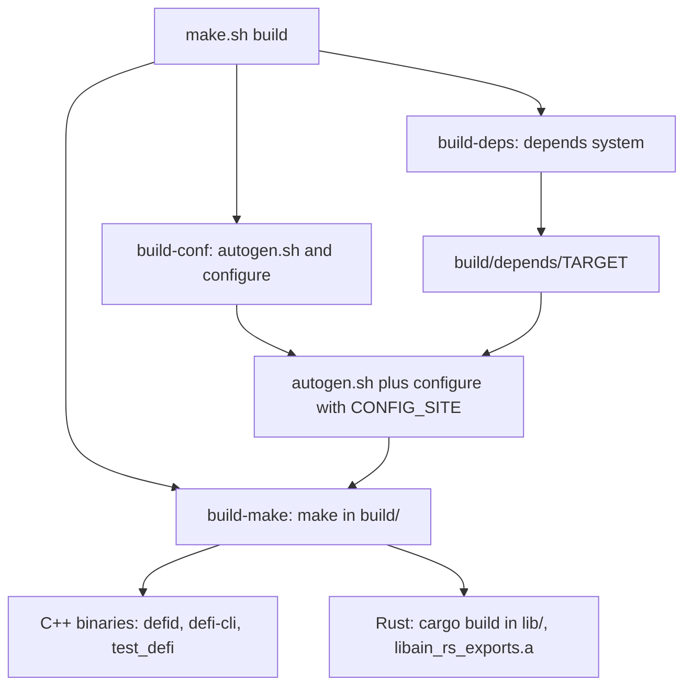

# Building & Testing

How the DeFiChain node is built, how it is tested and how the code is
formatted and linted.

Part of the [Developer & Architecture Manual](../index.md).

## Contents

| Page | Content |
| --- | --- |
| [Building the node](building.md) | The `make.sh` entry point, the `depends` system, the autotools and Cargo integration, the platform requirements and the dependencies. |
| [Testing and fuzzing](testing-and-fuzzing.md) | The C++ unit tests, the Rust unit tests, the Python functional tests, the fuzz targets and the CI workflows that run them. |
| [Coding and linting](coding-and-linting.md) | The coding conventions, the formatters, the lint scripts and the documentation checks. |

## The short version

```bash
# Build the node (dependencies, configure, make).
./make.sh build

# Run everything: C++ unit tests, Rust unit tests and the functional tests.
./make.sh test
```

Everything below is detail; the two commands above are what a contributor
needs most of the time.

## The toolchain at a glance

| Layer | Tool | Pinned by | Driven by |
| --- | --- | --- | --- |
| C++ sources | C++20, autotools, Clang 15 or GCC 10+ | `configure.ac`, `src/.clang-format` | `make.sh build-conf`, `make.sh build-make` |
| Native dependencies | `depends` (Berkeley DB, Boost, SQLite, ZeroMQ, protobuf, `rustup`, `solc`) | `depends/packages/*.mk` | `make.sh build-deps` |
| Rust sources | Cargo workspace in `lib/` | `rust-toolchain.toml` (channel `1.79`), `lib/Cargo.toml` | `lib/Makefile.am` via `make.sh lib …` |
| Python helpers | Python 3, `black`, `flake8`, `shellcheck` | `test/requirements.txt` | `make.sh check-py`, `make.sh check-sh` |
| Tests | Boost.Test (`test_defi`), `cargo test`, `test_runner.py` | `src/test/`, `lib/`, `test/functional/` | `make.sh test` |
| Documentation | MkDocs with Material for MkDocs | `docs/requirements.txt`, `mkdocs.yml` | `mkdocs build --strict` |

## How the build fits together



Two build systems cooperate:

* The **autotools** build (`configure.ac`, `Makefile.am`) compiles the C++ node.
  It is configured with the `config.site` file that the `depends` system
  generated, so the C++ build uses the same library versions as the rest of
  the release.
* The **Cargo** build (`lib/Cargo.toml`) compiles the Rust crates of the
  MetaChain EVM layer and the `cxx` bridge. `lib/Makefile.am` wraps `cargo`
  so that the autotools build drives it, and it copies the resulting
  `libain_rs_exports.a` back into the Cargo target directory, where the C++
  linker picks it up.

The order matters: the Rust build produces the bridge header and the static
library that the C++ side links against, and the `cxx` bridge generator runs
as part of the Cargo build.

## Choosing the right page

* You want to **compile the node** — read [Building the node](building.md).
* You want to **run a test** — read
  [Testing and fuzzing](testing-and-fuzzing.md).
* Your CI is **red because of a style check** — read
  [Coding and linting](coding-and-linting.md).

## Related pages

* [Codebase map](../codebase-map/index.md) — where the sources and the test
  trees live.
* [Architecture overview](../architecture/overview.md) — the two execution
  layers the build produces.
* [Consensus](../consensus/index.md) — the rules that the test suites verify.
