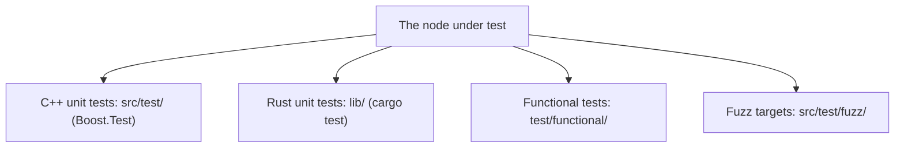

# Testing and fuzzing

The node is covered by three test suites — C++ unit tests, Rust unit tests
and Python functional tests — plus the fuzz targets. This page explains how
to run each of them.

Part of the [Building & Testing](index.md) section of the
[Developer & Architecture Manual](../index.md).

## The test pyramid



| Suite | Language | Location | Runs against | Command |
| --- | --- | --- | --- | --- |
| Unit tests | C++ | `src/test/` | In-process, with a temporary chain | `./make.sh test-cpp` |
| Unit tests | Rust | `lib/ain-*` | In-process, per crate | `./make.sh lib test` |
| Functional tests | Python | `test/functional/` | Real `defid` processes on a regtest chain | `./make.sh test-py` |
| Fuzzing | C++ | `src/test/fuzz/` | Random input, sanitizers enabled | see [Fuzzing](#fuzzing) |

All of the suites need a configured build tree; run `./make.sh build` first.

## C++ unit tests (Boost.Test)

The unit tests are Boost.Test suites in `src/test/`. The test binary is
`build/src/test/test_defi`, built from the sources listed in
`src/Makefile.test.include` and linked against the Boost unit test framework
and RapidCheck.

The suite name follows the file name: `src/test/applytx_tests.cpp` declares
`BOOST_FIXTURE_TEST_SUITE(applytx_tests, TestingSetup)`, so the suite is
`applytx_tests`.

```bash
# Run all unit tests.
./make.sh test-cpp

# Run a single suite.
build/src/test/test_defi --run_test=applytx_tests

# Run a single test case of a suite.
build/src/test/test_defi --run_test=mempool_tests/MempoolRemoveTest

# List the suites and the test cases.
build/src/test/test_defi --list_content
```

`./make.sh test-cpp` runs `make check` in the build directory, which builds
the binary first and then executes it through the automake test driver.

Fixtures come from `src/test/setup_common.h`: `BasicTestingSetup` only
creates the chain configuration, `TestingSetup` adds the genesis blocks and
`TestChain100Setup` a chain of 100 blocks.

Property-based tests use RapidCheck, for example
`src/test/key_properties.cpp`.

## Rust unit tests (Cargo)

The Rust crates carry their tests next to the code, in `#[cfg(test)]`
modules, for example `lib/ain-evm/src/gas.rs`.

```bash
# Run all Rust tests.
./make.sh lib test

# Run the tests of a single crate.
cd lib && cargo test -p ain-evm

# Run the tests of a single module.
cd lib && cargo test -p ain-evm gas
```

`make.sh lib test` runs `cargo test` with `--all-targets` on a native build.
The tests are compiled in the build profile of the `configure` run: a debug
build (`--enable-debug`) compiles them in the debug profile, a release build
in the release profile.

## Python functional tests

The functional tests start real `defid` processes and drive them over RPC
and P2P. They live in `test/functional/` and use the framework in
`test/functional/test_framework/` (the base class is `DefiTestFramework`).

```bash
# Run the whole suite.
./make.sh test-py

# Run a single test.
./make.sh test-py feature_accounts.py

# Run the tests whose name matches a regular expression.
./make.sh test-py --filter "feature_evm.*"
```

`make.sh test-py` calls `build/test/functional/test_runner.py` with the
configuration file that the build generated (`build/test/config.ini`). The
runner understands these options:

| Option | Effect |
| --- | --- |
| `--jobs <n>` | How many tests run in parallel (default 4). |
| `--filter <regex>` | Run only the tests whose file name matches. |
| `--exclude <list>` | Skip a comma-separated list of tests. |
| `--extended` | Also run the extended test suite. |
| `--failfast` | Stop after the first failure. |
| `--tmpdirprefix <dir>` | The root directory of the node data directories. |
| `--combinedlogslen <n>` | Print a combined log of `n` lines on failure. |
| `--keepcache` | Keep the cached chain data directories of the last run. |
| `--coverage` | Report which RPCs are not covered by the tests. |
| `--ci` | Enable the checks that are only run in a CI environment. |

The node data directories are created below `--tmpdirprefix`; the framework
caches a pre-mined chain in `test/cache/`, which
`test/functional/create_cache.py` regenerates.

The tests that compile Solidity contracts need the Solidity compiler. The
Python environment installs it with `./make.sh pkg-local-install-py-deps`
(which installs `solc` 0.8.20 through `py-solc-x`).

!!! warning

    Always use `test_runner.py` (or `make.sh test-py`) to run the functional
    tests. The runner starts and stops the nodes, manages the timeouts and
    removes the data directories; a manually started `defid` stays in the
    background.

### Writing a functional test

`test/functional/example_test.py` is the commented template. The naming and
style rules are documented in `test/functional/README.md`:

* the file name describes the area: `feature_<area>.py`, `rpc_<command>.py`,
  `interface_<interface>.py`, `mempool_<behaviour>.py`, `wallet_<topic>.py`;
* the test class subclasses `DefiTestFramework` and sets
  `self.num_nodes` and `self.setup_clean_chain` in `set_test_params()`;
* the module has a docstring that explains what is tested.

## Fuzzing

The fuzz targets are in `src/test/fuzz/`. Every target is a `FUZZ_TARGET(...)`
that is registered in the single fuzz binary `build-fuzz/src/test/fuzz/fuzz`.

| File | Targets |
| --- | --- |
| `src/test/fuzz/transaction.cpp` | `transaction` |
| `src/test/fuzz/deserialize.cpp` | The deserialisation targets, for example `block_deserialize`, `transaction_deserialize`, `netaddr_deserialize`, `messageheader_deserialize`. |
| `src/test/fuzz/p2p_message_parsing.cpp` | `p2p_message_parsing` |
| `src/test/fuzz/partially_downloaded_block.cpp` | `partially_downloaded_block` |
| `src/test/fuzz/addrv2_deserialize.cpp` | `addrv2_deserialize` |
| `src/test/fuzz/netaddr_str.cpp` | `netaddr_str` |
| `src/test/fuzz/script_flags.cpp` | `script_flags` |

### Building the fuzz binary

The fuzz binary needs the sanitizers and a separate build tree, exactly as
the `Fuzz` workflow does it:

```bash
./make.sh build-deps

REPO_ROOT="$(pwd)"
./autogen.sh
mkdir -p build-fuzz
cd build-fuzz
CC=clang-15 CXX=clang++-15 \
CONFIG_SITE="${REPO_ROOT}/build/depends/x86_64-pc-linux-gnu/share/config.site" \
  ../configure \
  --prefix="${REPO_ROOT}/build/depends/x86_64-pc-linux-gnu" \
  --enable-fuzz \
  --with-sanitizers=fuzzer,address,undefined
make -j"$(nproc)" -C lib
make -j"$(nproc)" -C src test/fuzz/fuzz
```

The Rust workspace has to be built first, because it provides
`ain_rs_exports.h` and `libain_rs_exports.a`.

### Running the targets

```bash
# List the registered targets.
PRINT_ALL_FUZZ_TARGETS_AND_ABORT=1 ./build-fuzz/src/test/fuzz/fuzz

# Fuzz one target for five minutes and keep the crashes.
mkdir -p fuzz-artifacts
FUZZ=transaction ./build-fuzz/src/test/fuzz/fuzz \
  -max_total_time=300 \
  -artifact_prefix="$(pwd)/fuzz-artifacts/transaction-"
```

The `FUZZ` environment variable selects the target; the binary then behaves
like a `libFuzzer` executable and reads the corpus from the directory that
is passed on the command line.

`test/fuzz/test_runner.py` drives the same binary with a corpus directory
and can replay the seeds of the `qa-assets` repository:

```bash
export DIR_FUZZ_IN="$PWD/qa-assets/fuzz_seed_corpus"
test/fuzz/test_runner.py --fuzz_bin build-fuzz/src/test/fuzz/fuzz "$DIR_FUZZ_IN" transaction
```

### The startup regression check

Sanitizer builds reserve a fixed address range for their allocator. If the
fuzz binary is linked as a position-independent executable, the loader can
place it inside that reservation and the process dies with `SIGSEGV` before
`main()` runs. `configure` therefore links sanitizer builds as non-PIE, and
`ci/fuzz/main.sh` verifies that:

```bash
./ci/fuzz/main.sh build-fuzz/src/test/fuzz/fuzz 100
```

The script checks that the binary is linked non-PIE (`ET_EXEC`) and starts it
100 times in a row.

### AFL

The legacy `doc/fuzzing.md` also documents the AFL route: build with
`CC=$AFLPATH/afl-gcc CXX=$AFLPATH/afl-g++` and
`./configure --disable-ccache --disable-shared --enable-tests --enable-fuzz`,
then run `afl-fuzz` with the seed corpus of the target as the input
directory. The `libFuzzer` route above is the one that CI uses.

## CI workflows

| Workflow | What it runs |
| --- | --- |
| `.github/workflows/tests.yaml` | The `e2e-tests` job builds the node and runs `./make.sh test` (unit tests, Rust tests and functional tests); the `rust-tests` job runs `./make.sh lib test`. |
| `.github/workflows/lint.yaml` | The lint jobs: `./ci/lint/main.sh`, `./ci/extended_lint/main.sh`, `cargo fmt --check`, `cargo clippy` and `cargo audit`. |
| `.github/workflows/fuzz.yaml` | Builds the fuzz binary, runs the startup regression check and fuzzes the targets for a bounded time. |
| `.github/workflows/docs.yaml` | Validates the documentation structure and builds the site with `mkdocs build --strict`. |
| `.github/workflows/build-dev.yaml` | The release build matrix for Linux, Windows and macOS. |
| `.github/workflows/tests-frontier.yml`, `tests-jellyfish.yml`, `tests-ocean.yml`, `tests-sync.yml`, `tests-ethlibs.yaml` | The integration suites against the ecosystem repositories (`metachain-ts-suite`, `JellyfishSDK`, `go-ethlibs`) and the public networks. |

The helper scripts of the workflows live in `ci/`: `ci/lint/main.sh`,
`ci/extended_lint/main.sh`, `ci/test/main.sh` and `ci/fuzz/main.sh`.

## Legacy documentation

This page consolidates the fuzzing instructions of `doc/fuzzing.md` and the
testing parts of the legacy build documentation. The legacy files remain in
the repository because the build system ships them (`Makefile.am` →
`DIST_DOCS`); they are replaced by a pointer to this page.
