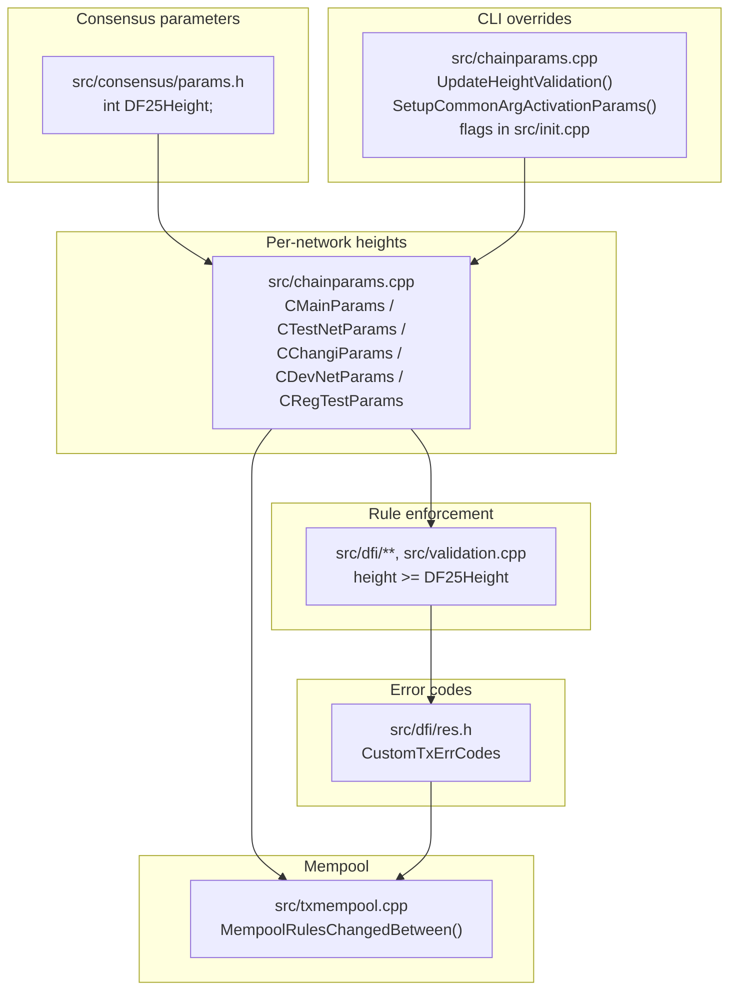

# Upgrade gating

How a new height-gated consensus rule is added to the node: the consensus
parameter, the per-network heights, the CLI override, the mempool coupling,
the error codes and the tests that have to cover both sides of the activation
height.

Part of the [Consensus section](index.md) of the
[Developer & Architecture Manual](../index.md).

## The pattern in one diagram



Every step below is mandatory. A rule that skips the mempool coupling or the
error codes can be mined in a block but will strand transactions in the
mempool, or will make nodes disagree about whether a transaction is valid.

## 1. Declare the consensus parameter

Add the height to `Consensus::Params` in `src/consensus/params.h`:

```cpp
    /**
     * DF25 Upgrade Height: bundles consensus hardening rules for v4.2.7+
     * (including DFI account balance MAX_MONEY enforcement).
     * INT_MAX disables DF25 rules.
     */
    int DF25Height;
```

Rules for the declaration:

* The member is a plain `int` named `DF<n><Name>Height`.
* Document what the fork changes, in a Doxygen comment.
* Document that `INT_MAX` disables the rule.

Optional helper for "is the fork active":

```cpp
inline bool IsDF25Active(const uint32_t height, const Params &consensus) {
    return consensus.DF25Height != std::numeric_limits<int>::max() &&
           height >= static_cast<uint32_t>(consensus.DF25Height);
}
```

The `INT_MAX` check matters: without it, `height >= static_cast<uint32_t>(INT_MAX)`
compares an unsigned height against `UINT32_MAX` and would be true for
heights that wrap around, and the "not scheduled" state would no longer be
distinguishable from "active".

## 2. Set the height for every network

`src/chainparams.cpp` sets **all** `DF<n>` heights in each network class —
there is no default and no inheritance between networks:

| Network | Class | Height for a not-yet-scheduled fork |
| --- | --- | --- |
| Mainnet | `CMainParams` | `std::numeric_limits<int>::max()` |
| Testnet | `CTestNetParams` | `std::numeric_limits<int>::max()` |
| Changi | `CChangiParams` | `std::numeric_limits<int>::max()` |
| DevNet | `CDevNetParams` | `std::numeric_limits<int>::max()` |
| Regtest | `CRegTestParams` | `1` (or `0`) |

Rules for the values:

* An unscheduled public network gets `std::numeric_limits<int>::max()`.
* Regtest gets `1` (or `0`) so the new rule is active from the start of a
  test chain.
* The concrete mainnet height is entered in **one** place only —
  `CMainParams` — once the release window is fixed. All other networks keep
  `INT_MAX` until their own window is decided.
* Consensus changes of one release are normally bundled under **one** shared
  height (the `DF23Height` / `DF24Height` / `DF25Height` pattern) instead of
  one height per fix.

## 3. Add the CLI override

`UpdateHeightValidation()` in `src/chainparams.cpp` implements the override:

```cpp
std::optional<int> UpdateHeightValidation(const std::string& argName, const std::string& argFlag, int& argTarget) {
    if (gArgs.IsArgSet(argFlag)) {
        int64_t height = gArgs.GetArg(argFlag, argTarget);
        if (height < -1 || height >= std::numeric_limits<int>::max()) {
            std::string lowerArgName = ToLower(argFlag);
            throw std::runtime_error(strprintf(
                "Activation height %ld for %s is out of valid range. Use -1 to disable %s.",
                height, argName, lowerArgName));
        } else if (height == -1) {
            LogPrintf("%s disabled for testing\n", argName);
            height = std::numeric_limits<int>::max();
        }
        argTarget = static_cast<int>(height);
        return height;
    }
    return {};
}
```

Semantics:

* `-1` disables the fork (it is mapped to `INT_MAX`).
* Any value outside `[-1, INT_MAX)` aborts startup with a clear error.
* The function returns the parsed height, or `std::nullopt` when the flag is
  not set.

Wire the new parameter into `SetupCommonArgActivationParams()`:

```cpp
    UpdateHeightValidation("DF25 Upgrade Height", "-df25height", consensus.DF25Height);
```

and declare the flag in `src/init.cpp`:

```cpp
    gArgs.AddArg("-df25height", "DF25 fork activation height (regtest only)", ArgsManager::ALLOW_ANY | ArgsManager::DEBUG_ONLY, OptionsCategory::CHAINPARAMS);
```

!!! warning "CLI overrides are not a consensus mechanism"

    `SetupCommonArgActivationParams()` is called from `CRegTestParams::UpdateActivationParametersFromArgs()`
    and from `SetMocknet()`. Mainnet, testnet, Changi and DevNet only evaluate
    the overrides in mocknet mode. An override that changes a consensus
    constant on a public network would let a single node fork the chain away
    from the rest of the network.

    For the same reason `nBalanceOverflowHeight` and `nMNVersionGateHeight`
    are consensus constants that are only overridable on regtest and
    mocknet.

    Some forks need a *dependent* override: `-eunosheight` also moves
    `DF9EunosKampungHeight`, because the two forks activate together on
    every non-mainnet network.

## 4. Gate the rule on the height

Enforce the new rule only from the activation height on. Two idioms are in
use:

```cpp
// Explicit comparison against the parameter.
if (height >= consensus.DF25Height) {
    // strict behaviour
}

// Via the helper in src/consensus/params.h.
if (Consensus::IsDF25Active(blockCtx.GetHeight(), blockCtx.GetConsensus())) {
    // strict behaviour
}
```

Both branches must be implemented: the code below the activation height has
to keep the old behaviour, because blocks that were already mined before the
activation must stay valid.

Typical places for a DVM rule:

| Rule area | Location |
| --- | --- |
| Custom transaction checks | `src/dfi/consensus/` (`loans.cpp`, `vaults.cpp`, `smartcontracts.cpp`, `tokenlock.cpp`, …) |
| Pool pair arithmetic | `src/dfi/poolpairs.cpp` |
| Account balances (DF25 `MAX_MONEY` rule) | `src/dfi/accounts.cpp` (`CAccountsView::AddBalance()`), `src/dfi/masternodes.cpp` (pool reward balances), switch site `src/validation.cpp` (`SetEnforceAccountMaxMoney()`) |
| Transfer sum overflow (`nBalanceOverflowHeight`) | `src/dfi/consensus/txvisitor.cpp` (`CCustomTxVisitor::SumTransfers()`) |
| Block validation | `src/dfi/validation.cpp`, `src/validation.cpp` |
| Block template | `src/miner.cpp` (DF23 and DF24 add EVM token-split and token-lock transactions) |

## 5. Couple the rule to the mempool

A transaction that was valid below the activation height may be invalid above
it. The mempool therefore has to know where the rules change:

```cpp
static bool HeightCrossed(int activation, int fromHeight, int toHeight) {
    if (activation == std::numeric_limits<int>::max()) {
        return false;
    }
    return fromHeight < activation && activation <= toHeight;
}

static bool MempoolRulesChangedBetween(int fromHeight, int toHeight) {
    const auto &consensus = Params().GetConsensus();
    return HeightCrossed(consensus.nBalanceOverflowHeight, fromHeight, toHeight) ||
           HeightCrossed(consensus.DF25Height, fromHeight, toHeight);
}
```

`MempoolRulesChangedBetween()` is used in `CTxMemPool::removeForBlock()`
(`src/txmempool.cpp`): when the next block crosses the activation height, the
accounts view is rebuilt even if no transaction was removed, because the
rules of the next block differ from the rules the view was built with.

!!! important "Every new height-gated rule belongs in `MempoolRulesChangedBetween()`"

    Without the entry, the mempool keeps transactions that the new rules
    reject, and the node either mines invalid blocks or stalls. The
    `HeightCrossed()` helper already handles the `INT_MAX` case, so a
    not-yet-scheduled fork needs no special treatment.

## 6. Tag the errors the mempool has to distinguish

The mempool must be able to tell "this transaction is invalid, drop it" apart
from "this transaction might become valid later". The codes are defined in
`src/dfi/res.h`:

```cpp
enum CustomTxErrCodes : uint32_t {
    NotSpecified = 0,
    NotEnoughBalance = 1024,
    TransferSumOverflow = 2048,
    AccountBalanceOutOfRange = 4096,
    Fatal = uint32_t(1) << 31  // not allowed to fail
};
```

* `NotEnoughBalance` (1024) — an ordinary failure. The transaction stays in
  the mempool; it may become valid once funds arrive.
* `TransferSumOverflow` (2048) — the sum of the transfer amounts overflows.
  Raised in `CCustomTxVisitor::SumTransfers()` (`src/dfi/consensus/txvisitor.cpp`)
  when the height is at or above `nBalanceOverflowHeight`. The transaction was
  accepted below the activation height and is not valid anymore above it, so
  it has to be dropped.
* `AccountBalanceOutOfRange` (4096) — a DFI account balance would exceed
  `MAX_MONEY`. Also a "drop it" condition.
* `Fatal` (`1 << 31`) — reserved for errors that are never allowed to fail.

`CTxMemPool::rebuildAccountsView()` in `src/txmempool.cpp` uses these codes
when it re-applies the staged transactions against a rebuilt accounts view:

```cpp
if (!res && (res.code & (CustomTxErrCodes::Fatal | CustomTxErrCodes::TransferSumOverflow |
                         CustomTxErrCodes::AccountBalanceOutOfRange))) {
    // A transaction with an overflow of the transfer sum was accepted
    // below the activation height and is not valid anymore. Drop it
    // instead of keeping it in the mempool, where it would never be
    // mined.
    removeTxBackToStage(mapTx, staged, vtx, tx);
}
```

The code is set at the point of failure with `Res::ErrCode()`:

```cpp
return Res::ErrCode(CustomTxErrCodes::AccountBalanceOutOfRange,
                    "account balance out of range: %s", balance.ToString());
```

!!! note "Error codes live in `src/dfi/res.h`, not in `src/dfi/errors.h`"

    `src/dfi/errors.h` holds the `DeFiErrors` helpers that build `Res`
    objects; the numeric `CustomTxErrCodes` enum is declared in
    `src/dfi/res.h`.

## 7. Test both sides of the activation height

A height-gated rule is only correctly implemented when **both** the state
below and the state at/above the activation height are covered.

### Unit tests (C++)

Boost.Test suites live in `src/test/`. The activation height is set directly
on the consensus parameters, so a test can exercise both sides without
starting a node:

```cpp
    consensus.DF25Height = 100;                 // rule active from height 100
    ...
    consensus.DF25Height = std::numeric_limits<int>::max();  // rule never active
```

Relevant suites:

| Suite | File | What it covers |
| --- | --- | --- |
| `applytx_tests` | `src/test/applytx_tests.cpp` | Custom transaction acceptance below and at/above `DF25Height`, including the `TransferSumOverflow` and `AccountBalanceOutOfRange` codes. |
| `mempool_tests` | `src/test/mempool_tests.cpp` | Mempool behaviour across the activation height (`DF25Height = 100` vs. `INT_MAX`). |
| `validation_block_tests` | `src/test/validation_block_tests.cpp` | Block validation with the fork disabled (`INT_MAX`), enabled from height `1` and enabled from an arbitrary height. |
| `liquidity_tests` | `src/test/liquidity_tests.cpp` | Pool-pair liquidity arithmetic below and at/above `DF25Height`. |
| `versionbits_tests` | `src/test/versionbits_tests.cpp` | The masternode version gate (`nMNVersionGateHeight`, `VERSION_BIT_BALANCE_OVERFLOW`). |
| `res_tests` | `src/test/res_tests.cpp` | `Res` and the error codes. |

Run them with:

```bash
./make.sh build
./build/src/test/test_defi --run_test=applytx_tests
```

### Functional tests (Python)

Functional tests live in `test/functional/` and drive a real regtest node.
They use the CLI overrides to move the activation height of a running chain,
for example `-df25height=<n>`, and assert that the behaviour differs below and
above that height. Existing examples are
`test/functional/feature_df25_time.py`,
`test/functional/feature_balance_overflow_height.py` and
`test/functional/feature_balance_overflow_mempool.py`.

Run them with:

```bash
python3 test/functional/test_runner.py <test_name>
```

### Checklist for a new gated rule

- [ ] `src/consensus/params.h`: parameter declared and documented.
- [ ] `src/chainparams.cpp`: height set for **all five** networks; `INT_MAX`
      for unscheduled public networks, `1`/`0` for regtest.
- [ ] `src/chainparams.cpp`: `UpdateHeightValidation()` call for the new
      parameter; `src/init.cpp`: the matching flag.
- [ ] Rule implemented with an explicit `height >= <Height>` check or
      `IsDF25Active()`, with the pre-activation behaviour preserved.
- [ ] `src/txmempool.cpp`: `MempoolRulesChangedBetween()` covers the new
      height.
- [ ] `src/dfi/res.h`: error codes that let the mempool distinguish
      "drop" from "keep"; used at the failure sites.
- [ ] Unit tests below **and** at/above the activation height.
- [ ] Functional test that moves the activation height with the CLI
      override.
- [ ] Mainnet height entered in `CMainParams` once the release window is
      fixed — and in exactly one place.

## Related pages

* [Hardfork timeline](hardforks.md) — all activation heights and their
  values per network.
* [Consensus section index](index.md).
* [Subsystems](../subsystems/index.md) — mempool and block validation in
  detail.
