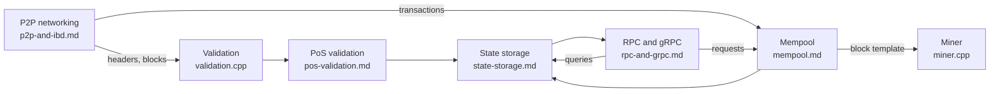

# Subsystems

The subsystems of the node: the mempool, the peer-to-peer network and the
initial block download, the Proof-of-Stake validation and the masternodes,
the state storage and the RPC layer.

Part of the [Developer & Architecture Manual](../index.md).

## Contents

| Page | Content |
| --- | --- |
| [Mempool and transaction acceptance](mempool.md) | How a transaction enters the pool, how it is replaced or evicted, and how the pool is coupled to the height-gated consensus rules. |
| [P2P networking and IBD](p2p-and-ibd.md) | The connection handling, the header and block synchronisation, the anchored header-tip selection and the detection of the initial block download. |
| [PoS validation and masternodes](pos-validation.md) | The masternode state machine, the stake kernel and signature checks, the difficulty retargeting and the anchor system. |
| [State storage](state-storage.md) | The C++ storage abstraction (`CFlushableStorageKV`), the databases in the data directory and the RocksDB backend of the Rust layer. |
| [RPC and gRPC layer](rpc-and-grpc.md) | The JSON-RPC server of the C++ layer (`RPCHelpMan`), the Ethereum JSON-RPC and the WebSocket subscriptions of the Rust layer, and the REST and ZMQ interfaces. |

## How the subsystems fit together

A transaction arrives over the P2P layer and is validated by the mempool
against the current state; the miner assembles the block template from the
mempool, the template is signed by a masternode and the resulting block is
validated by the PoS rules before it is written to the state.

## Related pages

* [Architecture overview](../architecture/overview.md) — the layers of the
  system.
* [Codebase map](../codebase-map/index.md) — where the files of the
  subsystems live.
* [Consensus](../consensus/index.md) — the rules that the subsystems
  implement.
