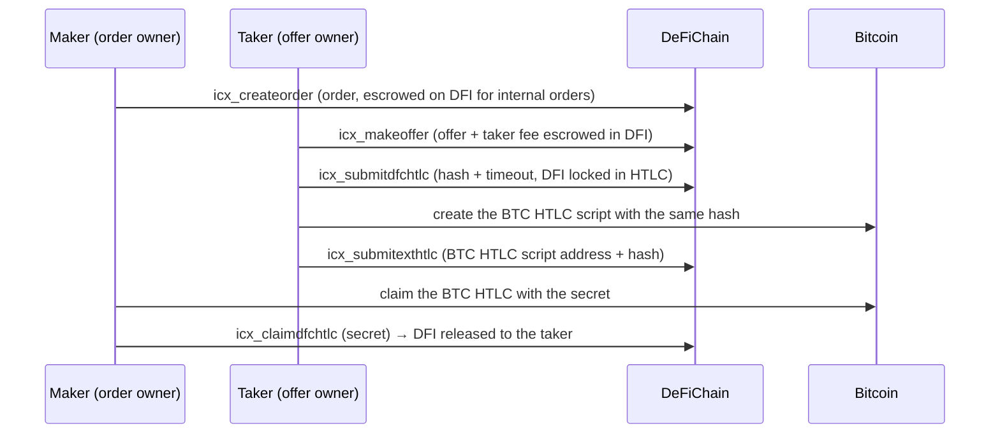

# ICX atomic swaps

**ICX** is the cross-chain order book of DeFiChain. It lets a holder of DFI
trade against BTC without a custodian: the two sides of the trade are linked
by a **hash-locked time-locked contract (HTLC)** on both chains, so the swap
either completes on both sides or on neither.

!!! danger "ICX is an experimental feature"

    The RPC help of `icx_createorder` and friends warns about it
    explicitly: *"EXPERIMENTAL warning: ICX and Atomic Swap are experimental
    features. You might end up losing your funds. USE IT AT YOUR OWN RISK."*
    The mechanism requires two different chains to run correctly, and a
    mistake in the HTLC setup can lock your funds until the timeouts expire.

Part of the [DEX & Liquidity](index.md).

## The two order directions

An order is either **internal** or **external** (`CICXOrder::TYPE_INTERNAL`
= 1, `CICXOrder::TYPE_EXTERNAL` = 2 in `src/dfi/icxorder.h`).

| Order type | Direction | What is escrowed on DeFiChain | What is escrowed on Bitcoin |
| --- | --- | --- | --- |
| `TYPE_INTERNAL` | sell DFI (or another token) for BTC | the token you sell, at the address derived from the order creation transaction | the BTC, in the HTLC script |
| `TYPE_EXTERNAL` | sell BTC for DFI (or another token) | nothing at order creation; the DFI is paid out on claim | the BTC, in the HTLC script |

The direction is not chosen by the user but derived from the RPC arguments:
`icx_createorder` with a `tokenFrom` creates an internal order, and with a
`chainFrom` of `"BTC"` it creates an external order.

## The lifecycle of a swap



The two HTLCs use the **same hash**: the taker commits to a secret, puts the
hash into both HTLCs, and only reveals the secret when the maker claims the
BTC side. If the maker never claims, the timeouts return the funds to their
owners.

### The steps in detail

1. **`icx_createorder`** (DfTx `'1'`, `ICXCreateOrder`) — the maker creates
   the order. The order carries the token, the amount, the price and an
   expiry. For an internal order the sold amount is moved to the address
   derived from the creation transaction, so it is escrowed and cannot be
   spent.
2. **`icx_makeoffer`** (DfTx `'2'`, `ICXMakeOffer`) — a taker offers to fill
   the order. The offer states the amount and an expiry, and the **taker fee
   is escrowed in DFI** at the offer transaction.
3. **`icx_submitdfchtlc`** (DfTx `'3'`, `ICXSubmitDFCHTLC`) — the taker
   locks the DFI side in an HTLC with a hash lock and a timeout.
4. **`icx_submitexthtlc`** (DfTx `'4'`, `ICXSubmitEXTHTLC`) — the taker
   registers the Bitcoin-side HTLC script address. The node checks that the
   hash matches the DFI-side HTLC and that the amount matches the order
   price.
5. **`icx_claimdfchtlc`** (DfTx `'5'`, `ICXClaimDFCHTLC`) — the maker
   claims the BTC side with the secret and submits it to DeFiChain. The node
   verifies that the secret hashes to the committed hash and releases the
   DFI to the taker.
6. **`icx_closeorder`** / **`icx_closeoffer`** (DfTx `'6'` / `'7'`) — close an
   order or an offer that was not (or no longer) needed.

### Statuses

| Object | Statuses | Source |
| --- | --- | --- |
| Order | `OPEN` (0), `CLOSED` (1), `FILLED` (2), `EXPIRED` (3) | `CICXOrder` in `src/dfi/icxorder.h` |
| Offer | `OPEN` (0), `CLOSED` (1), `EXPIRED` (2) | `CICXMakeOffer` in `src/dfi/icxorder.h` |
| DFI HTLC | `OPEN` (0), `CLAIMED` (1), `REFUNDED` (2), `EXPIRED` (3) | `CICXSubmitDFCHTLC` in `src/dfi/icxorder.h` |
| BTC HTLC | `OPEN` (0), `CLOSED` (1), `EXPIRED` (3) | `CICXSubmitEXTHTLC` in `src/dfi/icxorder.h` |

An order that has been completely filled is closed with the status `FILLED`;
an order or offer that ran out of time is closed as `EXPIRED`.

## Expiry and timeouts

All periods are counted in **blocks**.

| Value | Blocks | Meaning |
| --- | --- | --- |
| `2880` | 24 h at 30 s per block | default **and minimum** expiry of an order (`CICXOrder::DEFAULT_EXPIRY`) — a shorter expiry is rejected with *"order expiry must be greater than 2879!"* |
| `10` / `20` | — | minimum expiry of an offer, before and from `DF10EunosPayaHeight` (`CICXMakeOffer::DEFAULT_EXPIRY`, `EUNOSPAYA_DEFAULT_EXPIRY`) |
| `500` / `1440` | — | minimum timeout of the DFI-side HTLC when it is the **first** HTLC, before and from `DF10EunosPayaHeight` (`CICXSubmitDFCHTLC::MINIMUM_TIMEOUT`) |
| `250` / `480` | — | minimum timeout of the DFI-side HTLC when it is submitted **second**, i.e. when the BTC-side HTLC already exists (`CICXSubmitDFCHTLC::MINIMUM_2ND_TIMEOUT`) |
| `30` / `72` | — | minimum timeout of the BTC-side HTLC when it is the **first** HTLC, before and from `DF10EunosPayaHeight` (`CICXSubmitEXTHTLC::MINIMUM_TIMEOUT`) |
| `15` / `24` | — | minimum timeout of the BTC-side HTLC when it is submitted **second**, i.e. when the DFI-side HTLC already exists (`CICXSubmitEXTHTLC::MINIMUM_2ND_TIMEOUT`) |
| `100` | — | `MAKER_DEPOSIT_REFUND_TIMEOUT`: after this many blocks the maker's deposit is refunded |
| `16` / `20` | — | BTC blocks per DFI block period used to convert the BTC-side timeout (`BTC_BLOCKS_IN_DFI_BLOCKS`) |

The node enforces the relations between these values:

* An offer must live at least as long as the minimum offer expiry, otherwise
  *"offer expiry must be greater than %d!"*.
* The DFI-side HTLC must not outlive the order: *"order will expire before
  dfc htlc expires!"*.
* The BTC-side HTLC must not outlive the order either, and it must expire
  before the DFI-side HTLC: *"timeout must be less than expiration period of
  1st htlc in DFC blocks"*.
* The amount of the BTC-side HTLC must match the order price exactly:
  *"amount must be equal to calculated dfchtlc amount"*, and the hash must
  be identical: *"Invalid hash, external htlc hash is different than dfc
  htlc hash"*.

## The taker fee

Every offer must pay a **taker fee**. It is denominated in BTC and converted
to DFI with the price of the BTC/DFI pool:

```text
takerFee(DFI) = amount(BTC) × takerFeePerBTC / 10⁸ × (DFI per BTC) / 10⁸
```

* The default is `0.003` BTC per BTC swapped
  (`CICXMakeOffer::DEFAULT_TAKER_FEE_PER_BTC` in `src/dfi/icxorder.cpp`).
* Governance can change it with the `ICX_TAKERFEE_PER_BTC` variable
  (`src/dfi/govvariables/icx_takerfee_per_btc.cpp`); the value must be
  greater than zero.
* The DFI price of BTC is taken from the BTC/DFI pool pair, so the fee moves
  with the market.
* The fee is escrowed in DFI when the offer is created. If the HTLC amount
  differs from the offer amount, the difference is refunded to the taker
  (`src/dfi/consensus/icxorders.cpp`).

On a successful claim the fee is returned to the **order owner** (the
maker), together with a **maker incentive of 25 %** of the fee and — for
1:1 dBTC/BTC trades only — an additional **maker bonus of 50 %** of the fee
(`CICXOrdersConsensus::operator()(const CICXClaimDFCHTLCMessage &)` in
`src/dfi/consensus/icxorders.cpp`). The fee therefore keeps the maker in the
market; the amount that stays locked in the order and offer transaction
addresses leaves the circulating supply.

## Is ICX enabled?

ICX can be switched off by governance:

* From `DF22MetachainHeight` on, ICX transactions are only accepted when
  the attribute `v0/params/feature/icx` is set (`IsICXEnabled()` in
  `src/dfi/consensus/icxorders.cpp`, attribute key `DFIPKeys::ICXEnabled`;
  the `Param` category is exported as `params`). Without the attribute the
  transactions are rejected with *"Cannot create tx, ICX is not enabled"*.
* Before that upgrade, ICX was enabled everywhere except between
  `DF13FortCanningParkHeight` and `DF22MetachainHeight`, where it was
  disabled (regtest and, from block 1,250,000, testnet were excepted).

## The numbers at a glance

| Parameter | Value | Source |
| --- | --- | --- |
| Default and minimum order expiry | 2880 blocks | `CICXOrder::DEFAULT_EXPIRY` in `src/dfi/icxorder.h` |
| Minimum offer expiry | 10 blocks (20 from `DF10EunosPayaHeight`) | `CICXMakeOffer` in `src/dfi/icxorder.h` |
| Minimum DFI HTLC timeout (first HTLC) | 500 blocks (1440 from `DF10EunosPayaHeight`) | `CICXSubmitDFCHTLC` in `src/dfi/icxorder.h` |
| Minimum DFI HTLC timeout (second HTLC) | 250 blocks (480 from `DF10EunosPayaHeight`) | `CICXSubmitDFCHTLC` in `src/dfi/icxorder.h` |
| Minimum BTC HTLC timeout (first HTLC) | 30 blocks (72 from `DF10EunosPayaHeight`) | `CICXSubmitEXTHTLC` in `src/dfi/icxorder.h` |
| Minimum BTC HTLC timeout (second HTLC) | 15 blocks (24 from `DF10EunosPayaHeight`) | `CICXSubmitEXTHTLC` in `src/dfi/icxorder.h` |
| Maker deposit refund timeout | 100 blocks | `CICXMakeOffer::MAKER_DEPOSIT_REFUND_TIMEOUT` in `src/dfi/icxorder.h` |
| BTC blocks per DFI block period | 16 (20 from `DF10EunosPayaHeight`) | `CICXSubmitEXTHTLC` in `src/dfi/icxorder.h` |
| Default taker fee | 0.003 BTC | `CICXMakeOffer::DEFAULT_TAKER_FEE_PER_BTC` in `src/dfi/icxorder.cpp` |
| Maker incentive / bonus | 25 % / 50 % of the taker fee | `src/dfi/consensus/icxorders.cpp` |
| Governance switch | attribute `v0/params/feature/icx` | `src/dfi/consensus/icxorders.cpp` |

## What is where

| Topic | Lives in |
| --- | --- |
| The DEX as an alternative to ICX | [Swapping and fees](swapping-and-fees.md) |
| The DfTx payload format of the ICX transactions | [DVM](../dvm/index.md) |
| Setting the taker fee and switching ICX on or off | [Governance](../governance/index.md) |
| The order book RPCs | [RPC & CLI Reference](../../node-manual/rpc-cli/index.md) |
| The implementation | [Developer & Architecture Manual](../../developer-manual/index.md) |
