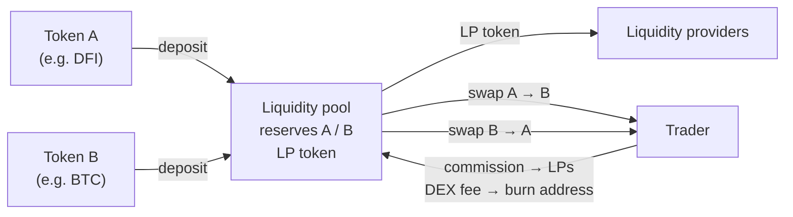
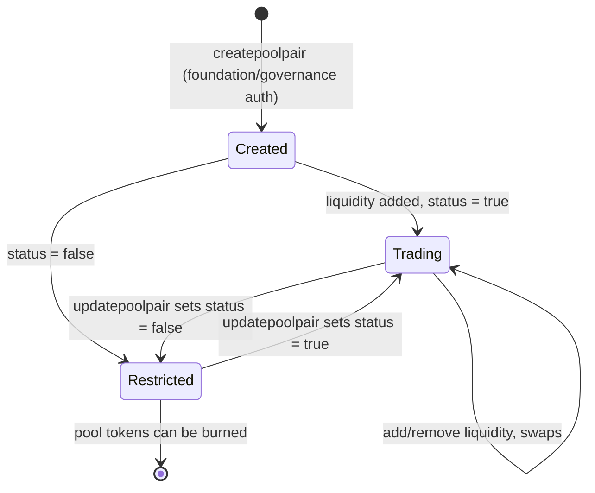

# DEX & Liquidity

The **decentralised exchange (DEX)** of DeFiChain is an *automated market
maker* that lives inside the DeFi VM. You do not place an order and wait for
somebody to fill it: you trade against a **liquidity pool** that holds two
tokens, and the price follows automatically from the reserves of that pool.

This section explains how the DEX works: how pools are created, how liquidity
is added and removed, how a swap is priced and what it costs, and how the
older **ICX atomic swap** mechanism lets you swap DFI against BTC without a
custodian.

Part of the [User & Protocol Manual](../index.md).

## Contents

| Document | What you learn |
| --- | --- |
| [AMM and pools](amm-and-pools.md) | The anatomy of a liquidity pool, the maths of adding and removing liquidity, the LP token and the rewards a liquidity provider earns. |
| [Swapping and fees](swapping-and-fees.md) | How a swap is priced, price limits, single-hop and composite swaps, the pool commission and the DEX fee. |
| [ICX atomic swaps](icx-atomic-swaps.md) | The order/offer/HTLC lifecycle of the ICX order book, the taker fee and the expiry rules. |

## The DEX in one minute

* A **pool** pairs exactly two tokens. It keeps two reserves, `reserveA` and
  `reserveB`, and issues a third token — the **LP token** — that represents
  the provider's share of the pool.
* Adding liquidity mints LP tokens, removing liquidity burns them. The price
  of the pool token pair follows the constant-product curve
  `reserveA × reserveB = k`.
* A **swap** takes one token out of the pool and puts another one in. The
  output amount is computed from the reserves, so large trades move the price
  — this is *slippage*.
* The trader pays the **pool commission** (to the liquidity providers) and,
  where governance has configured it, the **DEX fee** (burned).

## Which transaction do I need?

Every DEX action is a custom transaction (DfTx) with its own one-byte type
identifier, as defined in `src/dfi/customtx.h`.

| Action | DfTx type | RPC helper | Consensus code |
| --- | --- | --- | --- |
| Create a pool | `'p'` `CreatePoolPair` | `createpoolpair` | `src/dfi/consensus/poolpairs.cpp` |
| Update a pool (status, commission, owner, rewards) | `'u'` `UpdatePoolPair` | `updatepoolpair` | `src/dfi/consensus/poolpairs.cpp` |
| Add liquidity | `'l'` `AddPoolLiquidity` | `addpoolliquidity` | `src/dfi/consensus/poolpairs.cpp` |
| Remove liquidity | `'r'` `RemovePoolLiquidity` | `removepoolliquidity` | `src/dfi/consensus/poolpairs.cpp` |
| Swap in one pool | `'s'` `PoolSwap` | `poolswap`, `testpoolswap` | `src/dfi/mn_checks.cpp` |
| Swap across several pools | `'i'` `PoolSwapV2` | `compositeswap` | `src/dfi/mn_checks.cpp` |
| ICX order, offer, HTLC, claim, close | `'1'`…`'7'` | `icx_createorder`, `icx_makeoffer`, `icx_submitdfchtlc`, `icx_submitexthtlc`, `icx_claimdfchtlc`, `icx_closeorder`, `icx_closeoffer` | `src/dfi/consensus/icxorders.cpp` |

The general shape of a DfTx is explained in
[Custom transactions](../dvm/custom-transactions.md).

## The numbers at a glance

| Parameter | Value | Source |
| --- | --- | --- |
| Pool trading price | `reserveF × 10⁸ / reserveT` (input side ÷ output side) | `CPoolPair::Swap()` in `src/dfi/poolpairs.cpp` |
| Liquidity minted for the first deposit | `√(amountA × amountB) − 1000` | `CPoolPair::AddLiquidity()` in `src/dfi/poolpairs.cpp` |
| Liquidity permanently locked in a pool | `1000` satoshi units (10⁻⁵ of a token) | `CPoolPair::MINIMUM_LIQUIDITY` in `src/dfi/poolpairs.h` |
| Minimum reserve for a trade to be accepted | `1000` per side | `CPoolPair::SLOPE_SWAP_RATE` in `src/dfi/poolpairs.h` |
| Ratio slippage tolerance when adding liquidity | 3 % | `CPoolPair::AddLiquidity()` in `src/dfi/poolpairs.cpp` |
| Maximum number of pools in one composite swap | 3 | `MAX_POOL_SWAPS` in `src/dfi/mn_checks.h` |
| Pool commission range | 0 … 100 % (in units of 10⁻⁸) | `CCreatePoolPairMessage` handling in `src/dfi/consensus/poolpairs.cpp` |
| DEX fee range | 0 … 100 % (in units of 10⁻⁸) | `CPoolPairView::SetDexFeePct()` in `src/dfi/poolpairs.cpp` |
| LP token of a pool | a token with the flags `DAT`, `LPS`, `Tradeable`, `Finalized` | `src/dfi/consensus/poolpairs.cpp` |
| Default symbol of a pool token | `<tokenA>-<tokenB>`, max. 16 characters | `CToken::MAX_TOKEN_POOLPAIR_LENGTH` in `src/dfi/tokens.h` |

## The lifecycle of a pool

* A pool is created by the **foundation or governance** — ordinary users
  cannot create one (`HasGovOrFoundationAuth()` in
  `src/dfi/consensus/poolpairs.cpp`). The same authorisation is required for
  `updatepoolpair`, so the pool owner alone cannot change the status, the
  commission or the owner of a pool.
* A pool without liquidity cannot trade: a swap is rejected with
  *"Lack of liquidity."* when a reserve drops below `SLOPE_SWAP_RATE`.
* A pool with `status = false` rejects swaps with *"Pool trading is turned
  off!"* but keeps the liquidity and the LP tokens intact.

## What is where

| Topic | Lives in |
| --- | --- |
| Pool mechanics, liquidity, LP rewards | this section |
| The `DfTx` payload format of the DEX transactions | [DVM](../dvm/index.md) |
| Vaults, loans and dTokens — the other side of the DEX | [Loans & dTokens](../loans-dtokens/index.md) |
| Who sets the DEX fee and the pool parameters | [Governance](../governance/index.md) |
| Running a node that serves the DEX | [Node Software Manual](../../node-manual/index.md) |
| Implementation internals | [Developer & Architecture Manual](../../developer-manual/index.md) |

## Related sections

* [Core concepts](../getting-started/core-concepts.md) — the DVM and the
  account model that all DEX balances live in.
* [Tokens and DAT](../dvm/tokens-and-dat.md) — how the LP token and the
  pool tokens are defined.
* [Account transfers](../dvm/account-transfers.md) — how the tokens you trade
  reach your account in the first place.
