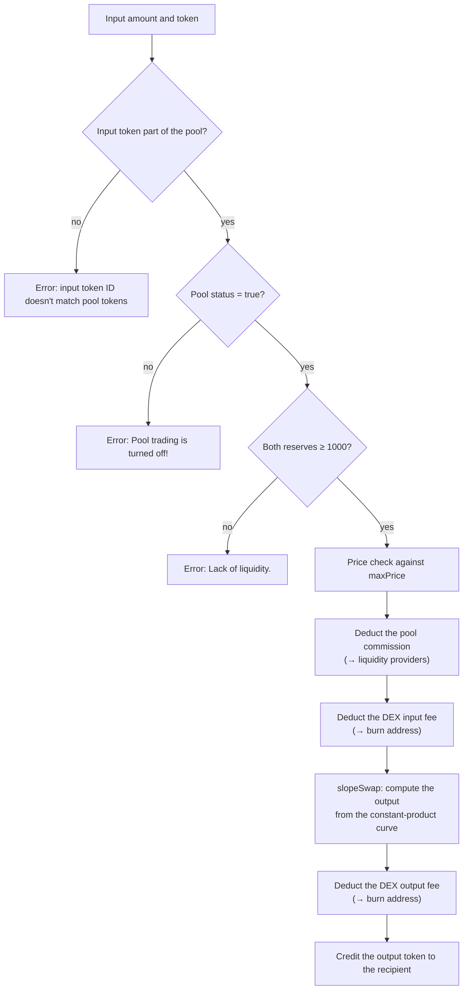

# Swapping and fees

A **swap** trades one token for another against a liquidity pool. This page
explains the exact order in which the node applies fees and computes the
output, how price limits protect you, how a **composite swap** routes a trade
across several pools, and what the pool commission and the DEX fee cost.

Part of the [DEX & Liquidity](index.md).

## The two swap transactions

| | Single swap | Composite swap |
| --- | --- | --- |
| DfTx type | `'s'` `PoolSwap` | `'i'` `PoolSwapV2` |
| RPC helper | `poolswap` | `compositeswap` |
| Number of pools | exactly one | up to 3 (`MAX_POOL_SWAPS`) |
| Available from | always | `DF11FortCanningHeight` |
| Route selection | none, the pool is looked up | automatic, see below |

Both RPCs take the same metadata:

```text
poolswap '{"from":"<address>","tokenFrom":"DFI","amountFrom":1.0,
           "to":"<address>","tokenTo":"BTC","maxPrice":0.5}'
```

`maxPrice` is the maximum acceptable price of `tokenTo` per unit of
`tokenFrom`. It is optional; if it is omitted the node uses the largest
valid price and the trade is only limited by the pool's liquidity.

`testpoolswap` runs the same calculation without submitting a transaction and
returns the result — use it to check a route and its output before you
commit.

## What happens during a swap

The whole calculation happens in `CPoolPair::Swap()`
(`src/dfi/poolpairs.cpp`), called from `CPoolSwap::ExecuteSwap()`
(`src/dfi/mn_checks.cpp`). The steps are always taken in this order:



1. **Token check** — the input token must be one of the two pool tokens,
   otherwise *"Error, input token ID (%s) doesn't match pool tokens"*.
2. **Status check** — a restricted pool rejects every trade with *"Pool
   trading is turned off!"*.
3. **Liquidity check** — both reserves must be at least
   `SLOPE_SWAP_RATE` (1000), otherwise *"Lack of liquidity."*.
4. **Price check** — the pool price is computed from the reserves *before*
   the trade and compared with `maxPrice`; if it is higher, the trade is
   rejected with *"Price is higher than indicated."*.
5. **Pool commission** — `tradeFee = amount × commission / 10⁸` is deducted
   from the input amount and booked as `blockCommissionA` or
   `blockCommissionB`. It is paid to the liquidity providers in the same
   block.
6. **DEX input fee** — `dexFeeIn = amount × dexInPct / 10⁸` is deducted from
   the (already reduced) input amount and **burned**.
7. **Price curve** — `slopeSwap()` computes the output from the reserves.
8. **DEX output fee** — `dexFeeOut = output × dexOutPct / 10⁸` is deducted
   from the output and **burned**.
9. **Credit** — the remaining output is credited to the recipient address.

!!! note "The fees are taken from the trader, not from the pool"

    Because the commission and the DEX fees are deducted *before* the curve is
    applied, the trader receives less than the raw curve result. The total
    cost of a swap is therefore
    `commission + dexInPct + dexOutPct` plus the price impact of the trade.

## Price limits

Two price checks exist, and they are not the same:

* **Before the trade** — `CPoolPair::Swap()` computes the pool price from
  the current reserves as `reserveF × 10⁸ / reserveT` (from
  `DF6DakotaHeight` on; the formula was inverted before that) and compares
  it with `maxPrice`. This check applies to a single swap.
* **After the trade** — for a composite swap the per-pool check is skipped
  (the maximum valid price is used for every hop) and the *effective* price
  of the whole route is checked afterwards:

  ```text
  amountFrom × 10⁸ / result  >  maxPrice  →  "Price is higher than indicated."
  ```

  This check exists since `DF11FortCanningHeight` and protects you from a
  route that looks cheap per hop but is expensive overall.

## Composite swaps

A composite swap routes a trade through two or three pools, for example
`DFI → BTC → USDT`. The node finds the route itself.

### How the route is found

`CPoolSwap::CalculatePoolPaths()` (`src/dfi/mn_checks.cpp`) collects all
pools and builds the candidate paths:

1. **Direct pools** — a pool that contains both the input and the output
   token.
2. **Two-hop paths** — every combination of a pool that contains the input
   token and a pool that contains the output token, provided both share an
   intermediate token.
3. **Three-hop paths** — pairs of those two pools that are themselves
   connected by a *bridge* pool containing the intermediate token.

`CPoolSwap::CalculateSwaps()` then executes every candidate path on a copy
of the view and keeps the path that yields the **largest output**. The
errors of the failing paths are collected and returned to the RPC caller, so
a failed route is reported with the reason it failed.

`compositeswap` uses this search itself when there is no usable direct pool:

```text
direct pool found and enabled  →  use it
otherwise                      →  search composite paths, pick the best
no path at all                 →  "Cannot find usable pool pair."
```

### Rules for composite swaps

| Rule | Value | Source |
| --- | --- | --- |
| Maximum number of pools per route | 3 | `MAX_POOL_SWAPS` in `src/dfi/mn_checks.h` |
| Route length limit enforced from | `DF14FortCanningHillHeight` | `src/dfi/mn_checks.cpp` |
| Last pool must contain the output token | enforced from `DF14FortCanningHillHeight` | `src/dfi/mn_checks.cpp` |
| Output token of the last hop must be the requested token | enforced from `DF20GrandCentralHeight` | `src/dfi/mn_checks.cpp` |
| Empty `to` address means "pay to `from`" | from `DF20GrandCentralHeight` | `src/dfi/mn_checks.cpp` |
| Pools with locked tokens abort the swap | always | `src/dfi/mn_checks.cpp` (`"Pool currently disabled due to locked token"`) |

The intermediate amounts never leave the transaction: the output of the
first hop is subtracted again in the second hop, so only the final amount is
credited to the recipient.

## The fees

### The pool commission

The commission belongs to a **single pool** and is set when the pool is
created (or changed with `updatepoolpair`). It is a percentage of the input
amount, between 0 and 100 %, and it is **not burned**: it is paid to the
liquidity providers of that pool in the block of the swap.

Both `createpoolpair` and `updatepoolpair` require **foundation or
governance authorisation** (`HasGovOrFoundationAuth()` in
`src/dfi/consensus/poolpairs.cpp`); the pool owner cannot change the
commission.

In a composite swap every pool on the route charges its own commission, so
a two-hop route costs the sum of two commissions.

### The DEX fee

The DEX fee is the second, DEX-wide surcharge. Unlike the commission it is
**burned**: it is credited to the burn address (`consensus.burnAddress` in
`src/chainparams.cpp`) and leaves the circulating supply.

The DEX fee is set per pool **and** per token by governance, as *attributes*:

| Attribute | Meaning |
| --- | --- |
| `v0/poolpairs/<poolId>/token_a_fee_pct` | DEX fee for the token A side of this pool |
| `v0/poolpairs/<poolId>/token_b_fee_pct` | DEX fee for the token B side of this pool |
| `v0/token/<tokenId>/dex_in_fee_pct` | DEX fee applied to this token as the *input* of a swap in every pool that holds it |
| `v0/token/<tokenId>/dex_out_fee_pct` | DEX fee applied to this token as the *output* of a swap in every pool that holds it |
| `v0/poolpairs/<poolId>/token_a_fee_direction` | whether the fee of token A is charged on the input, on the output or on both |
| `v0/poolpairs/<poolId>/token_b_fee_direction` | the same for token B |

The direction attribute takes the values `Both` (the default), `In` and
`Out` (`FeeDirValues` in `src/dfi/govvariables/attributes.h`). A fee is only
charged if the direction of that side allows it (`poolInFee()` and
`poolOutFee()` in `src/dfi/poolpairs.cpp`).

The lookup order is: the pool-specific value first, and the token-wide value
as a fallback (`GetDexFeeInPct()` and `GetDexFeeOutPct()` in
`src/dfi/poolpairs.cpp`). A fee above 100 % is rejected with *"Dex fee input
percentage over 100%"*.

### The DEX stabilisation fee

The **DEX stabilisation fee** is not a separate constant in the node code —
it is the DEX fee mechanism described above, used as the lever that
stabilises the DEX:

* Because the fee is set **per token**, governance can raise the fee of a
  token that is being traded heavily and lower it for a token that is not.
  The effect is that trading a token becomes more or less expensive without
  touching the pools themselves.
* Because the fee is **burned**, it leaves the supply of the fee token
  permanently instead of inflating the rewards of the liquidity providers.
* Because the fee is charged **on top of** the pool commission, it can be
  used independently of the incentive structure of a single pool.

The burned amounts are accounted: the DEX statistics keep the burned fees per
pool and per token side (`fee_burn_a` / `fee_burn_b` in
`src/dfi/govvariables/attributes.cpp`), and `getaccount` reports the totals
as `feeburn` and `dexfeetokens` (`src/dfi/rpc_accounts.cpp`).

For the BTC side of the DEX the equivalent lever is the **ICX taker fee**,
which is charged per BTC swapped in an atomic swap — see
[ICX atomic swaps](icx-atomic-swaps.md).

### Summary

| Fee | Charged on | Where it goes | Changeable by |
| --- | --- | --- | --- |
| Pool commission | the input amount of a swap | the liquidity providers of that pool | the foundation or governance, via `updatepoolpair` |
| DEX fee (in / out) | the input amount or the output of a swap | the burn address | governance, via attributes |
| ICX taker fee | every BTC swapped in an ICX order | the order owner (maker), plus a maker incentive | governance, via `ICX_TAKERFEE_PER_BTC` |
| Transaction fee | the transaction | the block reward of the masternode that mines it | the protocol |

## What is where

| Topic | Lives in |
| --- | --- |
| The swap transactions as DfTx | [DVM](../dvm/index.md) |
| The pools the trades happen in | [AMM and pools](amm-and-pools.md) |
| Governance attributes and proposals | [Governance](../governance/index.md) |
| The RPC reference for the pool commands | [RPC & CLI Reference](../../node-manual/rpc-cli/index.md) |
| The implementation | [Developer & Architecture Manual](../../developer-manual/index.md) |
