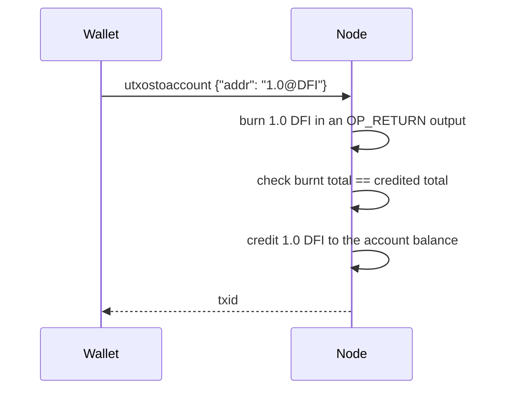

# Account transfers

This page describes the four account transactions of the DVM in detail: what
their payload looks like, which consensus rules they have to satisfy and how
to create them with the node's RPCs.

The account store itself is introduced in
[UTXO and accounts](../getting-started/utxo-and-accounts.md); the type
identifiers are listed in
[Custom transactions](custom-transactions.md).

## Authorisation

All four transactions that debit an account require the **auth** of the
debited address: the transaction must contain an input whose previous output
is locked by the same script as the account address, or by the mapped
counterpart of that address (a legacy or bech32 output authorises the
`erc55` address of the same key).

`HasAuth()` in `src/dfi/consensus/txvisitor.cpp` implements the check. If it
fails, the transaction is rejected with *tx must have at least one input from
account owner* (`DeFiErrors::InvalidAuth()` in `src/dfi/errors.h`).

## `UtxosToAccount` (`'U'`)

**Payload** (`CUtxosToAccountMessage`): a map of recipient address to token
balances.

```text
to = { <address> → { <token id> → <amount>, … }, … }
```

**Rules** (`CAccountsConsensus::operator()(const CUtxosToAccountMessage&)` in
`src/dfi/consensus/accounts.cpp`):

1. The converted value has to be **burnt in the same transaction**. The node
   sums up the token amounts of all `OP_RETURN` outputs of the transaction and
   compares them with the sum of the amounts that are credited to the
   accounts. If they differ, the transaction is rejected with *transfer tokens
   mismatch burnt tokens*.
2. On success, the accounts are credited.

There is no authorisation requirement for the recipients, but the funding
outputs have to be spendable by the sender.



## `AccountToUtxos` (`'b'`)

**Payload** (`CAccountToUtxosMessage`): the source account, the balances to
convert and the index of the first output that carries the minted value.

```text
from             = <address>
balances         = { <token id> → <amount>, … }
mintingOutputsStart = <index of the first minting output>
```

**Rules**:

1. The transaction must authorise `from`.
2. The node sums up the token amounts of the outputs starting at
   `mintingOutputsStart` and compares them with `balances`. A mismatch is
   rejected with *amount of minted tokens in UTXOs and metadata do not
   match*.
3. **Only DFI can be converted back.** Any other token id in `balances` is
   rejected with *only available for DFI transactions*.
4. On success, the account balance is debited and the minted outputs become
   spendable UTXOs.

## `AccountToAccount` (`'B'`)

**Payload** (`CAccountToAccountMessage`): one source account and a map of
recipients.

```text
from = <address>
to   = { <address> → { <token id> → <amount>, … }, … }
```

**Rules**: the transaction must authorise `from`; the sum of the amounts is
debited from `from` and credited to the recipients. The recipients do not
need to authorise anything.

This is the transaction to use when you move your own funds between accounts:
it costs one fee, it does not create change outputs, and it works for every
token, not only for DFI.

## `AnyAccountsToAccounts` (`'a'`)

**Payload** (`CAnyAccountsToAccountsMessage`): two maps of accounts and
balances.

```text
from = { <address> → { <token id> → <amount>, … }, … }
to   = { <address> → { <token id> → <amount>, … }, … }
```

**Rules**:

1. Every account in `from` must authorise the transaction.
2. The sum of `from` must equal the sum of `to`. A mismatch is rejected with
   *sum of inputs (from) != sum of outputs (to)*.

The type allows a single transaction to consolidate many accounts into one,
which is why some protocol operations use it internally.

## Creating the transactions

The node ships wallet RPCs for the common cases:

| RPC | Purpose |
| --- | --- |
| `utxostoaccount <amounts> [inputs]` | Convert UTXO value into account balances. `<amounts>` maps an address to `amount@token` values. |
| `accounttoaccount <from> <to> [inputs]` | Transfer tokens between accounts. |
| `accounttoutxos <from> <to> [inputs]` | Convert an account balance back into UTXOs. Only DFI is supported. |
| `sendutxosfrom <from> <to> <amount> [change]` | Ordinary UTXO send that spends the UTXOs of a specific sender address. |

Example:

```console
$ defi-cli utxostoaccount '{"myAddress":"1.0@DFI"}'
$ defi-cli accounttoaccount myAddress '{"otherAddress":"0.5@DFI"}'
```

The full RPC reference is part of the
[Node Software Manual](../../node-manual/rpc-cli/index.md).

## Fees and ordering

All four transactions are ordinary transactions and pay the ordinary fee.
Because they credit and debit account balances directly, they do not create
change outputs; the fee is the only difference between the amount that leaves
an account and the amount that arrives.

The account balance of an address is updated in the order the transactions
appear in a block. If two transactions spend the same account balance in the
same block, only the first one succeeds; the second one is rejected with an
insufficient balance error.

## Reference

* `src/dfi/accounts.h` — the four message structures and their serialisation.
* `src/dfi/consensus/accounts.cpp` — the consensus rules of the four
  transactions.
* `src/dfi/consensus/txvisitor.cpp` — the authorisation check.
* `src/dfi/rpc_accounts.cpp` — the wallet RPCs.
