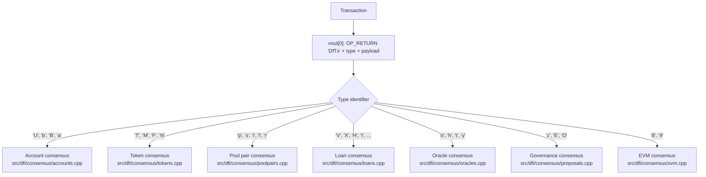

# DVM

The **DVM** (DeFi VM) is the native execution environment of DeFiChain. It is
the UTXO-based layer of the chain, and it adds *custom transactions* (DfTx) —
the transactions that implement every DeFi feature of the protocol: tokens,
liquidity pools, vaults and loans, oracles, masternodes and on-chain
governance.

Part of the [User & Protocol Manual](../index.md).

## Contents

| Document | What you learn |
| --- | --- |
| [Custom transactions](custom-transactions.md) | How a DfTx is encoded, which types exist and how to inspect one. |
| [Tokens and DAT](tokens-and-dat.md) | The token system: DFI as DAT, user tokens as DGT, liquidity pool shares and loan tokens. |
| [Account transfers](account-transfers.md) | The exact rules of the four account transactions, including the UTXO ↔ account conversions. |

## Why the DVM exists

A pure UTXO chain can pay addresses and it can run a scripting language, but
the DeFi features of DeFiChain need a state machine: they need to remember
balances per address, to update price oracles, to run auctions, to track
vaults and to apply governance decisions.

The DVM provides exactly that, without giving up the UTXO model:

* **Transactions stay ordinary transactions.** A DfTx has inputs, outputs and
  a fee, is signed like any other transaction and pays the ordinary fee rules.
* **The payload is interpreted by the node, not by a script.** The standard
  Bitcoin-style script subset is still there for ordinary payments and for
  spending conditions such as P2SH (`p2sh-segwit`) or multisig setups. A DfTx
  goes one step further: instead of a small script, the node decodes the DfTx
  metadata and runs the corresponding consensus module in `src/dfi/consensus/`.
  The DfTx layer is added on top of the script subset, it does not replace it.
* **Balances live in a separate account store.** The account store is written
  only by DfTx, so ordinary transactions cannot move account balances and DfTx
  cannot create value out of thin air: every DfTx is checked against the
  UTXO set, the account store and the fees.

## The two kinds of value

The DVM manages two balance models at the same time, the UTXO set and the
account store. The [UTXO and accounts](../getting-started/utxo-and-accounts.md)
page explains the difference; the practical consequence for DfTx authors is:

* Transactions that create value (a swap, a loan, a mint) write into the
  account store or into the coinbase, and the node checks that the amounts
  match the protocol rules.
* Transactions that move existing account value must authorise the sending
  account.

## Reading the rules

The consensus rules of every DfTx type live in `src/dfi/consensus/`. The
`CCustomTxVisitor` in `src/dfi/consensus/txvisitor.cpp` dispatches a decoded
transaction to the module that implements its type, and each module returns a
`Res` — either success or an error with a message. Those messages are what
you see when a transaction is rejected.

## Related sections

* [EVM](../evm/index.md) — the second layer of the chain and the cross-layer
  transfers.
* [Governance](../governance/index.md) — how protocol parameters are changed.
* [Node Software Manual](../../node-manual/rpc-cli/index.md) — the RPCs that
  create, sign and inspect these transactions.
