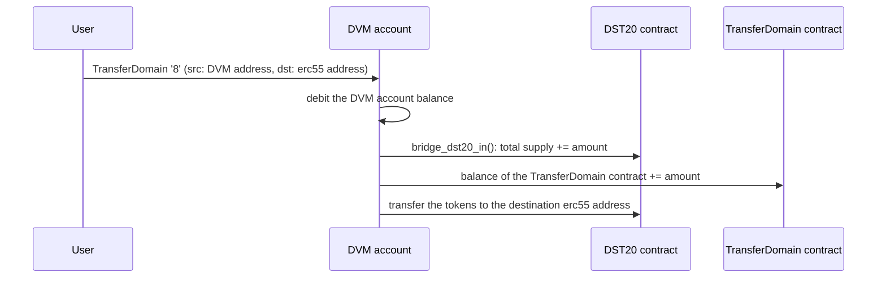

# DST20 bridging

**DST20** is the ERC-20-like representation of a DeFiChain token on the EVM
layer. Every *DAT* (DeFi Asset Token) has a DST20 contract, and the
[TransferDomain](transfer-domain.md) mechanism moves the token between the DVM
account store and that contract.

DFI itself is the exception: it is the **native currency** of the EVM. DFI is
never bridged through a DST20 contract — its balance moves as the plain
balance of the EVM account.

## Which tokens get a DST20 contract

A token gets a DST20 contract when it is

* a **DAT** — a token marked as a DeFi Asset Token on the DVM, and
* **not** a liquidity pool share.

The node enumerates exactly those tokens when the EVM state is prepared
(`getDST20Tokens()` in `src/ffi/ffiexports.cpp`) and deploys a contract for
each of them. Tokens that are not DATs — for example a plain DGT — cannot be
bridged; the node rejects such a transfer with
`Non-DAT or LP tokens are not supported for transferdomain`.

## The contract address is deterministic

The address of a DST20 contract is derived from the token id, so you can always
compute it:

```text
address = 0xff ++ zero-padded token id (38 hex characters)
```

Examples:

| Token id | DST20 address |
| --- | --- |
| `0` (DFI — bridged as the native balance) | `0xff00000000000000000000000000000000000000` |
| `128` | `0xff00000000000000000000000000000000000080` |
| `144` | `0xff00000000000000000000000000000000000090` |

(`dst20_address_from_token_id()` in `lib/ain-contracts/src/lib.rs`.)

To make sure that nobody can occupy these addresses with an unrelated
contract, the node deploys a *reserved* contract to the whole namespace of the
first 1024 addresses when the EVM state is created
(`reserve_dst20_namespace()` in `lib/ain-evm/src/contract/dst20.rs`).

## Layout of a DST20 contract

The DST20 contract is a proxy: the token logic lives in an implementation
contract, and the proxy forwards every call to it. The implementation that is
used depends on the height at which the token was deployed
(`dst20_name_info()` in `lib/ain-evm/src/contract/dst20.rs`):

| Height | Implementation |
| --- | --- |
| before `DF23Height` | DST20 v1 |
| from `DF23Height` | DST20 v2 |
| from `DF24Height` | DST20 v3 |

From `DF25Height` on, newly created DST20 contracts use the upgradeable DST20
bytecode; the node accepts both the legacy and the DF25 code hash when it
validates a bridge operation (`is_valid_dst20_codehash()` in
`lib/ain-contracts/src/lib.rs`).

The relevant storage slots of a token contract are:

| Slot | Content |
| --- | --- |
| `0` | Balance mapping — the balance of the **TransferDomain contract** holds the bridged amount. |
| `1` | Allowance mapping. |
| `2` | Total supply. |
| `3` | Token name. |
| `4` | Token symbol. |

Decimals are always **18** on the EVM side, while the DVM token usually has 8.
The node converts between the two when it bridges: an amount of `1.0` on the
DVM is `1e18` on the EVM.

## The TransferDomain contract

The DST20 contract does not hold the bridged balance itself. The **TransferDomain
contract** does, at the fixed address

```text
0xdf00000000000000000000000000000000000001
```

(`get_transfer_domain_contract()` in `lib/ain-contracts/src/lib.rs`). It is the
counterpart of the DVM account store for bridged tokens: the sum of the
balances held there is always equal to the amount of the token that is
currently on the EVM side.

## Bridging a token in (DVM → EVM)



Concretely, `bridge_dst20_in()` in `lib/ain-evm/src/contract/dst20.rs`

1. checks that the target address really holds a DST20 contract (the code
   hash has to be a valid DST20 code hash),
2. increases the total supply of the token by the bridged amount, and
3. sets the balance of the TransferDomain contract to that amount.

The transfer itself then moves the tokens from the TransferDomain contract to
the destination `erc55` address, exactly like an ordinary ERC-20 transfer.

Requirements: the feature attribute `v0/params/feature/transferdomain`, the
direction switch `v0/transferdomain/dvm-evm/enabled` and the DAT switch
`v0/transferdomain/dvm-evm/dat-enabled` have to be enabled.

## Bridging a token out (EVM → DVM)

The reverse direction works like this:

1. The node **subtracts** the amount from the balance of the TransferDomain
   contract and decreases the total supply of the token
   (`bridge_dst20_out()`).
2. The token is moved from the owner to the TransferDomain contract with the
   standard ERC-20 `transferFrom()` call, which the TransferDomain contract
   performs on the token contract.
3. The DVM account of the destination address is credited.

The `transferFrom()` in step 2 is executed with the TransferDomain contract as
the spender, so the token contract checks the allowance of the owner for that
spender. The node writes that allowance into the token contract as part of the
bridge transaction (`dst20_allowance()` in
`lib/ain-evm/src/contract/dst20.rs`), so **you do not have to call
`approve()` yourself** before bridging a token out.

After the bridge, the owner keeps the remainder of the bridged balance on the
EVM side and the bridged part is gone from the token contract — the sum of the
balances held by the TransferDomain contract is always equal to the amount of
the token that is currently on the EVM side.

Requirements: `v0/transferdomain/evm-dvm/enabled` and
`v0/transferdomain/evm-dvm/dat-enabled`.

## Token splits and locks

When a token is bridged back to the DVM, the DVM-side rules apply:

* From `DF23Height` on, a **token split** is executed on the received amount
  (`ExecuteTokenMigrationTransferDomain()` in `src/dfi/validation.cpp`), so the
  DVM account receives the amount in the *new* token.
* From `DF24Height` on, the **token lock** ratio is applied to the received
  amount (`ExecuteLockTransferDomain()`); the locked part is held by the token
  lock contract and only the remainder is credited to the account.

## Reading a DST20 balance

```bash
# balance of an address
eth_call '{"to":"0xff00000000000000000000000000000000000080",
           "data":"0x70a08231000000000000000000000000<erc55 address>"}' latest

# total supply
eth_call '{"to":"0xff00000000000000000000000000000000000080",
           "data":"0x18160ddd"}' latest
```

The selectors are the standard ERC-20 ones: `balanceOf(address)` is
`0x70a08231`, `totalSupply()` is `0x18160ddd`, `allowance(owner, spender)`
is `0xdd62ed3e` and `approve(spender, amount)` is `0x095ea7b3`.

On the DVM side, `getaccount <erc55 address>` shows the balance of the DVM
account that belongs to the same key.

## Restrictions at a glance

| Restriction | Reason |
| --- | --- |
| Only DAT tokens can be bridged | Liquidity pool shares and non-DAT tokens have no EVM representation. |
| DFI is not a DST20 | DFI is the native currency of the EVM. |
| The EVM side of a transfer must not be a smart contract | The bridge moves value to or from a plain account only. |
| A token can be excluded per direction | The governance configuration holds a disallowed-token list per direction (`dvmToEvmDisallowedTokens`, `evmToDvmDisallowedTokens`). |

## Related pages

* [TransferDomain](transfer-domain.md) — the transfer rules and the RPC.
* [Tokens and DAT](../dvm/tokens-and-dat.md) — what a DAT is.
* [Accounts and gas](accounts-and-gas.md) — units, fees and gas.
