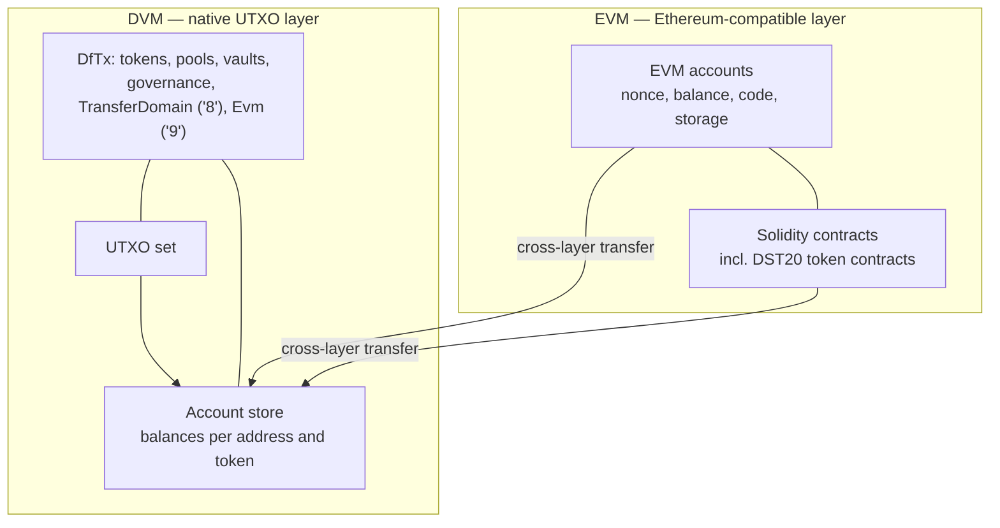

# EVM

The **EVM** is the Ethereum-compatible execution environment of DeFiChain. It
runs inside the node as a second execution layer next to the native
[DeFi VM](../dvm/index.md) and it hosts Solidity contracts, EVM-style accounts
and the ERC-20-like **DST20** tokens that mirror DeFiChain tokens.

Part of the [User & Protocol Manual](../index.md).

## Contents

| Document | What you learn |
| --- | --- |
| [MetaChain overview](metachain-overview.md) | What the EVM layer is, how it is anchored to the DVM, how to reach it and which transaction types it adds. |
| [Accounts and gas](accounts-and-gas.md) | EVM accounts, address formats, the gas model, the EIP-1559 base fee and where the fees go. |
| [TransferDomain](transfer-domain.md) | Moving value between the DVM and the EVM: the rules, the RPC, the governance switches and the failure modes. |
| [DST20 bridging](dst20-bridging.md) | How a DeFiChain token becomes an ERC-20-like contract on the EVM and how it is bridged back. |

## The two layers in one picture

DeFiChain has always been a UTXO chain with a custom-transaction layer. The
EVM was added on top of it, but it does **not** replace anything: both layers
run side by side and share one block sequence.

Every DVM block carries exactly one EVM block. The EVM block is produced by
the same masternode that produces the DVM block, and the two are tied together
by a hash edge that the node stores in its database, so the DVM chain and the
EVM chain can never drift apart silently.

## What is where

| Topic | Lives in |
| --- | --- |
| EVM concepts, accounts, gas, cross-layer transfers | this section |
| Native transactions, tokens, the DAT, account transfers | [DVM](../dvm/index.md) |
| Running an EVM-enabled node, ETH JSON-RPC port, wallets | [Node Software Manual](../../node-manual/index.md) |
| Implementation details of the EVM (Rust `ain` crate, FFI boundary) | [Developer & Architecture Manual](../../developer-manual/index.md) |

## Before you use the EVM

Two things have to be true before any EVM activity is possible, and both are
decided by the community:

1. **The height gate.** The EVM code path exists from the *Metachain*
   activation height onwards (`consensus.DF22MetachainHeight` in
   `src/consensus/params.h`; mainnet block `3,462,000`, 15 November 2023).
2. **The governance switch.** The feature attribute
   `v0/params/feature/evm` has to be set to `true` by an on-chain
   proposal (`IsEVMEnabled()` in `src/dfi/govvariables/attributes.cpp`).

Cross-layer transfers additionally require the *TransferDomain* feature
attribute `v0/params/feature/transferdomain` and the per-direction switches
described in [TransferDomain](transfer-domain.md).

## Related sections

* [DVM](../dvm/index.md) — the native layer and the custom transactions.
* [Wallets and addresses](../getting-started/wallets-and-addresses.md) — how
  the `erc55` address relates to the bech32 and legacy addresses of the same
  key.
* [Tokens and DAT](../dvm/tokens-and-dat.md) — which tokens exist on the DVM
  and which of them can be bridged.
