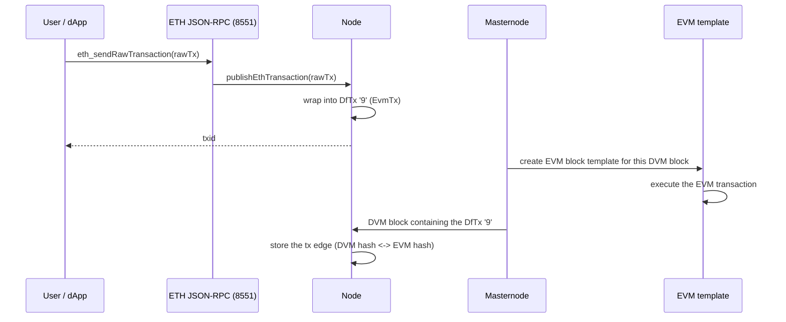

# MetaChain overview

This page explains what the EVM layer of DeFiChain is, how it is anchored to
the native layer, how you reach it and which transaction types it adds.

## What the "MetaChain" is

DeFiChain's EVM is **not a separate blockchain**. It is an Ethereum-compatible
execution environment that the node runs *inside* the DVM block production:

* The execution engine is written in Rust (`lib/ain-evm/`, exposed to C++ via
  `lib/ain-rs-exports/` and the FFI layer in `src/ffi/ffiexports.cpp`).
* The node keeps an EVM block template per DVM block. When a masternode builds
  a DVM block, it creates the matching EVM block template with
  `CScopedTemplate::Create()` (`src/dfi/evm.cpp`), which calls
  `evm_try_unsafe_create_template()` in the Rust side.
* The EVM block is committed together with the DVM block. The DVM coinbase
  carries an **XVM** payload that names the EVM beneficiary and the EVM
  parameters of that block (`XVM::TryFrom()` in
  `src/dfi/consensus/xvm.h`, used in `src/validation.cpp`).
* The EVM chain id is a network parameter: `1130` on mainnet, `1131` on
  testnet, `1132` on devnet and `1133` on Changi and regtest
  (`consensus.evmChainId` in `src/chainparams.cpp`). It is part of the
  signature of every EVM transaction, exactly like on Ethereum.

The consequence for a user is simple: **one EVM block per DVM block**, i.e. one
EVM block every 30 seconds, produced by the same masternode that produces the
DVM block.

## Anchoring the two chains together

Because both layers advance in lockstep, the node stores the relation between
them:

* `SetVMDomainBlockEdge()` / `GetVMDomainBlockEdge()` map an EVM block hash to
  the DVM block hash and back (`src/dfi/evm.cpp`, storage prefix `'N'`).
* `SetVMDomainTxEdge()` / `GetVMDomainTxEdge()` map an EVM transaction hash to
  the DVM transaction hash that carried it and back (storage prefix `'e'`).
* On startup the node verifies that the latest EVM block hash can be resolved
  to a known DVM block. If it cannot, the node refuses to start and asks for a
  `-reindex`, because a mismatch means the two databases disagree
  (`src/init.cpp`).

For you this means that an EVM transaction and the DVM transaction that
carried it always have a known pair of hashes, and that an EVM block is never
"ahead" of the DVM chain.

## Activation

The EVM code path exists from the *Metachain* activation height:

| Network | `DF22MetachainHeight` |
| --- | --- |
| Mainnet | `3,462,000` (15 November 2023) |
| Testnet | `1,150,040` |
| Changi | `1,586,750` |
| Devnet | `1,586,750` |
| Regtest | `10,000,000` (overridable with `-metachainheight`) |

The values live in `src/chainparams.cpp` and are exposed as the
`-metachainheight` command line override.

Reaching the height is not enough: the EVM is only *active* while the
governance attribute `v0/params/feature/evm` is `true`
(`IsEVMEnabled()` in `src/dfi/govvariables/attributes.cpp`). While the
attribute is `false`, the node does not create an EVM block template and
rejects EVM transactions.

## Talking to the EVM

The node exposes a second JSON-RPC server with the Ethereum namespace:

| Interface | Mainnet port | Regtest port |
| --- | --- | --- |
| ETH JSON-RPC (`eth_*`, `net_*`, `web3_*`) | `8551` | `19551` |
| ETH WebSocket (subscriptions, `eth_subscribe`) | `8553` | `19553` |
| DVM JSON-RPC (`defi_*`, `getaccount`, …) | `8554` | `19554` |

The ports come from `CBaseChainParams` in `src/chainparamsbase.cpp` and are
configurable with `-ethrpcport` and `-wsport`. The ETH RPC server must never
be exposed to an untrusted network — it can move funds.

An EVM transaction is submitted with `eth_sendRawTransaction`. The node wraps
the raw, RLP-encoded Ethereum transaction into a DfTx of type `'9'`
(`CustomTxType::EvmTx` in `src/dfi/customtx.h`), signs and broadcasts it as a
normal DVM transaction (`publishEthTransaction()` in `src/ffi/ffiexports.cpp`),
and executes it inside the EVM block of the DVM block that contains it.

## Reading EVM state

| Question | Where to look |
| --- | --- |
| DFI balance of an EVM address | `eth_getBalance` on the ETH RPC, or `gettokenbalances` with the `evm` flag on the DVM RPC |
| DVM account balance of an `erc55` address | `getaccount <erc55_address>` — the node maps the EVM address to the DVM account of the same key |
| Token (DST20) balance | `eth_call` on the token contract with `balanceOf(address)` |
| EVM block and transactions | `eth_getBlockByNumber`, `eth_getTransactionByHash` |
| Live statistics | `getgov ATTRIBUTES` (see [Accounts and gas](accounts-and-gas.md)) |

`gettokenbalances` with the `evm` flag set to `true` adds the DFI balances
that are held in the EVM layer to the result. It does **not** include DST20
tokens — those live in the token contract and are read with `eth_call`.

## Governance parameters of the EVM

The EVM behaviour is tuned by governance attributes, all under `v0/evm/block/`:

| Attribute | Default | Meaning |
| --- | --- | --- |
| `finality_count` | `100` | How many EVM blocks behind the tip the `safe` and `finalized` block tags point. |
| `gas_limit` | `30,000,000` | Maximum gas that may be used by one EVM block. |
| `gas_target_factor` | `2` | The gas target of a block is `gas_limit / gas_target_factor`; the base fee moves towards that target. |
| `rbf_increment_fee_pct` | `10` | How much a replacement transaction must increase the tip fee by. |

The defaults are defined in `src/ffi/ffiexports.h` (`DEFAULT_EVM_BLOCK_GAS_LIMIT`,
`DEFAULT_EVM_BLOCK_GAS_TARGET_FACTOR`, `DEFAULT_EVM_FINALITY_COUNT`,
`DEFAULT_EVM_RBF_FEE_INCREMENT`) and can be changed by an on-chain proposal.

## Related pages

* [Accounts and gas](accounts-and-gas.md) — the account model and the fee rules.
* [TransferDomain](transfer-domain.md) — moving value between the layers.
* [DST20 bridging](dst20-bridging.md) — tokens on the EVM.
