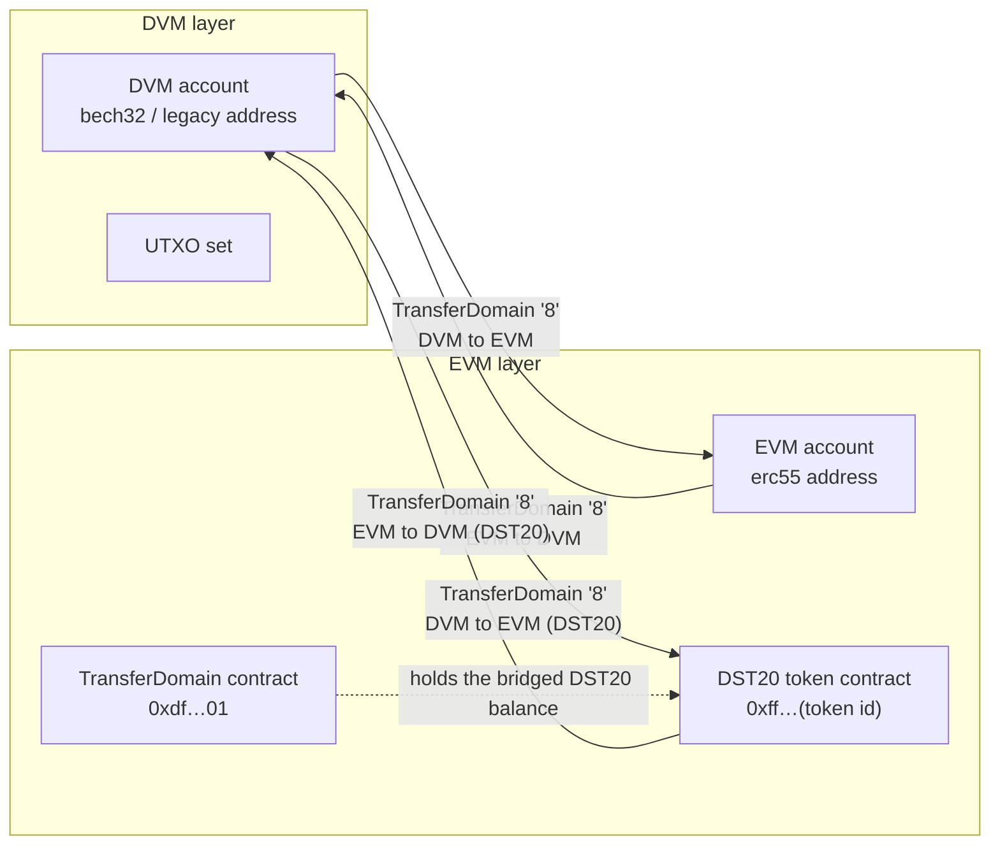

# TransferDomain

**TransferDomain** is the mechanism that moves value between the native DVM
layer and the EVM layer. It is the only way to get DFI onto the EVM, and the
only way to bring it back.

## What a cross-layer transfer is

A TransferDomain transaction is a DfTx of type `'8'`
(`CustomTxType::TransferDomain` in `src/dfi/customtx.h`) that carries exactly
one transfer. The transfer has a **source** and a **destination**, and each of
them has

* an **address** in one of the two address formats of its layer,
* an **amount** in the `amount@token` notation (`1.5@DFI`, `10.0@BTC`), and
* a **domain**: `2` for DVM, `3` for EVM (`VMDomain` in
  `src/dfi/consensus/xvm.h`).

The source and the destination must be in **different** domains, and they must
carry the **same token and the same value**. The consensus rules live in
`CXVMConsensus::operator()(const CTransferDomainMessage&)` in
`src/dfi/consensus/xvm.cpp`.



## The rules

These are the checks the node performs. They are consensus rules — a
transaction that violates one of them is rejected, not adjusted.

| Rule | Error message |
| --- | --- |
| The TransferDomain feature must be enabled (`v0/params/feature/transferdomain`) | `Cannot create tx, transfer domain is not enabled` |
| The EVM must be enabled for the block | `Cannot create tx, EVM is not enabled` |
| Only **one** transfer per transaction | `TransferDomain currently only supports a single transfer per transaction` |
| At most **one** input in the transaction | `Invalid transfer domain TX` |
| Source and destination must be in different domains | `Cannot transfer inside same domain` |
| Source and destination must carry the same amount | `Source amount must be equal to destination amount` |
| Source and destination must carry the same token | `Source token and destination token must be the same` |
| Only DFI or a **DAT** (never a liquidity pool share) can be transferred | `Non-DAT or LP tokens are not supported for transferdomain` |
| The direction must be enabled | `DVM to EVM is not currently enabled` / `EVM to DVM is not currently enabled` |
| DFI bridging must be enabled for that direction | `transferdomain for DFI from DVM to EVM is not enabled` (and the EVM → DVM variant) |
| DAT bridging must be enabled for that direction | `transferdomain for DST20 from DVM to EVM is not enabled` (and the EVM → DVM variant) |
| The address format must be allowed for that side | `Src address must be a legacy or Bech32 address in case of "DVM" domain`, `Dst address must be an ERC55 address in case of "EVM" domain` |
| The EVM side must not be a smart contract | `TransferDomain EVM source/destination is a smart contract` |
| The transaction must be authorised by the owner | `tx must have at least one input from account owner` |
| The embedded EVM transaction may not exceed 1024 bytes | `Excess data set, maximum allow is 1024` |

### Authorisation

Both directions need an input that proves ownership of the funds:

* **DVM → EVM:** the transaction must spend an output that is locked by the
  source DVM address (`HasAuth()` with the direct match, `src/dfi/consensus/txvisitor.cpp`).
* **EVM → DVM:** the transaction must spend an output of the DVM address that
  belongs to the **same key** as the source `erc55` address. The node accepts a
  legacy public key hash output or a bech32 witness output as proof
  (`HasAuth()` with `AuthStrategy::Mapped` and the flags
  `AuthFlags::PKHashInSource` / `AuthFlags::Bech32InSource`).

That is why an EVM-only wallet can still move funds back to the DVM: the
bech32 address of the same key authorises the transfer.

## Creating a transfer

### With the RPC

The node provides the `transferdomain` RPC on the DVM RPC port
(`src/dfi/rpc_accounts.cpp`):

```bash
defi-cli transferdomain \
  '[{"src":{"address":"<df1… address>","amount":"1.0@DFI","domain":2},
     "dst":{"address":"<0x… address>","amount":"1.0@DFI","domain":3}}]'
```

and in the other direction:

```bash
defi-cli transferdomain \
  '[{"src":{"address":"<0x… address>","amount":"1.0@DFI","domain":3},
     "dst":{"address":"<df1… address>","amount":"1.0@DFI","domain":2}}]'
```

The RPC does more than wrap the payload:

* It builds and **signs the EVM transaction** that performs the transfer on
  the EVM side and embeds it into the `data` field of the DfTx (at most
  1024 bytes, `MAX_TRANSFERDOMAIN_EVM_DATA_LEN` in
  `src/dfi/consensus/xvm.cpp`).
* It selects the authorisation inputs and pays the ordinary DVM fee.
* With `singlekeycheck` enabled (the default, `-tdsinglekeycheck`), it refuses
  the request unless the source and the destination belong to the **same key**.

Because the EVM transaction is signed by the node from the wallet key, the
transaction has to be created by a wallet that holds the key of the source
address.

### What happens on the DVM → EVM direction

1. The node checks that the DVM account holds the amount.
2. It debits the DVM account balance.
3. It credits the EVM side: for DFI the balance is moved to the EVM account of
   the destination, for a DAT the token is bridged into its
   [DST20 contract](dst20-bridging.md) and transferred to the destination.
   On the EVM side the TransferDomain contract at `0xdf…01` acts as the
   buffer that holds the value while it is being moved.
4. It records the hash edge between the DVM transaction and the EVM
   transaction, so both can be looked up from each other.

### What happens on the EVM → DVM direction

1. The node checks that the EVM side holds the amount and subtracts it: the
   DFI balance of the EVM account, or the DST20 balance of the token contract.
2. It credits the DVM account of the destination.
3. From the DF23 activation height on, a **token split** is applied to the
   received amount (`ExecuteTokenMigrationTransferDomain()` in
   `src/dfi/validation.cpp`); from DF24 on, the **token lock** ratio is
   applied to it (`ExecuteLockTransferDomain()`).

## Governance switches

Cross-layer transfers are controlled by governance attributes. All of them
live under the `transferdomain` attribute type and can be changed by an
on-chain proposal.

| Attribute | Default | Meaning |
| --- | --- | --- |
| `v0/params/feature/transferdomain` | `false` | Master switch for the feature. |
| `v0/transferdomain/dvm-evm/enabled` | `true` | Allow transfers from the DVM to the EVM. |
| `v0/transferdomain/dvm-evm/src-formats` | `p2pkh`, `bech32` | Address formats accepted as source. |
| `v0/transferdomain/dvm-evm/dest-formats` | `erc55` | Address formats accepted as destination. |
| `v0/transferdomain/dvm-evm/native-enabled` | `true` | Allow bridging DFI itself. |
| `v0/transferdomain/dvm-evm/dat-enabled` | `true` | Allow bridging DAT tokens (DST20). |
| `v0/transferdomain/evm-dvm/enabled` | `true` | Allow transfers from the EVM to the DVM. |
| `v0/transferdomain/evm-dvm/src-formats` | `erc55` | Address formats accepted as source. |
| `v0/transferdomain/evm-dvm/dest-formats` | `p2pkh`, `bech32` | Address formats accepted as destination. |
| `v0/transferdomain/evm-dvm/auth-formats` | `bech32-erc55`, `p2pkh-erc55` | Which DVM address types may authorise an `erc55` source. |
| `v0/transferdomain/evm-dvm/native-enabled` | `true` | Allow bridging DFI back. |
| `v0/transferdomain/evm-dvm/dat-enabled` | `true` | Allow bridging DAT tokens back. |

The defaults are the ones in `TransferDomainConfig::Default()`
(`src/dfi/mn_checks.cpp`); the node reads the effective configuration with
`TransferDomainConfig::From(mnview)`.

## Statistics

The node keeps live counters for the cross-layer flow:

```text
v0/live/economy/transferdomain/dvm-evm/<token id>/total   DVM -> EVM, cumulative
v0/live/economy/transferdomain/evm-dvm/<token id>/total   EVM -> DVM, cumulative
v0/live/economy/transferdomain/dvm/{in,out,current}/<token id>
v0/live/economy/transferdomain/evm/{in,out,current}/<token id>
```

Read them with `getgov ATTRIBUTES`.

## Checking a transfer

* `getcustomtx <txid>` shows the transfer with its source, destination,
  domains and amounts (the `src` and `dst` objects of the `transfers` array).
* `getaccount <erc55 address>` shows the DVM account of the same key.
* `eth_getBalance <erc55 address>` shows the EVM balance.

## Related pages

* [Accounts and gas](accounts-and-gas.md) — the units you are transferring.
* [DST20 bridging](dst20-bridging.md) — what happens to a bridged token.
* [Wallets and addresses](../getting-started/wallets-and-addresses.md) — the
  address formats and how they map to each other.
