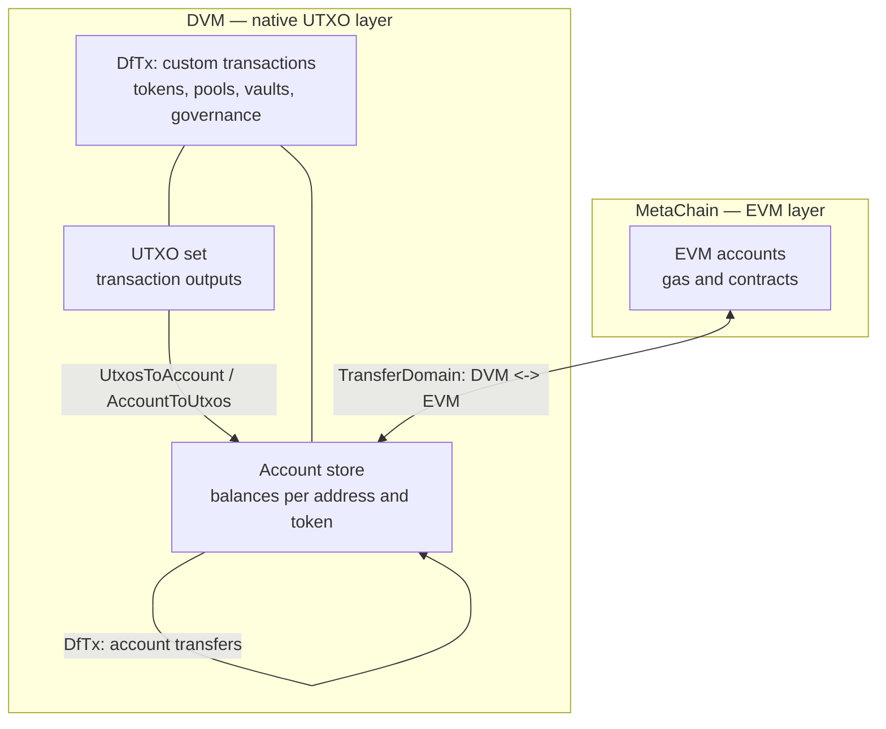
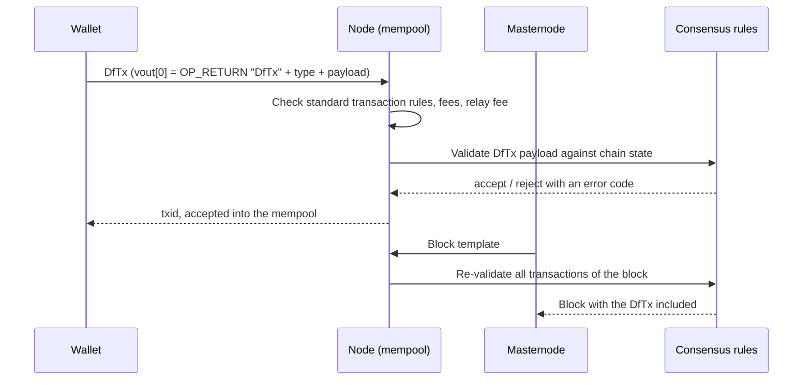

# Core concepts

This page introduces the vocabulary used throughout the
[User & Protocol Manual](../index.md). It describes what the chain is, how
blocks are produced, what a transaction costs and which kinds of transactions
exist.

## The two layers

DeFiChain consists of two connected layers:

* The **DVM** (DeFi VM) is the native, UTXO-based layer. It is a Bitcoin-like
  chain that stores value in transaction outputs and executes *custom
  transactions* (DfTx) instead of general-purpose scripts. Every DeFi feature
  of the protocol — tokens, liquidity pools, vaults, oracles, governance — is
  implemented as a DfTx on this layer.
* The **EVM** is an Ethereum-compatible virtual machine that runs on the
  MetaChain. It hosts Solidity contracts and holds EVM-style accounts.

The two layers are connected by an anchor mechanism and by cross-layer
transfers. The [EVM section](../evm/index.md) describes the MetaChain, gas
handling and the transfer of assets between the layers.

## Blocks, masternodes and confirmations

DeFiChain is a proof-of-stake chain: blocks are produced by **masternodes**
instead of by miners.

* The target block time is **30 seconds**, so a day consists of 2880 blocks
  (`consensus.pos.nTargetSpacing` in `src/consensus/params.h`).
* A masternode has to lock **20,000 DFI** as collateral since the Dakota
  hardfork; before that height the requirement was 1,000,000 DFI
  (`GetMnCollateralAmount()` in `src/dfi/masternodes.cpp`).
* A new masternode pays a creation fee of 10 DFI in addition to the collateral
  (`consensus.mn.creationFee` in `src/chainparams.cpp`).
* The reward of a coinbase output can only be spent after
  `COINBASE_MATURITY = 100` blocks (`src/consensus/consensus.h`, checked in
  `src/consensus/tx_verify.cpp`). There is no fixed settlement window for
  ordinary transactions — the number of confirmations you wait for is a risk
  decision, not a protocol rule. (`consensus.nMinerConfirmationWindow = 10` is
  unrelated to this: it is the BIP34 / versionbits deployment period used in
  `src/validation.cpp`.)

The [Staking & Masternodes section](../staking-masternodes/index.md) describes
collateral tiers, timelocks and the reward split in detail.

## Fees

Ordinary transactions pay a fee in DFI. The minimum relay fee defaults to
**1000 satoshi per kilobyte** (`DEFAULT_MIN_RELAY_TX_FEE` in
`src/validation.h`), i.e. `0.00001 DFI` per kB. Most DeFi actions cost more
than the bare relay fee, because they also create a custom transaction with
metadata.

Fees are always paid in DFI, even when the transaction moves other tokens. The
fee is deducted from the transaction inputs by the ordinary UTXO rules, before
the DfTx payload is interpreted.

## Transactions: ordinary and custom

A DeFiChain transaction is either an **ordinary transaction**, which moves DFI
or token amounts between outputs, or a **custom transaction (DfTx)**, which
carries a payload that the DVM interprets.

A DfTx is recognised by its first output: it contains a provably
non-spendable `OP_RETURN` output whose data starts with the four bytes `DfTx`,
followed by a one-byte type identifier and the type-specific metadata
(`GuessCustomTxType()` in `src/dfi/customtx.cpp`, marker in
`src/consensus/tx_check.cpp`).

The complete list of DfTx types is documented in
[Custom transactions](../dvm/custom-transactions.md).

## Tokens

Every value on the DVM is denominated in a **token**. Tokens are identified by
a numeric id (`DCT_ID`):

* `DCT_ID 0` is **DFI**, the only *DAT* (DeFi Asset Token). It is the fee
  currency, the staking currency and the collateral currency of the protocol.
* User-created tokens start at `DCT_ID 128`. They are *DGTs* (DeFi Governance
  Tokens) and are identified by symbol and id, for example `BTC#144`.
* Special token kinds are the liquidity pool shares (LPS) and the loan tokens
  (dTokens) that the loan system mints against vault collateral.

See [Tokens and DAT](../dvm/tokens-and-dat.md) for the rules that govern token
creation.

## Accounts

Because DeFiChain needs to execute complex DeFi logic, it adds an **account
layer** on top of the UTXO set. An account is identified by an address and
holds a balance per token, similar to an Ethereum account. Accounts are
credited and debited by DfTx, and the balance of an address can be queried
with the `getaccount` and `getbalances` RPCs.

The [UTXO and accounts](../getting-started/utxo-and-accounts.md) page explains
how the two balance models interact.

## Fees, prices and oracles

Protocol actions that need a price reference — loans, liquidations, futures
swaps — read it from **oracles**. An oracle is a masternode that publishes a
price for a currency or a token by submitting an oracle data transaction.
Oracles are appointed and removed by on-chain governance.

See [Loans & dTokens](../loans-dtokens/index.md) for the price flow and
[Governance](../governance/index.md) for the rules that govern oracle
appointments.

## Governance

Protocol parameters are not hard-coded forever. They are changed by
**on-chain governance**: community proposals (CFP), DeFi Improvement Proposals
(DFIP) and vote-of-confidence proposals (VOC) are submitted, voted on by
masternodes and, once accepted, applied by the node at a future height.

See the [Governance section](../governance/index.md).

## Where to go next

* [Wallets and addresses](wallets-and-addresses.md) — the address formats you
  will meet in wallets and RPC output.
* [UTXO and accounts](utxo-and-accounts.md) — where balances are stored.
* [DFI tokenomics](dfi-tokenomics.md) — the DFI token in detail.
