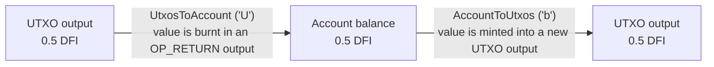

# UTXO and accounts

DeFiChain combines two balance models. The **UTXO model** is inherited from
Bitcoin and is the foundation of the chain; the **account model** is added on
top so that complex DeFi logic can be executed. This page explains what each
model stores, how they interact and how you move value between them.

## The UTXO model

In the UTXO model, value is stored in **transaction outputs**. Each output
holds an amount of one token and is locked by a script. Spending means
creating a new transaction that references the previous output as its input.

Consequences for users:

* A wallet does not "own an address with a balance"; it owns a set of outputs
  that are spendable by its keys. The balance shown by a wallet is the sum of
  those outputs.
* Every spend creates new outputs. Change is returned as a new output.
* Outputs of different tokens can be spent in the same transaction, which is
  how a swap or a collateral deposit is assembled.

The UTXO set is the source of truth for the coinbase and for the block
subsidy. Masternode rewards and pool rewards are credited as new outputs or as
account balances, depending on the reward address type.

## The account model

The account model stores, for every address, a **balance per token**. Accounts
are not derived from the UTXO set; they are a separate part of the chain
state, written and read by custom transactions.

Account state consists of:

* the token balances of the address,
* the *balances height* of the address, the height at which the balances were
  last updated. It is used to accrue pool rewards correctly across the period
  in which the address held its shares
  (`CAccountsView::GetBalancesHeight()` in `src/dfi/accounts.h`),
* futures swap positions and token lock values of the address.

Accounts are the model used by most DeFi features: liquidity pools, vaults,
loans, oracles and governance all operate on account balances.

## Authorisation

An account can only be debited by a transaction that carries the **auth** of
the owning address. Auth is proven by an input of the transaction whose
previous output is locked by the same script as the account address
(`HasAuth()` in `src/dfi/consensus/txvisitor.cpp`).

The node also accepts the **mapped** form of an address as an equivalent
authorisation: a legacy base58 address and its EVM-style (`0x…`,
[ERC-55](https://eips.ethereum.org/EIPS/eip-55) checksummed) counterpart
refer to the same key, and a bech32 address maps to the same EVM-style
address. This is what allows a user to sign a DVM transaction with the key
that controls the EVM address of the same wallet.

An address can hold value in both models at the same time. The two balances
are independent and are not merged automatically.

## Converting between the models

Two custom transactions move value across the boundary:

* **`UtxosToAccount`** (type `'U'`) converts UTXO value into account value.
  The tokens that are converted are burnt in the same transaction: they are
  paid to `OP_RETURN` outputs. The node requires the burnt amounts to match
  the amounts credited to the accounts exactly, otherwise the transaction is
  rejected with a *transfer tokens mismatch burnt tokens* error
  (`CAccountsConsensus::operator()(const CUtxosToAccountMessage&)` in
  `src/dfi/consensus/accounts.cpp`).
* **`AccountToUtxos`** (type `'b'`) converts account value back into spendable
  UTXOs. The transaction must authorise the account and must mint exactly the
  amounts stated in its metadata. **Only DFI can be converted back** in the
  current implementation; the node rejects the transaction with *only
  available for DFI transactions* if another token is included.

Other account-level transfers do not cross the boundary:

* **`AccountToAccount`** (type `'B'`) moves tokens between two accounts.
* **`AnyAccountsToAccounts`** (type `'a'`) moves tokens between many accounts
  in one transaction; the sum of the inputs must equal the sum of the outputs.

## Which model should I use?

| Situation | Model |
| --- | --- |
| Receiving funds from an exchange or another user | Either, depending on the sender. |
| Paying fees for a DeFi action | Account, because DeFi actions are custom transactions that operate on accounts. |
| Staking and masternode collateral | Account. |
| Moving funds between your own wallets | Account, with `AccountToAccount` or `AnyAccountsToAccounts`. |
| Consuming an output that was created before you started using accounts | UTXO, then convert with `UtxosToAccount`. |

Converting back and forth is possible, but every conversion is an extra
transaction with an extra fee, and only DFI can leave the account layer again.
Most wallets keep the account balance as the primary representation.

## Reference

* `src/dfi/accounts.h` — account store: balances, balances height, futures
  swaps and token locks.
* `src/dfi/consensus/accounts.cpp` — the consensus rules of the four account
  transactions.
* `src/dfi/customtx.h` — the type identifiers `'U'`, `'b'`, `'B'` and `'a'`.

For the exact transaction payloads and the wallet-facing RPCs, see
[Account transfers](../dvm/account-transfers.md).
