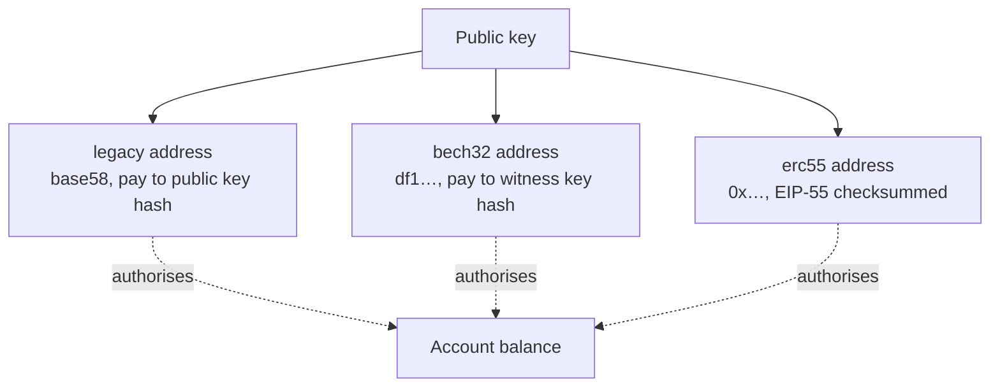

# Wallets and addresses

This page explains the address formats a DeFiChain wallet can use, how the
node derives them from a key, and how authorisation of account transactions
works.

## Address formats

The node supports four address types. They are selected with the
`address_type` argument of `getnewaddress` and `getrawchangeaddress`, or with
the `-addresstype` and `-changetype` node options.

| Type | Format | Script | Typical use |
| --- | --- | --- | --- |
| `legacy` | Base58Check, starts with `8` on mainnet | Pay to public key hash | The historical DeFiChain address type; still the most widely supported by external services. |
| `p2sh-segwit` | Base58Check, starts with `d` on mainnet | Pay to script hash | Scripts and multisig-style setups. |
| `bech32` | `df1…` on mainnet, `tf1…` on test networks | Pay to witness v0 key hash | SegWit-style addresses of the DVM. |
| `erc55` | `0x…`, EIP-55 checksummed | Not a spendable destination on its own | The EVM-style form of the same key. |

The human readable prefix of the bech32 format is network specific: `df` on
mainnet, `tf` on testnet and Changi, `bcrt` on regtest
(`bech32_hrp` in `src/chainparams.cpp`).

The `erc55` form is derived from the public key: the node takes the Ethereum
address identifier of the key and renders it with the
[ERC-55 checksum](https://eips.ethereum.org/EIPS/eip-55), so the address is
always prefixed with `0x` and uses mixed-case hex
(`DestinationEncoder::operator()(const WitnessV16EthHash&)` in
`src/key_io.cpp`).

## Address types and authorisation

The node treats the legacy address, the bech32 address and the `erc55` address
of the same key as **the same identity** for authorisation purposes. When a
DfTx must authorise an account, the node looks for an input whose previous
output is locked by:

* the same script as the account address (direct match), or
* the mapped counterpart of the account address — a legacy public key hash
  output authorises the `erc55` address of the same key, and a bech32 witness
  key hash output authorises the `erc55` address of the same key.

This is implemented by `HasAuth()` with the `AuthFlags::PKHashInSource` and
`AuthFlags::Bech32InSource` options in `src/dfi/consensus/txvisitor.cpp`.

Because of this mapping, a user who controls only the EVM-side key of a
wallet can still authorise DVM account transactions, and vice versa.

## Key types in the node

Internally, keys are tracked with a bit mask (`KeyType` in
`src/script/standard.h`):

* `PKHashKeyType` — legacy public key hash.
* `WPKHashKeyType` — bech32 witness key hash.
* `ScriptHashKeyType` — script hash.
* `EthHashKeyType` — Ethereum-style key hash, the basis of the `erc55`
  address.

Masternode and governance keys use the combination of key types that the
address type of the respective role allows; for example a masternode owner
address may be a legacy or a bech32 address.

## Wallet organisation

A DeFiChain wallet usually holds three kinds of material:

* **Keys** that derive addresses. A single key can produce a legacy, a bech32
  and an `erc55` address.
* **UTXO outputs** that are spendable by those keys. `listunspent` shows them,
  `getbalance` aggregates them per token.
* **Account balances**, which are not owned by the wallet but by the
  address. `getbalances` returns the account balances of the wallet's
  addresses, `getaccount` returns the balances of one address and
  `listaccounts` iterates over all accounts on chain.

Because account balances live on chain and not in the wallet, a restored
wallet recovers its account balances as soon as it rescans the chain, even
though it never held the corresponding keys locally.

## Practical notes

* Send funds to the address type your counterparty expects. Legacy addresses
  are accepted by every service; the other types are increasingly common.
* When you move value between your own addresses, use account transfers
  (`AccountToAccount`) instead of ordinary transactions. They cost less and do
  not create change outputs. See
  [Account transfers](../dvm/account-transfers.md).
* Never share a private key or an extended private key (`xprv`). Node
  operators should prefer remote signing; see the
  [Node Software Manual](../../node-manual/index.md).

## Reference

* `src/key_io.cpp` — encoding and decoding of addresses, including the
  ERC-55 checksum.
* `src/script/standard.h` — address destinations and key types.
* `src/dfi/consensus/txvisitor.cpp` — authorisation rules.
* `src/wallet/rpcwallet.cpp` — `getnewaddress`, `getbalance`, `listunspent`.
* `src/dfi/rpc_accounts.cpp` — `getaccount`, `getbalances`, `listaccounts`.
