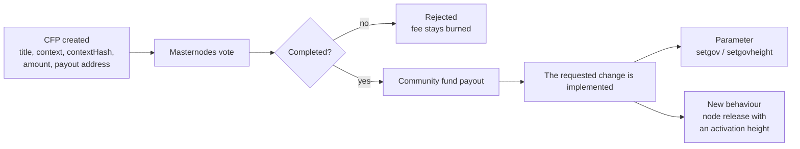

# CFPs and DFIPs

A **Community Fund Proposal (CFP)** is the instrument that carries a request
of the community to the network. It asks for money from the community fund and
— in practice — for a change of the protocol.

This page explains how a CFP is written, what it costs to create one, what
happens while it is being voted on, and how it becomes an implemented change.

Part of the [Governance](index.md) section.

## What a CFP consists of

| Field | Meaning | Limit | Source |
| --- | --- | --- | --- |
| `title` | the headline of the proposal | 1 … 128 bytes | `MAX_PROPOSAL_TITLE_SIZE` in `src/dfi/proposals.h` |
| `context` | the text of the proposal | 1 … 512 bytes | `MAX_PROPOSAL_CONTEXT_SIZE` in `src/dfi/proposals.h` |
| `contextHash` | the hash of the document the context refers to | ≤ 512 bytes | `CProposalObject` in `src/dfi/proposals.h` |
| `amount` | the amount requested from the community fund, in DFI | less than `MAX_MONEY` | `CProposalsConsensus::operator()` in `src/dfi/consensus/proposals.cpp` |
| `payoutAddress` | the address that receives the amount | a valid destination | `CProposalsConsensus::operator()` in `src/dfi/consensus/proposals.cpp` |
| `cycles` | the number of voting cycles | 1 … `cfp_max_cycles` (100 by default) | `MAX_CYCLES` in `src/dfi/proposals.h` |
| `options` | the flags of the proposal; `Emergency` is only allowed for a VOC | — | `CProposalOption` in `src/dfi/proposals.h` |

The **context** is short by design: the full specification of a request does
not fit into 512 bytes. It therefore points to a document outside the chain,
and `contextHash` is the hash of that document. This is the place where the
**DFIP** — the technical specification of the requested change — is referenced.
The chain stores only the hash, the title and a short summary; the document
itself lives outside the chain and is immutable because of the hash.

## Creating a CFP

```bash
defi-cli creategovcfp \
  '{"title":"Increase the DFI reward of the liquidity providers",
    "context":"The daily DFI reward should be raised to 6 DFI, see the DFIP at https://example.org/dfip",
    "contextHash":"4a1b...",
    "amount":100,
    "payoutAddress":"df1q...",
    "cycles":2}' \
  '[{"txid":"...","vout":0}]'
```

The transaction is a custom transaction of type `'z'` `CreateCfp`. Its first
output carries the **creation fee**; the metadata of the output contains the
proposal. The proposal identifier is the hash of the transaction.

The consensus code rejects the transaction when

* on-chain governance is not enabled (*"Cannot create tx, on-chain governance
  is not enabled"*),
* the transaction has no input of the payout address (*"tx must have at least
  one input from proposal account"*) — the payout address must therefore be an
  account you control,
* the title or the context is empty, or longer than the limits above
  (*"proposal title must not be empty"*, *"proposal context cannot be more
  than 512 bytes"*),
* the number of cycles is outside the allowed range (*"proposal cycles can be
  between 1 and 100"*),
* the amount is not the agreed fee (*"malformed tx vouts (wrong creation
  fee)"*).

## The cost of a CFP

The creation fee of a CFP is

```text
fee = max( 1 % of the requested amount , 10 DFI )
```

The percentage is the attribute `v0/gov/proposals/cfp_fee`, the minimum is
`consensus.props.cfp.minimumFee` of the network
(`GetProposalCreationFee()` in `src/dfi/masternodes.cpp`). A CFP that asks for
1 000 DFI therefore costs 10 DFI, and one that asks for 100 000 DFI costs
1 000 DFI.

The fee is **not** returned if the proposal is rejected. It is split:

| Share | Where it goes | Source |
| --- | --- | --- |
| 50 % (`v0/gov/proposals/fee_burn_pct`) | burned | `ApplyCustomTx()` in `src/dfi/mn_checks.cpp` (`CreateCfp`/`CreateVoc` branch) |
| the rest | the masternodes that voted, if `v0/gov/proposals/fee_redistribution` is enabled | `ProcessProposalEvents()` in `src/dfi/validation.cpp` |

The redistribution happens at the end of every voting cycle. The remaining
part that cannot be distributed exactly is burned as well. The details are in
[Voting and quorum](voting-and-quorum.md#the-fee-and-its-redistribution).

## The community fund payout

When a CFP is **completed** — the quorum and the approval threshold have been
reached in the last cycle — and the attribute
`v0/params/feature/gov-payout` is enabled, the node

1. subtracts the requested amount from the community fund
   (`CommunityAccountType::CommunityDevFunds`),
2. credits the amount to the payout address of the proposal,
3. calculates the owner rewards of that address.

If the community fund does not cover the requested amount, the payout fails
and is logged as *"Fails to subtract community developement funds"* — the
proposal itself still counts as completed.

!!! note

    The payout is a **payment from the community fund**, not from the
    proposer. The creation fee is never refunded.

## From a CFP to a DFIP



A **CFP** is the request and the vote; a **DFIP** is the specification of how
the request is implemented. The chain executes only the part it understands —
the payout. The protocol change itself is applied afterwards:

* **Existing parameters** are changed with `setgov` or `setgovheight`, for
  example `v0/params/feature/…` switches, the fees of the loan module or the
  governance parameters of this section.
* **New behaviour** requires a new release of the node and an activation
  height. Such a height is a `DF*Height` parameter in
  `src/consensus/params.h` and is listed in the
  [Developer & Architecture Manual](../../developer-manual/consensus/index.md).

Until the change is applied, the network keeps the old behaviour. A CFP that
has been completed does not change the protocol by itself.

## Votes of Confidence

A **Vote of Confidence (VOC)** is the second kind of proposal. It moves no
money and asks for nothing; it states that the masternodes still have
confidence in the team that steers the protocol.

| Property | Value |
| --- | --- |
| DfTx type | `'E'` `CreateVoc` |
| Amount | always 0 |
| Payout address | must be empty |
| Cycles | 1 (`VOC_CYCLES`) |
| Creation fee | 100 DFI on mainnet, 50 DFI on testnet, changi and devnet, 5 DFI on regtest |
| Approval threshold | more than 66.67 % |

```bash
defi-cli creategovvoc \
  '{"title":"Vote of confidence","context":"The team continues to work on the roadmap"}'
```

A **VOC can also be emergency**. An emergency VOC uses the option
`Emergency`, and then

* it may only have **one cycle**, and the voting period is the much shorter
  *emergency period* (8 640 blocks, three days, by default),
* the quorum is the higher *emergency quorum* (10 % of the active
  masternodes, by default),
* the creation fee is 10 000 DFI.

```bash
defi-cli creategovvoc \
  '{"title":"Emergency vote of confidence","context":"...","emergency":true}'
```

The emergency option is rejected for a CFP (*"only vote of confidence allowed
with emergency option"*) and a normal VOC with more than one cycle is rejected
as well (*"proposal cycles should be 1"*).

## Where to go next

* [Voting and quorum](voting-and-quorum.md) — who votes and when the result
  is counted.
* [On-chain governance](on-chain-governance.md) — the variables a completed
  CFP changes.
