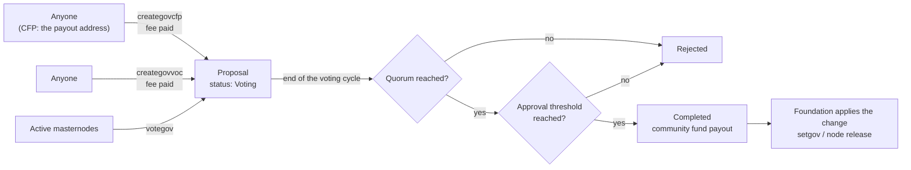
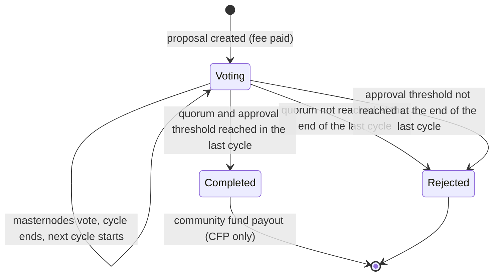

# Governance

DeFiChain has **on-chain governance**: the protocol parameters that decide how
the network behaves are changed by *proposals* that **masternodes vote on**.
There is no single person who can switch a rule on; a rule changes when a
majority of the voting masternodes agrees.

Two kinds of proposals exist:

* a **Community Fund Proposal (CFP)** asks the network to fund something from
  the community fund, and — by convention — carries the request to change the
  protocol,
* a **Vote of Confidence (VOC)** expresses the confidence of the masternodes
  in the current team. It moves no money and asks for nothing.

This section explains how a proposal is created, how it is paid for, how the
voting works, and how the result of the vote is turned into a changed
parameter.

Part of the [User & Protocol Manual](../index.md).

## Contents

| Document | What you learn |
| --- | --- |
| [On-chain governance](on-chain-governance.md) | The actors, the governance variables and attributes, the difference between a CFP and a VOC, and how a proposal travels from a transaction to a rule change. |
| [CFPs and DFIPs](cfps-and-dfips.md) | How a CFP is written, what it costs, how the community fund payout works, and how an approved CFP becomes an implemented DFIP. |
| [Voting and quorum](voting-and-quorum.md) | Who may vote, when the votes are counted, the quorum and approval thresholds, the cycle rules and the redistribution of the proposal fee. |

## Governance in one minute



* A **proposal** is a custom transaction with a title, a context and — for a
  CFP — an amount and a payout address. Its identifier is the hash of that
  transaction.
* The **fee** is paid at creation. It is not returned when the proposal is
  rejected.
* **Masternodes vote** on it. A masternode may vote only if it is active and
  has mined at least one block, and the vote must be signed by its owner.
* At the end of the **voting cycle** the votes are counted: the proposal must
  reach the **quorum** (how many masternodes take part) and the **approval
  threshold** (how many of them say yes).
* A completed CFP is paid out of the **community fund**; the requested
  protocol change is then applied by the foundation — either as a governance
  variable or in a new node release.

## Who decides what

| Actor | Can do | Cannot do |
| --- | --- | --- |
| Any account | create a CFP or a VOC and pay the fee | vote |
| Masternode owner | vote with the masternode | create a proposal for free — the fee applies |
| Foundation member | change every governance variable and attribute | vote for another masternode |
| Governance member (from `DF24Height`) | change governance variables and attributes, except the foundation ones | change the foundation members |

## Which transaction do I need?

Every governance action is a custom transaction (DfTx) with its own one-byte
type identifier, as defined in `src/dfi/customtx.h`.

| Action | DfTx type | RPC helper | Consensus code |
| --- | --- | --- | --- |
| Create a community fund proposal | `'z'` `CreateCfp` | `creategovcfp` | `src/dfi/consensus/proposals.cpp` |
| Create a vote of confidence | `'E'` `CreateVoc` | `creategovvoc` | `src/dfi/consensus/proposals.cpp` |
| Vote on a proposal | `'O'` `Vote` | `votegov`, `votegovbatch` | `src/dfi/consensus/proposals.cpp` |
| Set a governance variable | `'G'` `SetGovVariable` | `setgov` | `src/dfi/consensus/governance.cpp` |
| Schedule a governance variable change | `'j'` `SetGovVariableHeight` | `setgovheight` | `src/dfi/consensus/governance.cpp` |
| Unset a governance variable | `'Z'` `UnsetGovVariable` | `unsetgov` | `src/dfi/consensus/governance.cpp` |
| Unset a scheduled change | `'-'` `UnsetGovHeightVariable` | `unsetgovheight` | `src/dfi/consensus/governance.cpp` |
| Cancel all scheduled changes | `'+'` `ClearGovHeights` | `cleargovheights` | `src/dfi/consensus/governance.cpp` |

The general shape of a DfTx is explained in
[Custom transactions](../dvm/custom-transactions.md).

## The numbers at a glance

| Parameter | Value | Source |
| --- | --- | --- |
| CFP creation fee | the greater of 1 % of the requested amount and 10 DFI | `GetProposalCreationFee()` in `src/dfi/masternodes.cpp` |
| CFP approval threshold (mainnet) | more than 50 % of the yes votes | `consensus.props.cfp.approvalThreshold` in `src/chainparams.cpp` |
| CFP maximum number of cycles | 100 | `MAX_CYCLES` in `src/dfi/proposals.h` |
| VOC creation fee (mainnet) | 100 DFI | `consensus.props.voc.fee` in `src/chainparams.cpp` |
| VOC creation fee (testnet, changi, devnet) | 50 DFI | `consensus.props.voc.fee` in `src/chainparams.cpp` |
| Emergency VOC creation fee | 10 000 DFI | `consensus.props.voc.emergencyFee` in `src/chainparams.cpp` |
| VOC approval threshold | more than 66.67 % of the yes votes | `consensus.props.voc.approvalThreshold` in `src/chainparams.cpp` |
| Number of cycles of a normal VOC | 1 | `VOC_CYCLES` in `src/dfi/proposals.h` |
| Quorum | 1 % of the active masternodes | `consensus.props.quorum` in `src/chainparams.cpp` |
| Quorum of an emergency VOC | 10 % of the active masternodes | `GetQuorumFromAttributes()` in `src/dfi/masternodes.cpp` |
| Voting period (mainnet) | 130 000 blocks (≈ 45 days) | `consensus.props.votingPeriod` in `src/chainparams.cpp` |
| Voting period (testnet, changi, devnet) | 70 000 blocks | `consensus.props.votingPeriod` in `src/chainparams.cpp` |
| Emergency voting period | 8 640 blocks (3 days) | `consensus.props.emergencyPeriod` in `src/chainparams.cpp` |
| Maximum length of the proposal title | 128 bytes | `MAX_PROPOSAL_TITLE_SIZE` in `src/dfi/proposals.h` |
| Maximum length of the proposal context | 512 bytes | `MAX_PROPOSAL_CONTEXT_SIZE` in `src/dfi/proposals.h` |
| Share of the creation fee that is burned | 50 % | `consensus.props.feeBurnPct` in `src/chainparams.cpp` |

!!! note

    Every number in this table can be changed by governance itself. The values
    above are the defaults of the respective network in
    `src/chainparams.cpp`; the values that are actually in force are the
    *attributes* of the `ATTRIBUTES` governance variable, which can be read
    with `getgov ATTRIBUTES`.

## The two kinds of proposal

| | Community Fund Proposal | Vote of Confidence |
| --- | --- | --- |
| DfTx type | `'z'` `CreateCfp` | `'E'` `CreateVoc` |
| Requests an amount | yes, from the community fund | no, the amount is always 0 |
| Has a payout address | yes | no, the address must be empty |
| Who may create it | anyone, but the transaction must contain an input of the payout address | anyone |
| Approval threshold | more than 50 % | more than 66.67 % |
| Emergency variant | not possible | possible, with a shorter voting period and a higher fee |
| Typical use | request funds and a protocol change | signal the confidence of the masternodes in the team |

## The lifecycle of a proposal



The status is not a stored field of the proposal; it is derived from the
cycle index and the vote counters (`CProposalView::GetProposal()` in
`src/dfi/proposals.cpp`). A proposal that is still in the last cycle and has
not been rejected yet is *completed* the moment the last cycle ends.

## Governance variables and attributes

The parameters themselves are **governance variables**. The most important one
is `ATTRIBUTES`, a map of key/value pairs that covers everything from the
feature switches to the fees of the loan module:

```text
v0/params/feature/gov                 on-chain governance is enabled
v0/params/feature/gov-payout          approved CFPs are paid from the community fund
v0/gov/proposals/cfp_fee              creation fee of a CFP, in percent
v0/gov/proposals/cfp_approval_threshold   approval threshold of a CFP, in percent
v0/gov/proposals/voc_fee              creation fee of a VOC, in DFI
v0/gov/proposals/voc_emergency_fee    creation fee of an emergency VOC, in DFI
v0/gov/proposals/voc_emergency_period voting period of an emergency VOC, in blocks
v0/gov/proposals/voc_emergency_quorum quorum of an emergency VOC, in percent
v0/gov/proposals/quorum               quorum, in percent
v0/gov/proposals/voting_period        length of a voting cycle, in blocks
v0/gov/proposals/cfp_max_cycles       maximum number of cycles of a CFP
```

Besides `ATTRIBUTES` there are the special variables `LP_SPLITS`,
`LP_LOAN_TOKEN_SPLITS`, `LP_DAILY_DFI_REWARD`, `LP_DAILY_LOAN_TOKEN_REWARD`,
`LOAN_LIQUIDATION_PENALTY`, `ORACLE_DEVIATION`, `ORACLE_BLOCK_INTERVAL` and
`ICX_TAKERFEE_PER_BTC`. They are read with `getgov <NAME>` and changed with
`setgov`.

## Where to go next

* [On-chain governance](on-chain-governance.md) — the actors, the attributes
  and the path from a proposal to a changed rule.
* [CFPs and DFIPs](cfps-and-dfips.md) — how a CFP is written, what it costs
  and how it is paid out.
* [Voting and quorum](voting-and-quorum.md) — the rules that decide whether a
  proposal passes.
* [Staking & Masternodes](../staking-masternodes/index.md) — what a
  masternode is and how it becomes eligible to vote.
* [Loans & dTokens](../loans-dtokens/index.md) — the module with the largest
  number of governance parameters.
