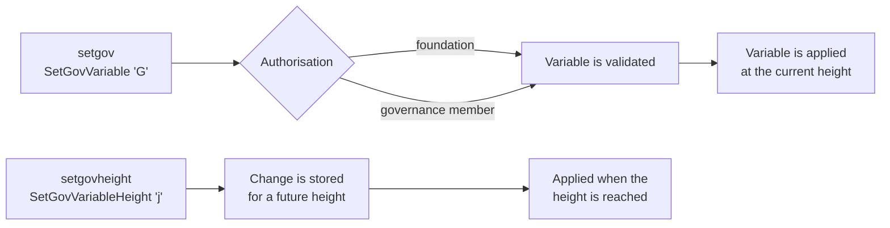
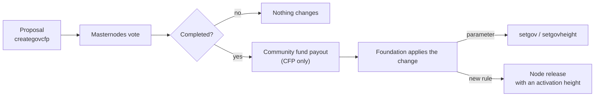

# On-chain governance

*On-chain governance* is the mechanism that lets the network change its own
rules. A rule is not changed by an operator and not by a hard fork alone: a
proposal is created on the chain, the masternodes vote on it, and the result
is applied by the foundation — either immediately as a **governance variable**
or later, in a node release, as a **DFIP**.

This page describes the actors, the variables they change and the path a
proposal takes from a transaction to a changed rule.

Part of the [Governance](index.md) section.

## The switch: `v0/params/feature/gov`

On-chain governance is only active when the attribute
`v0/params/feature/gov` is set to `true`. As long as it is not, the node
rejects every proposal with

```text
Cannot create tx, on-chain governance is not enabled
```

(`CProposalsConsensus::IsOnChainGovernanceEnabled()` in
`src/dfi/consensus/proposals.cpp`).

While the switch is off, the balance of the community fund is returned to the
foundation address instead of being paid out (`ProcessProposalEvents()` in
`src/dfi/validation.cpp`).

## The actors

| Actor | Where it is defined | What it may do |
| --- | --- | --- |
| **Foundation members** | `v0/params/foundation/members` | change every governance variable and attribute, including the foundation member list itself |
| **Governance members** | `v0/params/governance/members` | change the governance variables and attributes, except the foundation ones — available from `DF24Height` (`AuthManager::HasGovernanceAuth()` in `src/dfi/consensus/txvisitor.cpp`) |
| **Masternode owners** | masternode record | vote on proposals with their masternode |
| **Everyone** | — | create a proposal and pay the fee |

The authorisation rules are:

* `SetGovVariable` (`'G'`) and `UnsetGovVariable` (`'Z'`) require **foundation
  authorisation** (`HasFoundationAuth()` in
  `src/dfi/consensus/governance.cpp`).
* `SetGovVariableHeight` (`'j'`), `UnsetGovHeightVariable` (`'-'`) and
  `ClearGovHeights` (`'+'`) accept **foundation or governance
  authorisation** (`HasGovOrFoundationAuth()`).
* Governance members may not change `v0/params/foundation/members` and
  `v0/params/feature/gov-foundation`; for these keys the foundation
  authorisation is mandatory (`CanSetGovInternal()` in
  `src/dfi/consensus/txvisitor.cpp`).

## Governance variables

A **governance variable** is a named, typed value that the chain reads while
it validates transactions. Two kinds exist.

### `ATTRIBUTES`

`ATTRIBUTES` is a map of key/value pairs that covers the feature switches, the
fees and the parameters of the protocol modules. Its keys are addressed by a
path of the form `v0/<type>/<id>/<key>`:

```text
v0/params/feature/gov                       on-chain governance is enabled
v0/params/feature/gov-payout                approved CFPs are paid from the community fund
v0/params/feature/gov-unset                 governance variables may be unset
v0/params/foundation/members                the addresses of the foundation members
v0/params/governance/members                the addresses of the governance members
v0/params/governance/govheight_min_blocks   minimum distance of a scheduled change
v0/gov/proposals/cfp_fee                    creation fee of a CFP, in percent
v0/gov/proposals/cfp_approval_threshold     approval threshold of a CFP, in percent
v0/gov/proposals/cfp_max_cycles             maximum number of cycles of a CFP
v0/gov/proposals/voc_fee                    creation fee of a VOC, in DFI
v0/gov/proposals/voc_emergency_fee          creation fee of an emergency VOC, in DFI
v0/gov/proposals/voc_emergency_period       voting period of an emergency VOC, in blocks
v0/gov/proposals/voc_emergency_quorum       quorum of an emergency VOC, in percent
v0/gov/proposals/voc_approval_threshold     approval threshold of a VOC, in percent
v0/gov/proposals/quorum                     quorum, in percent
v0/gov/proposals/voting_period              length of a voting cycle, in blocks
v0/gov/proposals/fee_burn_pct               share of the creation fee that is burned
v0/gov/proposals/fee_redistribution         the rest of the fee is paid to the voters
```

The full list of keys and their types is in
`src/dfi/govvariables/attributes.cpp`; the accepted paths are the entries of
`allowedTypes()`, `allowedParamIDs()` and `allowedKeys()`.

### The special variables

Besides `ATTRIBUTES` there are a handful of dedicated variables. They are
read by the modules they belong to:

| Variable | What it controls | Source |
| --- | --- | --- |
| `LP_SPLITS` | how the daily DEX rewards are split between the liquidity pools | `src/dfi/govvariables/lp_splits.cpp` |
| `LP_LOAN_TOKEN_SPLITS` | how the daily loan rewards are split between the liquidity pools | `src/dfi/govvariables/loan_splits.cpp` |
| `LP_DAILY_DFI_REWARD` | the daily DFI reward of the liquidity providers | `src/dfi/govvariables/lp_daily_dfi_reward.cpp` |
| `LP_DAILY_LOAN_TOKEN_REWARD` | the daily reward of the dToken liquidity providers (legacy variable) | `src/dfi/govvariables/loan_daily_reward.cpp` |
| `LOAN_LIQUIDATION_PENALTY` | the penalty the first bid of a liquidation auction has to pay | `src/dfi/govvariables/loan_liquidation_penalty.cpp` |
| `ORACLE_DEVIATION` | how far the next oracle price may deviate from the active one | `src/dfi/govvariables/oracle_deviation.cpp` |
| `ORACLE_BLOCK_INTERVAL` | how often the fixed-interval price feeds are refreshed | `src/dfi/govvariables/oracle_block_interval.cpp` |
| `ICX_TAKERFEE_PER_BTC` | the taker fee of an ICX order | `src/dfi/govvariables/icx_takerfee_per_btc.cpp` |

The variables are read with `getgov <NAME>` and `listgovs`, and written with
`setgov` and `unsetgov` (`src/dfi/mn_rpc.cpp`):

```bash
defi-cli getgov ATTRIBUTES
defi-cli getgov LP_SPLITS
defi-cli listgovs
```

## Changing a variable



* `setgov` applies the change **immediately**, at the height of the
  transaction.
* `setgovheight` stores the change and applies it when the given height is
  reached. The height must lie at least `v0/params/governance/govheight_min_blocks`
  blocks in the future; otherwise the transaction is rejected with *"Height
  must be %d blocks above the current height"*.
* `unsetgov` and `unsetgovheight` remove a variable again. They require the
  attribute `v0/params/feature/gov-unset` to be enabled.
* `cleargovheights` cancels all scheduled changes.

Two rules deserve attention:

* A variable is **validated before it is applied**. An invalid value — for
  example a split that does not add up to 1, or an oracle deviation below the
  minimum — is rejected and the transaction fails
  (`CGovernanceConsensus::operator()(const CGovernanceMessage &)` in
  `src/dfi/consensus/governance.cpp`).
* `ORACLE_BLOCK_INTERVAL` may only be changed at the end of an oracle
  interval. A change that arrives in the middle of an interval is stored as a
  pending change for the end of that interval.

## From a proposal to a changed rule



A CFP is a **request**, not an execution: the node does not interpret the
text of a proposal. What the chain does automatically after a CFP is approved
is the **payout** of the requested amount from the community fund — and only
if the attribute `v0/params/feature/gov-payout` is enabled. Everything else —
the actual protocol change — is applied by the foundation afterwards:

* If the change is a **parameter that exists as a governance variable or
  attribute**, it is applied with `setgov` or `setgovheight`.
* If the change is **new behaviour of the node**, it is implemented in a
  release and activated at a height (`DF*Height`). The list of the activation
  heights is documented in the
  [Developer & Architecture Manual](../../developer-manual/consensus/index.md).

This is why a CFP is normally accompanied by a *DFIP*: the **CFP** is the
community request and the vote, the **DFIP** is the technical specification
that describes how the requested change is implemented. The two belong
together, but only the CFP lives on the chain.

## Reading the state

| Question | Command |
| --- | --- |
| What are the current attributes? | `getgov ATTRIBUTES` |
| What is the value of one special variable? | `getgov LP_SPLITS` |
| Which governance variables exist, including scheduled changes? | `listgovs` |
| Which proposals are running? | `listgovproposals` |
| What does one proposal look like? | `getgovproposal <proposalId>` |
| How did the masternodes vote? | `listgovproposalvotes <proposalId>` |

## Where to go next

* [CFPs and DFIPs](cfps-and-dfips.md) — how a CFP is written and paid out.
* [Voting and quorum](voting-and-quorum.md) — how a proposal passes.
* [Staking & Masternodes](../staking-masternodes/index.md) — the masternodes
  that do the voting.
