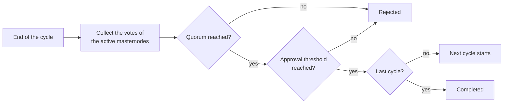

# Voting and quorum

A proposal only becomes a decision when the masternodes vote on it. This page
explains who may vote, when the votes are counted, and the two thresholds —
**quorum** and **approval threshold** — that decide whether a proposal passes.

Part of the [Governance](index.md) section.

## Who may vote

Only a masternode votes, and only under three conditions
(`CProposalsConsensus::operator()(const CProposalVoteMessage &)` in
`src/dfi/consensus/proposals.cpp`):

1. the masternode must **exist**,
2. it must be **active** at the current height (`CMasternode::IsActive()`),
3. it must have **mined at least one block**.

In addition, the vote transaction must contain an input of the **owner
address** of the masternode (*"tx must have at least one input from the
owner"*). The operator of a masternode cannot vote for it; only the owner
can.

Three answers are possible: `yes`, `no` and `neutral`. A neutral vote counts
as participation, but — since `DF22MetachainHeight` — it is excluded from the
denominator of the approval threshold.

```bash
defi-cli votegov <proposalId> <masternodeId> yes
defi-cli votegovbatch '[["<proposalId>","<masternodeId1>","yes"],["<proposalId>","<masternodeId2>","no"]]'
```

`votegovbatch` takes a **single array argument** whose entries are triples of
proposal id, masternode id and decision; every entry must have exactly three
items, otherwise the RPC rejects the call (*"Incorrect number of items, three
expected"*). The masternode id may also be given as the operator or owner
address. The optional second argument is a sleep time in milliseconds between
the individual vote transactions (default: 500).

The vote is a custom transaction of type `'O'` `Vote` and carries the
proposal id, the masternode id and the vote. The votes are stored per
proposal, per cycle and per masternode (`CMnVotePerCycle` in
`src/dfi/proposals.h`); a masternode that votes twice in the same cycle
replaces its own earlier vote.

## The voting cycle

The length of a voting cycle is the attribute
`v0/gov/proposals/voting_period` (130 000 blocks on mainnet by default,
roughly 45 days at 30 seconds per block).

The cycles of a proposal are aligned to the voting period. A proposal created
at height `h` with a voting period `P` ends its first cycle at

```text
h + (P − h mod P) + P
```

and its last cycle at

```text
h + (P − h mod P) + P × cycles
```

(`CProposalView::CreateProposal()` in `src/dfi/proposals.cpp`). A proposal
therefore never ends in the middle of a voting period, and all proposals of
the same period are counted at the same height.

An **emergency VOC** is the exception: it has exactly one cycle, which ends
after the *emergency period* (`v0/gov/proposals/voc_emergency_period`, 8 640
blocks by default).

## How the votes are counted

At the end of every cycle the node counts the votes of that cycle
(`ProcessProposalEvents()` in `src/dfi/validation.cpp`):



### The voters

Only votes of masternodes that are active **and** have mined at least one
block at the height of the counting are counted. A vote of an inactive or
never-mining masternode is ignored.

### The quorum

The quorum is the share of the active masternodes that must take part. It is
the attribute `v0/gov/proposals/quorum` (1 % by default).

```text
participation = voters × 10000 / active masternodes
```

If the participation is **not greater** than the quorum, the proposal is
rejected — *"Rejected"* — even if every vote that was cast says yes. The
emergency VOC uses its own, higher quorum
(`v0/gov/proposals/voc_emergency_quorum`, 10 % by default).

### The approval threshold

The approval threshold is the share of the votes that must say yes. It
depends on the type of the proposal:

| Proposal | Attribute | Default |
| --- | --- | --- |
| Community Fund Proposal | `v0/gov/proposals/cfp_approval_threshold` | more than 50 % |
| Vote of Confidence | `v0/gov/proposals/voc_approval_threshold` | more than 66.67 % |

Since `DF22MetachainHeight` the neutral votes are removed from the
denominator:

```text
approval = yes × 10000 / (voters − neutral)
```

Before that height the neutral votes were counted in the denominator:

```text
approval = yes × 10000 / voters
```

If the approval is **not greater** than the threshold, the proposal is
rejected. A cycle in which *all* votes are neutral is always rejected.

### The result

* If the quorum or the threshold is not reached, the proposal is **rejected**
  and the remaining cycles are dropped.
* If both are reached and the last cycle has ended, the proposal is
  **completed**.
* If both are reached and there are cycles left, the next cycle starts. The
  quorum and the threshold are read **again** from the attributes at that
  moment (`CProposalView::UpdateProposalCycle()` in `src/dfi/proposals.cpp`),
  so governance can change the rules while a proposal is running.

## The fee and its redistribution

The creation fee of a proposal is paid when the proposal is created and is
never returned. Half of it is burned; the other half can be paid to the
masternodes that voted (`v0/gov/proposals/fee_redistribution`).

At the end of a cycle, the share that is not burned is divided equally among
the masternodes that voted in that cycle:

```text
amount per voter = (fee − burned fee) / number of voters
```

Each voter receives the amount on its **reward address** — or on its owner
address if no reward address is set. The part that cannot be distributed
exactly is burned as well.

The redistribution is recorded in the account history as a transaction of type
`'Y'` `ProposalFeeRedistribution`.

## Reading the result

```bash
defi-cli getgovproposal <proposalId>
defi-cli listgovproposals --status voting
defi-cli listgovproposalvotes <proposalId>
```

`getgovproposal` reports the current status (`Voting`, `Rejected` or
`Completed`), the cycle, the quorum and the approval threshold in force, and
the number of yes, no and neutral votes. `listgovproposals` filters by type
and status; both filters take lower-case values only:

| Filter | Accepted values |
| --- | --- |
| `--type` | `cfp`, `voc`, `all` |
| `--status` | `voting`, `rejected`, `completed`, `all` |

Any other value is rejected by the RPC (*"type supports cfp/voc/all"*,
*"status supports voting/rejected/completed/all"*). The long type names
(`CommunityFundProposal`, `VoteOfConfidence`) are only the *output* strings of
`getgovproposal`, not accepted filter values.

## Where to go next

* [CFPs and DFIPs](cfps-and-dfips.md) — what a proposal asks for and what it
  costs.
* [Staking & Masternodes](../staking-masternodes/index.md) — how a
  masternode becomes active and able to vote.
