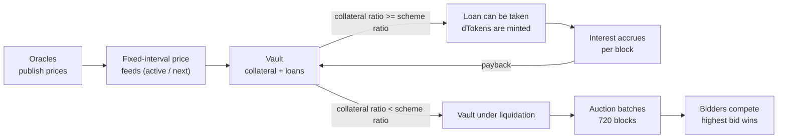
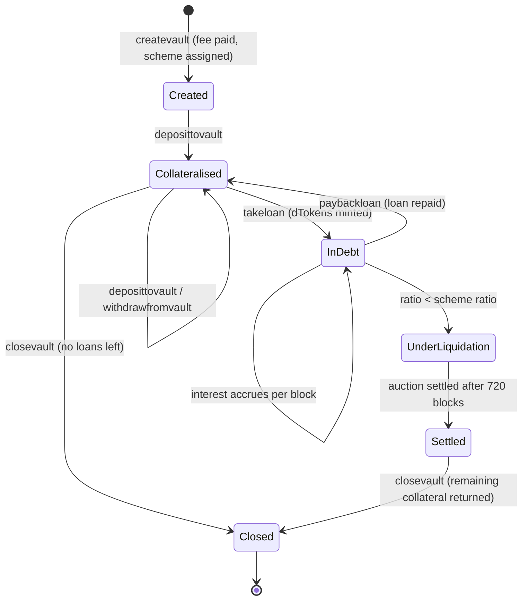

# Loans & dTokens

The **loan module** of DeFiChain lets you lock collateral in a *vault* and
borrow **dTokens** against it. A dToken is an ordinary token on the chain
(`DUSD`, `dBTC`, …) that represents a debt: whoever holds it has a claim on
the vault that minted it. As long as the vault stays sufficiently
collateralised, nobody loses anything. If the value of the collateral falls
below the loan scheme's minimum ratio, the vault is liquidated and the dToken
is auctioned off to the highest bidder.

Everything in this module depends on **prices**, and prices come from
**oracles** — appointed price feeds that publish a price for a token/currency
pair. If the oracle feeds go stale, the module freezes: no new loans, no
withdrawals, no paybacks.

Part of the [User & Protocol Manual](../index.md).

## Contents

| Document | What you learn |
| --- | --- |
| [Vaults and collateral](vaults-and-collateral.md) | What a vault is, how it is created, funded and closed, how the collateralisation ratio is computed and which collateral tokens are accepted. |
| [Loans and dTokens](loans-and-dtokens.md) | How dTokens are defined, how a loan is taken, how the interest accrues and how a loan is paid back. |
| [Oracles and prices](oracles-and-prices.md) | How oracles are appointed, how their prices are aggregated into the fixed-interval price feeds the loan module uses, and what happens when a feed goes stale. |
| [Liquidation auctions](liquidation-auctions.md) | How a vault is liquidated, how the collateral is split into auction batches and how the bidding and the settlement work. |

## The loan module in one minute

* A **vault** holds collateral (for example DFI and dBTC) and records the
  loans taken against it. Its identifier is the hash of the transaction that
  created it.
* A **loan scheme** defines the minimum collateralisation ratio (in percent)
  and the annual interest rate (in percent) that apply to a vault.
* A **dToken** is minted when a loan is taken and burned when it is paid
  back. The dToken itself never matures — the interest is accounted for
  inside the vault.
* The **collateralisation ratio** is `collateral value ÷ loan value × 100`.
  When it drops below the ratio of the vault's loan scheme, the vault is
  liquidated.
* **Oracles** feed the prices. Without a live price for every token in the
  vault, the vault cannot be changed.

## Which transaction do I need?

Every action in the loan module is a custom transaction (DfTx) with its own
one-byte type identifier, as defined in `src/dfi/customtx.h`.

| Action | DfTx type | RPC helper | Consensus code |
| --- | --- | --- | --- |
| Create a vault | `'V'` `Vault` | `createvault` | `src/dfi/consensus/vaults.cpp` |
| Close a vault | `'e'` `CloseVault` | `closevault` | `src/dfi/consensus/vaults.cpp` |
| Update a vault (owner, scheme) | `'v'` `UpdateVault` | `updatevault` | `src/dfi/consensus/vaults.cpp` |
| Deposit collateral | `'S'` `DepositToVault` | `deposittovault` | `src/dfi/consensus/vaults.cpp` |
| Withdraw collateral | `'J'` `WithdrawFromVault` | `withdrawfromvault` | `src/dfi/consensus/vaults.cpp` |
| Register a collateral token | `'c'` `SetLoanCollateralToken` | `setcollateraltoken` | `src/dfi/consensus/loans.cpp` |
| Register a dToken (loan token) | `'g'` `SetLoanToken` | `setloantoken` | `src/dfi/consensus/loans.cpp` |
| Update a dToken | `'x'` `UpdateLoanToken` | `updateloantoken` | `src/dfi/consensus/loans.cpp` |
| Create / update a loan scheme | `'L'` `LoanScheme` | `createloanscheme`, `updateloanscheme` | `src/dfi/consensus/loans.cpp` |
| Set the default loan scheme | `'d'` `DefaultLoanScheme` | `setdefaultloanscheme` | `src/dfi/consensus/loans.cpp` |
| Destroy a loan scheme | `'D'` `DestroyLoanScheme` | `destroyloanscheme` | `src/dfi/consensus/loans.cpp` |
| Take a loan (mint dTokens) | `'X'` `TakeLoan` | `takeloan` | `src/dfi/consensus/loans.cpp` |
| Pay back a loan | `'H'` `PaybackLoan` / `'k'` `PaybackLoanV2` | `paybackloan` | `src/dfi/consensus/loans.cpp` |
| Pay back a loan with vault collateral | `'W'` `PaybackWithCollateral` | `paybackwithcollateral` | `src/dfi/consensus/loans.cpp` |
| Bid on an auction batch | `'I'` `AuctionBid` | `placeauctionbid` | `src/dfi/consensus/vaults.cpp` |
| Appoint an oracle | `'o'` `AppointOracle` | `appointoracle` | `src/dfi/consensus/oracles.cpp` |
| Update an oracle appointment | `'t'` `UpdateOracleAppoint` | `updateoracle` | `src/dfi/consensus/oracles.cpp` |
| Remove an oracle appointment | `'h'` `RemoveOracleAppoint` | `removeoracle` | `src/dfi/consensus/oracles.cpp` |
| Publish oracle prices | `'y'` `SetOracleData` | `setoracledata` | `src/dfi/consensus/oracles.cpp` |

The general shape of a DfTx is explained in
[Custom transactions](../dvm/custom-transactions.md). Registering collateral
tokens, dTokens, loan schemes and oracles requires **foundation or
governance authorisation**; everything else is a normal user action that
only needs the signature of the vault owner or of the payer.

## The numbers at a glance

| Parameter | Value | Source |
| --- | --- | --- |
| Blocks per day (mainnet, 30 s blocks) | 2880 | `blocksPerDay()` in `src/consensus/params.h` |
| Blocks per year used by the interest formula | 1 051 200 | `InterestPerBlockCalculationV3()` in `src/dfi/loan.cpp` |
| Minimum collateralisation ratio of a loan scheme | 100 % | `CLoansConsensus::operator()(const CLoanSchemeMessage &)` in `src/dfi/consensus/loans.cpp` |
| Minimum interest rate of a loan scheme | 0.01 % | `CLoansConsensus::operator()(const CLoanSchemeMessage &)` in `src/dfi/consensus/loans.cpp` |
| Maximum length of a loan scheme identifier | 8 characters | `CLoansConsensus::operator()(const CLoanSchemeMessage &)` in `src/dfi/consensus/loans.cpp` |
| Vault creation fee (default, mainnet) | 2 DFI | `consensus.vaultCreationFee` in `src/chainparams.cpp` |
| Vault creation fee (default, testnet/changi/devnet/regtest) | 1 DFI | `consensus.vaultCreationFee` in `src/chainparams.cpp` |
| Refund of the creation fee when a vault is closed | half of the fee | `CVaultsConsensus::operator()(const CCloseVaultMessage &)` in `src/dfi/consensus/vaults.cpp` |
| Interval of the collateralisation-ratio check | 30 blocks (15 min) | `blocksCollateralizationRatioCalculation()` in `src/consensus/params.h` |
| Duration of a liquidation auction | 720 blocks (6 h) | `blocksCollateralAuction()` in `src/consensus/params.h` |
| Collateral value per auction batch | 10 000 USD | `batchThreshold` in `CollectAuctionBatches()` in `src/dfi/validation.cpp` |
| First bid of an auction batch | at least the batch amount plus the liquidation penalty | `CVaultsConsensus::operator()(const CAuctionBidMessage &)` in `src/dfi/consensus/vaults.cpp` |
| Minimum raise of a follow-up bid | 1 % above the current bid | `CVaultsConsensus::operator()(const CAuctionBidMessage &)` in `src/dfi/consensus/vaults.cpp` |
| Default oracle price deviation | 30 % | `COracleView::GetPriceDeviation()` in `src/dfi/oracles.cpp` |
| Default oracle update interval | 120 blocks (1 h) | `COracleView::GetIntervalBlock()` in `src/dfi/oracles.cpp` |
| Minimum number of live oracles per price | 2 (1 on regtest) | `GetAggregatePrice()` in `src/dfi/rpc_oracles.cpp` |
| Maximum age of an oracle price submission | 1 hour | `diffInHour()` in `src/dfi/rpc_oracles.cpp` |

## The lifecycle of a vault

The states are not stored as an enum — a vault is a record with an owner, a
loan scheme and a flag `isUnderLiquidation` (`CVaultData` in
`src/dfi/vault.h`). The flag is what switches the vault into the
liquidation path; while it is set, deposits, withdrawals, new loans and
paybacks are all rejected.

## Governance parameters of the loan module

The module is steered by governance variables and attributes:

| Parameter | Where it lives | What it controls |
| --- | --- | --- |
| `ATTRIBUTES` → `v0/vaults/params/creation_fee` | `src/dfi/govvariables/attributes.cpp` | the vault creation fee |
| `ATTRIBUTES` → `v0/vaults/dusd-vault/enabled` | `src/dfi/govvariables/attributes.cpp` | whether a vault may be collateralised with DUSD only |
| `ATTRIBUTES` → `v0/token/<id>/loan_collateral_enabled` | `src/dfi/govvariables/attributes.cpp` | whether a token may be used as collateral |
| `ATTRIBUTES` → `v0/token/<id>/loan_collateral_factor` | `src/dfi/govvariables/attributes.cpp` | the factor the collateral is valued with |
| `ATTRIBUTES` → `v0/token/<id>/loan_minting_enabled` | `src/dfi/govvariables/attributes.cpp` | whether new dTokens may be minted |
| `ATTRIBUTES` → `v0/token/<id>/loan_minting_interest` | `src/dfi/govvariables/attributes.cpp` | the annual interest of the dToken, in percent |
| `ATTRIBUTES` → `v0/token/<id>/fixed_interval_price_id` | `src/dfi/govvariables/attributes.cpp` | the price feed a dToken or collateral token is valued with |
| `LOAN_LIQUIDATION_PENALTY` | `src/dfi/govvariables/loan_liquidation_penalty.cpp` | the penalty the first auction bid has to pay (minimum 0.01 DFI) |
| `ORACLE_DEVIATION` | `src/dfi/govvariables/oracle_deviation.cpp` | how far the next price may deviate from the active one (minimum 1 %) |
| `ORACLE_BLOCK_INTERVAL` | `src/dfi/govvariables/oracle_block_interval.cpp` | how often the fixed-interval prices are refreshed (minimum 1 block) |
| `LP_DAILY_LOAN_TOKEN_REWARD` | `src/dfi/govvariables/loan_daily_reward.cpp` | the daily reward paid out to the dToken liquidity providers (a legacy variable: manual changes are rejected) |
| `LP_LOAN_TOKEN_SPLITS` | `src/dfi/govvariables/loan_splits.cpp` | how the daily reward is split between the liquidity pools |

## Where to go next

* [Loans and dTokens](loans-and-dtokens.md) — the interest formula and the
  payback rules.
* [Liquidation auctions](liquidation-auctions.md) — what happens when the
  ratio falls below the scheme.
* [Oracles and prices](oracles-and-prices.md) — the price feeds everything
  depends on.
* [DEX & Liquidity](../dex-liquidity/index.md) — where the interest and the
  auction proceeds are swapped into DFI and burned.
* [On-chain governance](../governance/index.md) — how the parameters above
  are changed.
