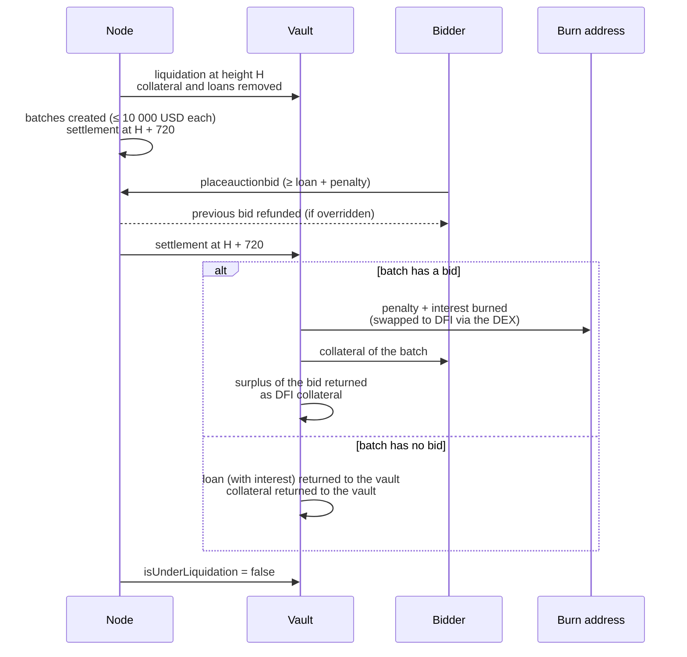

# Liquidation auctions

When the value of the collateral of a vault falls below the value of its
loans, the vault can no longer cover its debt. The node then takes the
collateral away, splits it into **auction batches** and lets anybody buy
the batches with the dToken that is owed. This page explains how the
liquidation is triggered, how the batches are built, how the bidding works
and how the auction is settled.

Part of the [Loans & dTokens](index.md).

## When a vault is liquidated

The node checks the vaults regularly. In `ProcessLoanEvents()`
(`src/dfi/validation.cpp`) the check runs every
`blocksCollateralizationRatioCalculation()` blocks — **30 blocks** (15
minutes) with 30-second blocks:

```text
if scheme.ratio <= vaultAssets.ratio():
    the vault is healthy, nothing to do
else:
    the vault is liquidated
```

The assets are valued with the **active** price and the price must be live
(`requireLivePrice = true`); if a price is not live, the vault cannot be
valued and is left alone.

When a vault is liquidated, the following happens in the same block
(`src/dfi/validation.cpp`):

1. The flag `isUnderLiquidation` is set on the vault. From now on the vault
   is frozen: deposits, withdrawals, new loans and paybacks are all
   rejected.
2. The interest of every loan is computed and taken out of the vault, so
   that it stops accruing there. The interest is still added to the loan
   amounts, because it is part of what the bidders have to pay.
3. The loans and the collaterals are removed from the vault.
4. The collateral and the loans are split into **auction batches** by
   `CollectAuctionBatches()`.
5. The auction is stored with its batch count, its settlement height and
   the liquidation penalty.

## The auction batches

`CollectAuctionBatches()` splits the collateral into chunks whose value is
at most **10 000 USD** (`batchThreshold = 10000 * COIN`). Every batch
contains:

| Field | Meaning | Source |
| --- | --- | --- |
| `collaterals` | the part of the vault's collateral that belongs to this batch | `CAuctionBatch` in `src/dfi/vault.h` |
| `loanAmount` | the dToken amount that has to be paid for this batch | `CAuctionBatch` in `src/dfi/vault.h` |
| `loanInterest` | the interest that belongs to this batch | `CAuctionBatch` in `src/dfi/vault.h` |

The batches are created per dToken: a vault with a DUSD loan and a dBTC loan
produces at least two batches, one per dToken. Rounding differences that
remain are booked in the attribute `v0/live/economy/batch_rounding_excess`.

## The auction parameters

| Parameter | Value | Source |
| --- | --- | --- |
| Settlement height | the height of the liquidation + `blocksCollateralAuction()` = 720 blocks (6 h) | `blocksCollateralAuction()` in `src/consensus/params.h` |
| Batch count | one per dToken, split further if the collateral is worth more than 10 000 USD | `CollectAuctionBatches()` in `src/dfi/validation.cpp` |
| Liquidation penalty | the value of the governance variable `LOAN_LIQUIDATION_PENALTY` | `CLoanView::GetLoanLiquidationPenalty()` in `src/dfi/loan.cpp` |

The liquidation penalty is the premium the first bidder has to pay. It is
a governance variable (`src/dfi/govvariables/loan_liquidation_penalty.cpp`)
and cannot be set below 0.01 DFI (*"Penalty cannot be less than 0.01
DFI"*).

## Bidding

Bids are placed with `placeauctionbid` (type `'I'`). The consensus code is
`CVaultsConsensus::operator()(const CAuctionBidMessage &)` in
`src/dfi/consensus/vaults.cpp`:

* The vault must be under liquidation (*"Cannot bid to vault which is not
  under liquidation"*).
* The auction and the batch must exist (*"No auction data to vault %s"*,
  *"No batch to vault/index %s/%d"*).
* The bid must be in the dToken of the batch (*"Bid token does not match
  auction one"*).
* The **first** bid of a batch must at least cover the batch amount plus
  the liquidation penalty:

  ```text
  first bid ≥ batch.loanAmount × (1 + liquidationPenalty)
  ```

  Otherwise the bid is rejected with *"First bid should include liquidation
  penalty of %d%%"*. From `DF12FortCanningMuseumHeight` on, the first bid
  must also be strictly higher than the batch amount (*"First bid should be
  higher than batch one"*).
* Every **following** bid must be at least 1 % higher than the current bid
  (*"Bid override should be at least 1% higher than current one"*) and
  strictly higher (*"Bid override should be higher than last one"*).
* When a bid is overridden, the previous bid is **refunded immediately**
  in the same transaction.

The bid is taken from the bidder's balance when the transaction is applied.

## The settlement

At the settlement height — 720 blocks after the liquidation — the auction
is settled in `ProcessLoanEvents()` (`src/dfi/validation.cpp`):



For a batch **with** a bid:

* The penalty and the interest of the batch are burned: the amount
  `penalty + loanInterest` is swapped into DFI (or DUSD) via the DEX and
  sent to the burn address.
* The bidder receives the **collateral** of the batch.
* The surplus of the bid — the amount above the batch amount plus the
  penalty — is swapped into DFI and returned to the vault as additional
  DFI collateral. A bidder who overpays therefore does not simply throw the
  money away.
* The minted supply of the dToken is reduced by the batch amount minus its
  interest.

For a batch **without** a bid:

* The loan including the interest is returned to the vault, and the
  interest starts accruing again.
* The collateral of the batch is returned to the vault.

After the settlement the vault is no longer under liquidation: the flag
`isUnderLiquidation` is cleared and the auction data is erased. The vault
can be closed (which returns the remaining collateral) or funded again.

## Reading the state

| What you want | RPC helper |
| --- | --- |
| The vaults and their state | `listvaults`, `getvault` |
| The running auctions | `listauctions` |
| The history of the auctions | `listauctionhistory` |
| The history of a vault | `listvaulthistory` |

## Where to go next

* [Vaults and collateral](vaults-and-collateral.md) — the ratio rules that
  trigger the liquidation.
* [Loans and dTokens](loans-and-dtokens.md) — how the interest that is
  burned in the auction is booked.
* [DEX & Liquidity](../dex-liquidity/index.md) — how the penalty and the
  interest are swapped into DFI before they are burned.
