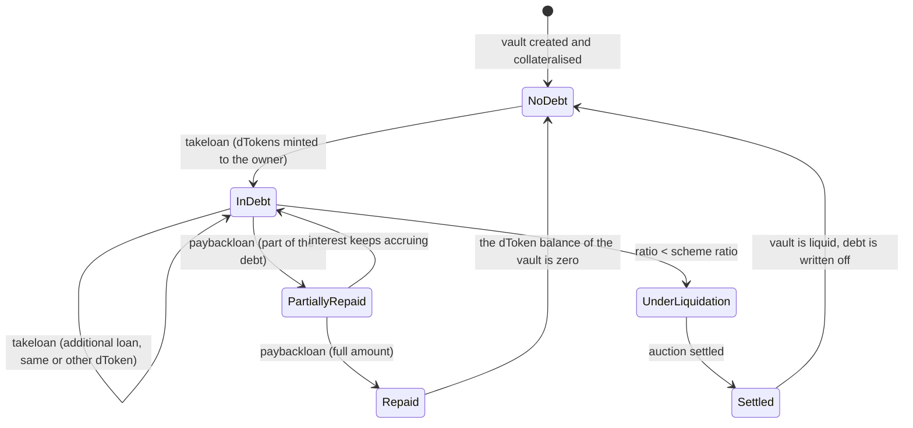

# Loans and dTokens

A **dToken** (loan token) is the debt instrument of the DeFiChain loan
module. It is an ordinary token on the chain — it can be held, transferred
and traded — but every unit of it represents a claim against a vault. This
page explains how a dToken is defined, how a loan is taken against a vault,
how the interest accrues block by block and how a loan is paid back.

Part of the [Loans & dTokens](index.md).

## What a dToken is

A dToken is created by the `SetLoanToken` DfTx (type `'g'`, RPC
`setloantoken`), which is handled in `src/dfi/consensus/loans.cpp`:

| Field | Meaning | Attribute (from `DF16FortCanningCrunchHeight`) |
| --- | --- | --- |
| `symbol` | the symbol of the dToken, at most 8 characters | — |
| `name` | the name of the dToken, at most 128 characters | — |
| `fixedIntervalPriceId` | the price feed the dToken is valued with | `v0/token/<id>/fixed_interval_price_id` |
| `mintable` | whether new dTokens may be minted | `v0/token/<id>/loan_minting_enabled` |
| `interest` | the annual interest rate of the dToken, in percent | `v0/token/<id>/loan_minting_interest` |

The token itself is created with the flags `LoanToken` and `DAT`, plus
`Mintable` if the dToken may be minted and `Tradeable` otherwise
(`src/dfi/consensus/loans.cpp`):

| Flag | Value | Meaning |
| --- | --- | --- |
| `LoanToken` | `0x20` | the token is a dToken |
| `DAT` | `0x04` | the token lives in the account (EVM) layer |
| `Mintable` | `0x01` | new units may be minted (loans) |
| `Tradeable` | `0x02` | the token may be traded |

Registering and updating a dToken requires **foundation or governance
authorisation**. The price feed must belong to an appointed oracle,
otherwise the registration is rejected with *"Price feed %s/%s does not
belong to any oracle"*.

Before `DF18FortCanningGreatWorldHeight` a negative interest was rejected
with *"interest rate cannot be less than 0!"*. From that height on, a dToken
may carry a **negative** interest rate, which reduces the debt instead of
increasing it.

## Taking a loan

`takeloan` (type `'X'`) mints dTokens against the collateral of a vault. The
consensus code in `src/dfi/consensus/loans.cpp` runs through these steps:

1. The vault must exist (*"Vault <%s> not found"*) and must not be under
   liquidation (*"Cannot take loan on vault under liquidation"*).
2. The **vault owner** must authorise the transaction (*"tx must have at
   least one input from vault owner"*).
3. All prices of the assets in the vault must be live (*"Cannot take loan
   while any of the asset's price in the vault is not live"*).
4. The vault must hold collateral (*"Vault with id %s has no collaterals"*).
5. The requested dToken must exist (*"Loan token with id (%s) does not
   exist!"*) and must be mintable (*"Loan cannot be taken on token with id
   (%s) as \"mintable\" is currently false"*).
6. From `DF18FortCanningGreatWorldHeight` on, the amount must be positive
   (*"Valid loan amount required"*).
7. The price feed of the dToken must be live (*"No live fixed prices for
   %s/%s"*).
8. The **collateralisation ratio** of the vault must still be at or above
   the ratio of the loan scheme — checked against the active *and* the next
   price (*"Vault does not have enough collateralization ratio defined by
   loan scheme - %d < %d"*).

The dTokens are minted to the vault owner, or to the address given in the
transaction (`to`). The minted supply is increased accordingly
(`AddMintedTokens()`), so the total supply of a dToken is always the sum of
all outstanding loans.

### The DUSD tracker

When the dToken is `DUSD`, the loan module keeps a separate tracker of the
DUSD supply (`TrackDUSDAdd()` / `TrackDUSDSub()`), so that the outstanding
DUSD debt can be distinguished from the DUSD that is circulating freely.
The tracker is only maintained from `DF15FortCanningRoadHeight` on.

## How the interest accrues

Every vault keeps an interest record **per dToken**
(`CInterestRateV3` in `src/dfi/loan.h`):

| Field | Meaning |
| --- | --- |
| `height` | the height at which the rate was last recalculated |
| `interestPerBlock` | the interest that accrues per block (with a sign) |
| `interestToHeight` | the interest that had already accrued at `height` |

The annual rate is the sum of the dToken interest and the loan scheme rate:

```text
netInterest     = (tokenInterest + schemeInterest) ÷ 100      (in percent)
interestPerBlock = loanAmount × netInterest × 10⁸ ÷ blocksPerYear
```

with `blocksPerYear = 365 × blocksPerDay = 1 051 200` blocks on mainnet
(30-second blocks). The calculation is done with 128-bit precision from
`DF14FortCanningHillHeight` on (`InterestPerBlockCalculationV3()` in
`src/dfi/loan.cpp`).

The total interest of a loan at height *h* is:

```text
totalInterest = interestToHeight + interestPerBlock × (h − height)
```

If the dToken interest or the scheme rate is negative, the interest is
negative and **reduces** the debt. In that case the node also books the
reduction in the DUSD tracker and resets the interest record when the debt
is fully covered.

The rate is not recomputed on every block. It is recalculated when the loan
amount changes (`IncreaseInterest()` / `DecreaseInterest()` in
`src/dfi/loan.cpp`) and when the vault changes its loan scheme. Because the
interest is linear in the loan amount, the accrued interest of a vault is
always `interestPerBlock × blocks since the last recalculation` plus the
interest that was already booked.

## Paying back a loan

`paybackloan` builds the `PaybackLoan` (type `'H'`) or `PaybackLoanV2`
(type `'k'`) DfTx; both are handled by the same code in
`src/dfi/consensus/loans.cpp`.

The rules that always apply:

* The vault must exist and must not be under liquidation (*"Cannot payback
  loan on vault under liquidation"*).
* The vault must still hold collateral.
* The payer must authorise the transaction.
* The amount must be positive from `DF18FortCanningGreatWorldHeight` on
  (*"Valid payback amount required (input: %d@%d)"*).
* The interest is settled first: `subLoan = paybackAmount − interest`. If
  the interest is larger than the payback amount, only the interest is
  paid.

### Paying back in the same token

The simplest case: the dToken itself is used to pay the debt.

* The principal is subtracted from the payer's balance and the minted
  supply is reduced.
* The accrued **interest is burned**: it is swapped into DFI (or DUSD) via
  the DEX and sent to the burn address (`SwapToDFIorDUSD()` in
  `src/dfi/mn_checks.cpp`).

### Paying back in another token

A loan may also be paid back with a different token — with DFI, or with
another dToken. Two attributes control this:

| Attribute | Meaning | Default |
| --- | --- | --- |
| `v0/token/<loanTokenId>/payback_dfi` | the loan may be paid back with DFI | must be enabled explicitly |
| `v0/token/<loanTokenId>/payback_dfi_fee_pct` | the fee charged for a DFI payback | 1 % (`COIN / 100`) |
| `v0/token/<loanTokenId>/loan_payback` | the loan may be paid back with the given token (keyed by the token id) | must be enabled explicitly |
| `v0/token/<loanTokenId>/loan_payback_fee_pct` | the fee charged for a token payback | 0 % |

If the corresponding attribute is missing, the payback is rejected with
*"Payback of loan via %s token is not currently active"*. The amount that has
to be paid is computed
through the USD prices of both tokens: the payback amount is converted into
USD, the fee is deducted, and the result is converted back into the dToken.
The fee itself is burned.

### Paying back with the vault's own collateral

From `DF19FortCanningEpilogueHeight` on, a special transaction exists:
`PaybackWithCollateral` (type `'W'`, RPC `paybackwithcollateral`). It
repays a **DUSD** loan with the **DUSD collateral** of the same vault
instead of with money from a wallet.

The rules are strict:

* The attribute `v0/token/<dusdId>/loan_payback_collateral` must be
  enabled, otherwise the transaction is rejected with *"Payback of DUSD loan
  with collateral is not currently active"*.
* The vault must hold DUSD collateral and have a DUSD loan.
* The interest is paid first out of the collateral and burned; the
  remaining collateral repays the principal.
* If the interest alone exceeds the collateral, the whole collateral is
  burned and the debt stays.
* Afterwards the vault must still be above the ratio of its loan scheme —
  otherwise the transaction fails with *"Vault does not have enough
  collateralization ratio defined by loan scheme - %d < %d"* and the vault
  would be liquidated.

## The economics of a dToken

| Flow | Where it goes |
| --- | --- |
| Interest of a repaid loan | burned (swapped into DFI/DUSD and sent to the burn address) |
| Fee of a payback in another token | burned |
| Auction penalty and auction interest | burned (see [Liquidation auctions](liquidation-auctions.md)) |
| Daily loan-token reward | paid to the liquidity providers of the pools that hold dTokens |

The daily reward is governed by the variables `LP_DAILY_LOAN_TOKEN_REWARD`
and `LP_LOAN_TOKEN_SPLITS`. The split assigns a share of the daily reward
to every pool that holds a dToken; the shares must add up to exactly 100 %
(*"total = %d vs expected %d"*) and every pool in the split must exist
(*"pool with id=%s not found"*). The reward variable itself is a legacy
variable: its validation rejects manual changes with *"Cannot be set
manually."*.

!!! note "Tokenomics 2.0 — a proposal, not the current behaviour"

    The workspace planning documents
    (`docs/tokenomics/dtoken-system-repair.md` in the umbrella repository)
    describe a **proposed** redesign of the dToken system: a near-complete
    freeze of the existing dUSD and dToken supply, new dUSD only against
    fully collateralised vaults (150 % ratio, at least 10 % DFI), a base
    interest of 2 % for dUSD loans and 0.5 % for the other dTokens, a
    release gate that unlocks a tranche only when the backing covers the
    circulating supply, and a dynamic interest formula
    (`Base + 4 × Discount` for dUSD, floor −2 %).

    None of this is implemented in the node yet. Everything described on
    this page is the behaviour of the code in `submodules/chain` — the
    current rules, the current interest formula and the current governance
    variables. Read the proposal as a plan, not as a description of the
    chain.

## The lifecycle of a loan



## Where to go next

* [Vaults and collateral](vaults-and-collateral.md) — the ratio rules a loan
  has to satisfy.
* [Oracles and prices](oracles-and-prices.md) — the prices the interest and
  the ratio are based on.
* [Liquidation auctions](liquidation-auctions.md) — what happens to a loan
  that is not paid back.
* [DEX & Liquidity](../dex-liquidity/index.md) — how the interest is
  swapped into DFI before it is burned.
