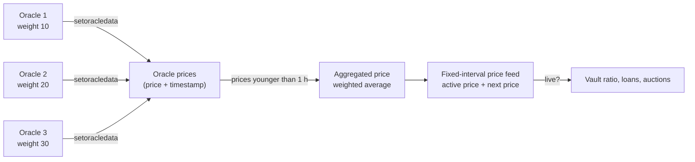

# Oracles and prices

Nothing in the loan module works without a price. The collateral of a vault
is valued in USD, the loans are valued in USD, and the two numbers are
compared to obtain the collateralisation ratio. Those prices come from
**oracles**: addresses that are appointed to publish a price for a
token/currency pair.

This page explains how oracles are appointed, how their prices are
aggregated, how the aggregated price is turned into the *fixed-interval
price feed* that the loan module reads, and what happens when a feed goes
stale.

Part of the [Loans & dTokens](index.md).

## Anatomy of an oracle

| Field | Meaning | Source |
| --- | --- | --- |
| `oracleAddress` | the address that may publish prices for this oracle | `CAppointOracleMessage` in `src/dfi/oracles.h` |
| `weightage` | the weight of this oracle in the aggregated price, 0 … 255 | `CAppointOracleMessage` in `src/dfi/oracles.h` |
| `availablePairs` | the token/currency pairs the oracle is allowed to price | `CAppointOracleMessage` in `src/dfi/oracles.h` |
| `tokenPrices` | the last price the oracle published for each pair, with a timestamp | `CTokenPricePoints` in `src/dfi/oracles.h` |

The identifier of an oracle is the hash of the transaction that appointed
it. The token and currency symbols are trimmed and cut to
`CToken::MAX_TOKEN_SYMBOL_LENGTH` (8) characters; an empty symbol or
currency is rejected with *"empty token / currency"*.

## Appointing, updating and removing oracles

All three actions require **foundation or governance authorisation**
(`HasGovOrFoundationAuth()` in `src/dfi/consensus/oracles.cpp`):

| Action | DfTx type | RPC helper | Effect |
| --- | --- | --- | --- |
| Appoint | `'o'` `AppointOracle` | `appointoracle` | registers a new oracle with its address, weightage and pairs |
| Update | `'t'` `UpdateOracleAppoint` | `updateoracle` | changes the address, the weightage and the pairs |
| Remove | `'h'` `RemoveOracleAppoint` | `removeoracle` | removes the oracle |

An update may not carry prices (*"oracle <%s> has token prices on update"*).
Prices that the oracle had published for pairs which are still supported
are kept; prices for pairs that are dropped are discarded.

## Publishing prices

`setoracledata` (type `'y'`) writes the prices of one oracle. The
consensus code in `src/dfi/consensus/oracles.cpp` checks:

* The oracle must exist (*"failed to retrieve oracle <%s> from
  database"*).
* The transaction must be authorised by the **oracle address** (*"tx must
  have at least one input from account owner"*).
* Every price must be positive (*"Amount out of range"*).
* From `DF11FortCanningHeight` on, the timestamp of the submission must be
  within one hour of the block time (*"Timestamp (%d) is out of price update
  window (median: %d)"*), see `diffInHour()` in `src/dfi/rpc_oracles.cpp`.

A price for a pair that the oracle is not appointed for is rejected with
*"token <%s> - currency <%s> is not allowed"*.

## From oracle prices to the aggregated price



The aggregation happens in `GetAggregatePrice()`
(`src/dfi/rpc_oracles.cpp`):

1. `DUSD`/`USD` is hard-coded to `1.00000000`.
2. Every oracle that is appointed for the pair and whose price is **younger
   than one hour** is counted as *live*.
3. The aggregated price is the **weighted average** of the live prices:

   ```text
   aggregated = Σ (price × weightage) ÷ Σ weightage
   ```

4. At least **two** live oracles are required (one on regtest), otherwise
   the aggregation fails with *"no live oracles for specified request"*.
5. The sum of the weights of the live oracles must not be zero, otherwise
   it fails with *"all live oracles which meet specified request, have zero
   weight"*.

The aggregated price is what the RPCs `getprice` and `listprices` show.

## The fixed-interval price feed

The loan module does not read the raw oracle prices. It reads a **fixed
interval price feed** per token/currency pair (`CFixedIntervalPrice` in
`src/dfi/oracles.h`), which holds two prices:

| Field | Meaning |
| --- | --- |
| `priceRecord[0]` | the **active** price — the one the protocol uses |
| `priceRecord[1]` | the **next** price — the one that will become active |
| `timestamp` | the time of the last update of the feed |

A feed is created when a dToken or a collateral token is registered with a
price feed (`v0/token/<id>/fixed_interval_price_id`). From then on it is
refreshed by the node itself in `ProcessOracleEvents()`
(`src/dfi/validation.cpp`):

* The refresh happens only every `ORACLE_BLOCK_INTERVAL` blocks — 120
  blocks (one hour) by default — and only from `DF11FortCanningHeight` on.
* The old next price becomes the active price.
* The new aggregate price becomes the next price.
* If no aggregate price is available, the next price stays empty (`-1`) —
  the last known price is kept as the active one, but the feed is no longer
  *live*.

### When is a feed live?

`CFixedIntervalPrice::isLive()` in `src/dfi/oracles.cpp`:

```text
live = priceRecord[0] > 0
   and priceRecord[1] > 0
   and |priceRecord[1] − priceRecord[0]| < priceRecord[0] × deviation
```

The **deviation** is a governance variable (`ORACLE_DEVIATION`) and defaults
to 30 %. It defines how far the next price may deviate from the active
price before the feed is considered dead. Setting it requires at least
1 % (*"Deviation cannot be less than 1 percent"*), and it can only be set
from `DF11FortCanningHeight` on (*"Cannot be set before FortCanning"*).

The block interval is a governance variable as well (`ORACLE_BLOCK_INTERVAL`,
minimum 1 block, *"Block interval cannot be less than 1"*).

!!! warning "A stale feed freezes the vault"

    If any price of a vault is not live, the vault cannot be changed:
    taking a loan fails with *"Cannot take loan while any of the asset's
    price in the vault is not live"*, a withdrawal fails with *"Cannot
    withdraw from vault while any of the asset's price is invalid"* and a
    payback in a different token fails with *"Cannot payback loan while any
    of the asset's price is invalid"*. The check is implemented by
    `IsVaultPriceValid()` in `src/dfi/mn_checks.cpp`.

A feed whose token is **locked** by a token lock is not usable either: the
price lookup fails with *"Fixed interval price currently disabled due to
locked token"* (`COracleView::GetFixedIntervalPrice()` in
`src/dfi/oracles.cpp`).

## Governance parameters of the oracle module

| Parameter | Where it lives | What it controls |
| --- | --- | --- |
| `ORACLE_DEVIATION` | `src/dfi/govvariables/oracle_deviation.cpp` | how far the next price may deviate from the active price (default 30 %, minimum 1 %) |
| `ORACLE_BLOCK_INTERVAL` | `src/dfi/govvariables/oracle_block_interval.cpp` | how often the feeds are refreshed (default 120 blocks, minimum 1) |
| `ATTRIBUTES` → `v0/token/<id>/fixed_interval_price_id` | `src/dfi/govvariables/attributes.cpp` | the feed a dToken or collateral token is valued with |
| `ATTRIBUTES` → `v0/oracles/splits/<height>` | `src/dfi/govvariables/attributes.cpp` | a token split that is scheduled for the given height |
| `ATTRIBUTES` → `v0/oracles/fractional_enabled` | `src/dfi/govvariables/attributes.cpp` | whether the scheduled splits may use fractional (non-integer) values |

## Reading the state

| What you want | RPC helper |
| --- | --- |
| The appointed oracles | `listoracles` |
| The raw prices of one oracle | `getoracledata` |
| The aggregated price of a pair | `getprice` |
| All aggregated prices | `listprices` |
| The raw prices of all oracles | `listlatestrawprices` |
| The fixed-interval feed of a pair | `getfixedintervalprice` |
| All fixed-interval feeds | `listfixedintervalprices` |

## Where to go next

* [Vaults and collateral](vaults-and-collateral.md) — how the prices are
  used in the collateralisation ratio.
* [Loans and dTokens](loans-and-dtokens.md) — how the prices are used in
  the interest and in the payback.
* [On-chain governance](../governance/index.md) — how oracles and the
  oracle parameters are appointed and changed.
