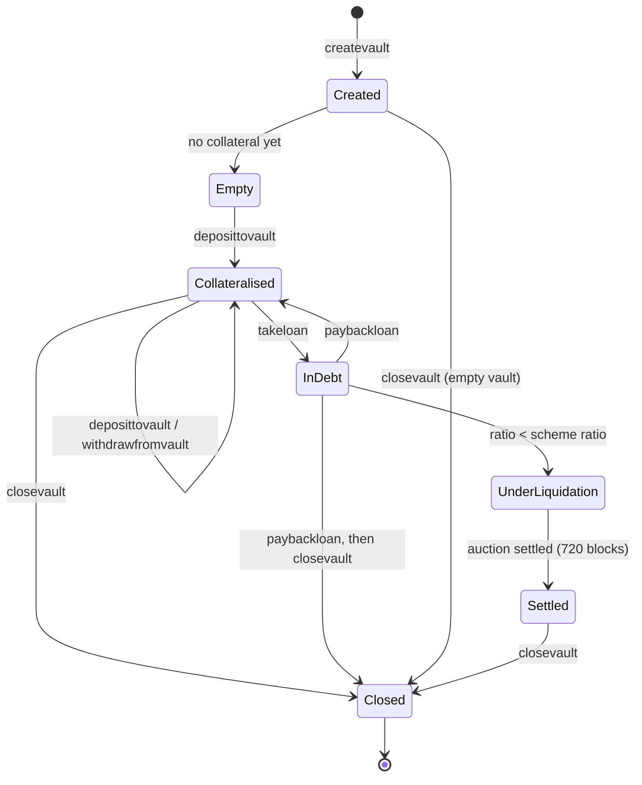

# Vaults and collateral

A **vault** is the container in which a loan lives. It holds collateral,
records the loans that were taken against that collateral and keeps track of
the owner who is responsible for it. This page explains how a vault is
created, funded, changed and closed, and how the **collateralisation ratio**
— the number that decides whether the vault is healthy — is computed.

Part of the [Loans & dTokens](index.md).

## Anatomy of a vault

| Field | Meaning | Source |
| --- | --- | --- |
| `vaultId` | the hash of the transaction that created the vault | `using CVaultId = uint256` in `src/dfi/vault.h` |
| `ownerAddress` | the address that controls the vault | `CVaultMessage` in `src/dfi/vault.h` |
| `schemeId` | the identifier of the loan scheme that applies to the vault | `CVaultMessage` in `src/dfi/vault.h` |
| `isUnderLiquidation` | set while the vault is being auctioned | `CVaultData` in `src/dfi/vault.h` |
| collaterals | the balances locked in the vault | `CBalances` under `CollateralKey` in `src/dfi/vault.h` |
| loans | the dToken balances owed by the vault | `CBalances` under `LoanTokenAmount` in `src/dfi/loan.h` |
| interest | the per-block interest rate of every loan in the vault | `CInterestRateV3` in `src/dfi/loan.h` |

A vault is identified by the hash of its **creation transaction**, so the
identifier is not chosen by the user. The RPC helpers `createvault`,
`closevault`, `updatevault`, `deposittovault` and `withdrawfromvault` all
take this identifier.

## Loan schemes

A **loan scheme** is a pair of numbers plus an identifier:

| Field | Meaning | Unit |
| --- | --- | --- |
| `identifier` | the scheme id, at most 8 characters | text |
| `ratio` | the minimum collateralisation ratio the vault must keep | percent, at least `100` |
| `rate` | the annual interest rate the scheme adds on top of the dToken interest | percent with 8 decimals, at least `0.01` |

The rules are enforced in `CLoansConsensus::operator()(const
CLoanSchemeMessage &)` in `src/dfi/consensus/loans.cpp`:

* `ratio < 100` is rejected with *"minimum collateral ratio cannot be less
  than 100"*.
* `rate < 1000000` (that is 0.01 %) is rejected with *"interest rate cannot
  be less than 0.01"*.
* An empty identifier or one longer than 8 characters is rejected with *"id
  cannot be empty or more than 8 chars long"*.
* A scheme with the same ratio **and** the same rate may not be created
  twice.
* Creating, updating and destroying a scheme requires **foundation or
  governance authorisation**.

The first scheme that is created automatically becomes the **default
scheme**. A vault created without an explicit scheme gets the default
scheme; if no default scheme exists, the creation fails with *"There is no
default loan scheme"*.

A scheme can be changed with a delay (`ACTIVATE_AFTER_BLOCK`): the new
values are stored and applied when the given height is reached
(`ProcessLoanEvents()` in `src/dfi/validation.cpp`). The default scheme can
be changed with `setdefaultloanscheme`, and a scheme can be removed with
`destroyloanscheme` — but the default scheme cannot be destroyed (*"Cannot
destroy default loan scheme, set new default first"*), and all vaults that
still use a destroyed scheme are moved to the default scheme.

## Registering a collateral token

Only tokens that governance has registered may be used as collateral. The
registration is the `SetLoanCollateralToken` DfTx (type `'c'`, RPC
`setcollateraltoken`), handled in `src/dfi/consensus/loans.cpp`. It defines:

| Field | Meaning | Attribute (from `DF16FortCanningCrunchHeight`) |
| --- | --- | --- |
| `idToken` | the token to accept as collateral | — |
| `factor` | the factor the collateral is valued with | `v0/token/<id>/loan_collateral_factor` |
| `fixedIntervalPriceId` | the price feed used to value the token | `v0/token/<id>/fixed_interval_price_id` |
| `activateAfterBlock` | the height from which the token may be used | — |

From `DF16FortCanningCrunchHeight` on, the registration is stored as
attributes instead of in the token database, and the token is additionally
gated by `v0/token/<id>/loan_collateral_enabled`. A token that is
registered but disabled is rejected on deposit with *"Collateral token (%d)
is disabled"*.

The price feed of the registration must belong to an appointed oracle,
otherwise the registration is rejected with *"Price feed %s/%s does not
belong to any oracle"*.

!!! note "The collateral factor"

    Since `DF20GrandCentralHeight` the value of the collateral is
    `amount × price × factor` (`PopulateCollateralData()` in
    `src/dfi/masternodes.cpp`). A factor of `1` means the collateral is
    counted at its full price; a factor of `0.5` means only half of its
    value counts towards the ratio. The same factor is used by the DFI/DUSD
    composition rules.

## Creating a vault

`createvault` builds the `Vault` DfTx (type `'V'`). The consensus code in
`src/dfi/consensus/vaults.cpp` checks:

* The **first output** of the transaction must contain exactly the creation
  fee in DFI — otherwise the transaction is rejected with *"Malformed tx
  vouts, creation vault fee is %s DFI"*. The fee is 2 DFI on mainnet and
  1 DFI on the other networks by default (`consensus.vaultCreationFee` in
  `src/chainparams.cpp`) and can be changed by governance through the
  attribute `v0/vaults/params/creation_fee`.
* The loan scheme must exist (*"Cannot find existing loan scheme with id
  %s"*) and must not be scheduled for destruction (*"Cannot set %s as loan
  scheme, set to be destroyed on block %d"*).
* From `DF23Height` on, the fee that was paid is stored **with the vault**,
  so a later change of the creation fee does not affect vaults that already
  exist.

The vault identifier is the hash of this transaction.

## Depositing and withdrawing collateral

`deposittovault` (type `'S'`) moves tokens from an address into the vault:

* The sender must authorise the transaction (`HasAuth(obj.from)`); the
  *vault owner* does not have to be the sender, so anybody may fund a vault.
* The vault must exist and must not be under liquidation.
* The token must be a registered collateral token. If it is registered but
  disabled, the deposit is rejected with *"Collateral token (%d) is
  disabled"*.
* After the deposit the collateralisation ratio of the vault is checked
  against the ratio of its loan scheme — otherwise the deposit could push
  the vault below the threshold.

`withdrawfromvault` (type `'J'`) moves tokens back out:

* Only the **vault owner** may withdraw.
* All prices of the assets in the vault must be live, otherwise the
  withdrawal is rejected with *"Cannot withdraw from vault while any of the
  asset's price is invalid"*.
* The ratio is checked against the scheme — against the **active** and the
  **next** price, both of which must be live.
* The collateral may not be emptied completely while loans are outstanding
  (*"Cannot withdraw all collaterals as there are still active loans in
  this vault"*).

## The collateralisation ratio

The ratio is computed by `CCustomCSView::GetVaultAssets()` in
`src/dfi/masternodes.cpp`:

```text
totalCollaterals = Σ (collateral amount × price × collateral factor)
totalLoans       = Σ (loan amount × price)          (interest included)
ratio            = totalCollaterals ÷ totalLoans × 100
```

A vault without loans has no ratio at all — `CVaultAssets::calcRatio()`
returns the maximum value in that case, so the ratio check always passes.

The ratio is compared with the `ratio` of the vault's loan scheme. The check
is performed twice in most operations — once against the **active** price
and once against the **next** price — so that a vault cannot be
manipulated by a price update that is about to happen. A violation is
reported as *"Vault does not have enough collateralization ratio defined by
loan scheme - %d < %d"*.

### The DFI / DUSD composition rules

Besides the ratio, the composition of the collateral is restricted. The
check lives in `CCustomTxVisitor::CollateralPctCheck()` in
`src/dfi/consensus/txvisitor.cpp` and has changed over time:

| Height | Rule | Error message |
| --- | --- | --- |
| before `DF14FortCanningHillHeight` | at least 50 % of the total collateral must be DFI | *"At least 50% of the minimum required collateral must be in DFI"* |
| `DF14FortCanningHillHeight` … `DF15FortCanningRoadHeight` | at least 50 % of the **minimum required** collateral must be DFI | *"At least 50% of the minimum required collateral must be in DFI"* |
| `DF15FortCanningRoadHeight` … `DF19FortCanningEpilogueHeight` | at least 50 % of the minimum required collateral must be DFI **or** DUSD | *"At least 50% of the minimum required collateral must be in DFI or DUSD"* |
| from `DF19FortCanningEpilogueHeight` | with DUSD loans: at least 50 % must be DFI; without DUSD loans: at least 50 % must be DFI or DUSD | as above |
| from `DF22MetachainHeight` | a vault that holds **only** DUSD collateral is allowed if the attribute `v0/vaults/dusd-vault/enabled` is set | — |

From `DF20GrandCentralHeight` on, the DFI and DUSD parts of the collateral
are multiplied by their collateral factor before the comparison, so a
discounted DFI counts less towards the 50 % requirement.

## Updating a vault

`updatevault` (type `'v'`) can change the **owner address** and the **loan
scheme** of a vault:

* Only the current owner may update the vault.
* The new scheme must exist and must not be scheduled for destruction.
* All prices in the vault must be live.
* When the scheme changes, the collateralisation ratio is re-checked
  against the **new** scheme, again for the active and the next price.
* From `DF18FortCanningGreatWorldHeight` on, the interest of every loan in
  the vault is rebased onto the new scheme (`IncreaseInterest()` with a
  zero amount), so that the new scheme rate applies from the moment of the
  change.

## Closing a vault

`closevault` (type `'e'`) removes a vault:

* The vault must not be under liquidation (*"Cannot close vault under
  liquidation"*) and must have no outstanding loans (*"Vault <%s> has
  loans"*) — the check includes the accrued interest.
* Only the owner may close the vault.
* All remaining collateral is returned to the address given in the
  transaction.
* **Half** of the creation fee is refunded to that address; the other half
  stays burned.

## The lifecycle of a vault



The transitions that involve the liquidation path are described in
[Liquidation auctions](liquidation-auctions.md).

## Where to go next

* [Loans and dTokens](loans-and-dtokens.md) — how the ratio is used when a
  loan is taken and how the interest is computed.
* [Oracles and prices](oracles-and-prices.md) — where the prices used in
  the ratio come from.
* [Liquidation auctions](liquidation-auctions.md) — what happens when the
  ratio falls below the scheme.
