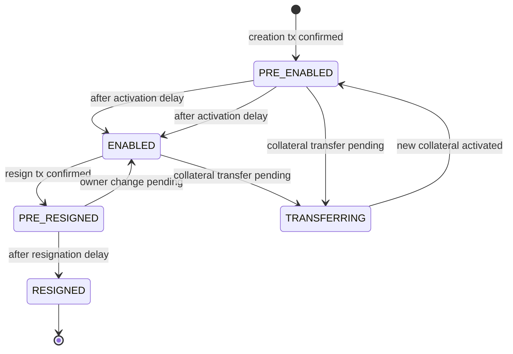

# Staking & Masternodes

DeFiChain is a **proof-of-stake** chain: blocks are produced by masternodes,
not by miners burning electricity. A masternode locks DFI as collateral, runs
a node that participates in the block lottery, and receives the block reward
when its node wins.

Part of the [User & Protocol Manual](../index.md).

## Contents

| Document | What you learn |
| --- | --- |
| [Masternode basics](masternode-basics.md) | The roles (owner, operator, reward address), the collateral and fees, and the full lifecycle of a masternode from creation to resignation. |
| [Timelocks and rewards](timelocks-and-rewards.md) | The timelock tiers, the staking weight they unlock, the block subsidy and how the reward is split between masternodes and the community. |
| [Staking and minting](staking-and-minting.md) | How a masternode actually produces a block, what "minting" means on DeFiChain, and which RPCs and operator tasks belong to a masternode. |

## Who can stake

On DeFiChain **only masternodes stake**. There is no delegating staking pool
and no "mint" transaction: a token holder cannot lock DFI and receive a share
of the block rewards without operating a masternode.

Consequences for a token holder:

* To earn block rewards you have to run a masternode yourself, which means
  running a node and keeping it in sync.
* You can pay an operator to run the node for your masternode. The operator
  receives no share of the reward by default — the reward goes to the
  masternode **owner** (or to the reward address you configured). See
  [Masternode basics](masternode-basics.md).
* The DFI you lock as masternode collateral is *not* transferable while the
  masternode exists. It is only returned when the masternode is resigned and
  the collateral is released.

## The numbers at a glance

| Parameter | Value | Source |
| --- | --- | --- |
| Masternode collateral (mainnet, since Dakota) | 20,000 DFI | `GetMnCollateralAmount()` in `src/dfi/masternodes.cpp` |
| Masternode collateral (before Dakota) | 1,000,000 DFI | `consensus.mn.collateralAmount` in `src/chainparams.cpp` |
| Masternode creation fee | 10 DFI | `consensus.mn.creationFee` in `src/chainparams.cpp` |
| Target block time | 30 s | `consensus.pos.nTargetSpacing` in `src/consensus/params.h` |
| Blocks per day | 2,880 | `consensus.blocksPerDay()` in `src/consensus/params.h` |
| Activation delay | 1,008 blocks (≈ 8.4 h) | `consensus.mn.newActivationDelay` in `src/chainparams.cpp` |
| Resignation delay | 2,016 blocks (≈ 16.8 h) | `consensus.mn.newResignDelay` in `src/chainparams.cpp` |
| Masternode share of the block subsidy | 33.33 % | `consensus.dist.masternode` in `src/chainparams.cpp` |
| Coinbase maturity | 100 blocks | `COINBASE_MATURITY` in `src/consensus/consensus.h` |

## The lifecycle of a masternode

A masternode is a state machine. The states are defined by `CMasternode::State`
in `src/dfi/masternodes.h` and derived by `CMasternode::GetState()` in
`src/dfi/masternodes.cpp`.

* **PRE_ENABLED** — the creation transaction is confirmed, but the masternode
  is not allowed to produce blocks yet. The delay is 1,008 blocks on mainnet.
* **ENABLED** — the masternode is active and its operator may produce blocks.
* **PRE_RESIGNED** — the resignation transaction is confirmed; the masternode
  can no longer produce blocks and the collateral is still locked.
* **RESIGNED** — the resignation delay has passed. The collateral is released
  and the masternode no longer exists.
* **TRANSFERRING** — an owner change is pending. The masternode is inactive
  until the new collateral has been activated.

## What is where

| Topic | Lives in |
| --- | --- |
| Roles, collateral, lifecycle, rewards | this section |
| The `C` / `R` / `m` custom transactions used here | [DVM](../dvm/index.md) |
| Voting with a masternode | [Governance](../governance/voting-and-quorum.md) |
| Running the node, keys, monitoring, upgrades | [Node Software Manual](../../node-manual/index.md) |
| Implementation details of the PoS kernel | [Developer & Architecture Manual](../../developer-manual/index.md) |

## Related sections

* [Core concepts](../getting-started/core-concepts.md) — the chain layers and
  the block model.
* [Custom transactions](../dvm/custom-transactions.md) — the transaction types
  used to create, update and resign a masternode.
* [Governance](../governance/voting-and-quorum.md) — how masternodes vote on on-chain
  proposals.
