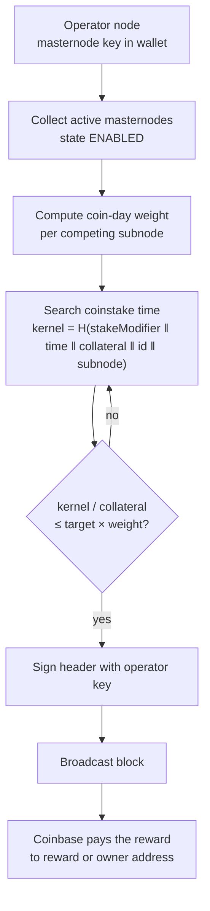

# Staking and minting

On DeFiChain, **staking and minting are the same activity**: a masternode
operator that wins the block lottery mints the next block and receives the
reward. There is no separate "mint" transaction and no delegating staking
pool — only masternode operators stake.

Part of the [Staking & Masternodes](index.md).

## How a block is produced

Every node runs a staking thread that tries to solve the proof-of-stake
kernel for the next block (`Staker::stake()` in `src/miner.cpp`).

1. **Collect the candidates.** The thread looks for masternodes whose operator
   key is in one of the local wallets and whose state is `ENABLED`
   (`IsActive()`).
2. **Compute the weight of every subnode.** For each masternode and each of
   its competing subnodes (the loop count of its timelock) the coin-day
   weight is computed (`CalcCoinDayWeight()` in `src/pos_kernel.cpp`). See
   [Timelocks and rewards](timelocks-and-rewards.md).
3. **Compute the stake modifier.** `stakeModifier = H(previousStakeModifier
   ‖ minterKey)` (`ComputeStakeModifier()` in `src/pos_kernel.cpp`). The
   modifier changes with every block, so the kernel hash cannot be
   pre-computed.
4. **Search for a valid kernel time.** The operator tries coinstake times
   until the kernel hash satisfies the target:
   `kernelHash / collateralAmount ≤ target × coinDayWeight`
   (`CheckKernelHash()` in `src/pos_kernel.cpp`).
5. **Sign and broadcast.** The winning block header is signed with the
   operator key (the PoS signature) and broadcast. Other nodes verify the
   kernel, the signature and the masternode state
   (`ContextualCheckProofOfStake()` in `src/pos.cpp`).

## Difficulty and block time

| Parameter | Value | Source |
| --- | --- | --- |
| Target block time | 30 s | `consensus.pos.nTargetSpacing` |
| Blocks per day | 2,880 | `consensus.blocksPerDay()` |
| Retargeting interval | 1,008 blocks (≈ 8.4 h) | `consensus.pos.DifficultyAdjustmentIntervalV2()` |
| Stake modifier | changes with every block | `ComputeStakeModifier()` in `src/pos_kernel.cpp` |

The difficulty is recomputed every retargeting interval
(`GetNextWorkRequired()` in `src/pos.cpp`). If the network produces blocks
too slowly, the target increases and blocks become easier to find; if blocks
come too fast, the target decreases.

Since the introduction of the `v0/params/feature/ascending_block_time`
attribute (`ascending_block_time`), a new block must have a timestamp later
than the previous block instead of only later than the median time of the
last eleven blocks (`src/miner.cpp`).

## What "minting" means here

There is no `mint` RPC and no minting transaction. The DFI of the block
subsidy is created by the coinbase transaction of the block that the
masternode produced. Concretely:

* The operator of the winning masternode signs the block; it does not receive
  the reward by itself.
* The reward is credited to the masternode's reward address, the node's
  `-rewardaddress` option or the owner address — in that order.
* The reward becomes spendable after 100 blocks (coinbase maturity).

If you want to earn staking rewards without running a node, you have to own
the masternode and pay an operator to run it, and — if you want to share the
income — set a reward address that belongs to the operator.

## Operator checklist

A masternode only produces blocks while its node is running and in sync. The
protocol-relevant requirements are:

* The masternode exists, is in the state `ENABLED`, and its operator key is
  available to the node's wallet.
* The node is fully synced (a node in initial block download does not
  participate).
* The node has the masternode's operator key; the key must be imported into
  the wallet that runs the staking thread.
* The node runs the same software version as the rest of the network — the
  node enforces a masternode version gate (`consensus.nMNVersionGateHeight`,
  see `src/validation.cpp` and `src/rpc/blockchain.cpp`) so that blocks
  produced by outdated software are rejected.

Day-to-day operator tasks — installing the node, keeping it in sync,
monitoring it, backing it up and upgrading it — are documented in the
[Node Software Manual](../../node-manual/index.md), not here. In particular:

* [Operations](../../node-manual/operations/index.md) — running full nodes
  and masternodes.
* [RPC & CLI Reference](../../node-manual/rpc-cli/index.md) — the commands
  used below.

## RPCs for masternode operators

| RPC | Purpose |
| --- | --- |
| `createmasternode` | Create a masternode and lock the collateral |
| `resignmasternode` | Start the resignation of a masternode |
| `updatemasternode` | Change the owner, the operator or the reward address |
| `listmasternodes` | List masternodes with their state and collateral |
| `getmasternode` | Show the details of a single masternode |
| `getmasternodeblocks` | Show the blocks a masternode has produced |
| `getactivemasternodecount` | Count the active masternodes in a height range |
| `getblocktemplate` | Show the staking candidates and their `targetMultiplier` |

The implementations live in `src/dfi/rpc_masternodes.cpp` and
`src/rpc/mining.cpp`. The full command reference is in the
[RPC & CLI Reference](../../node-manual/rpc-cli/index.md).

## Related pages

* [Masternode basics](masternode-basics.md) — roles, collateral, lifecycle.
* [Timelocks and rewards](timelocks-and-rewards.md) — the staking weight and
  the reward split.
* [Governance](../governance/voting-and-quorum.md) — voting with the masternode.
